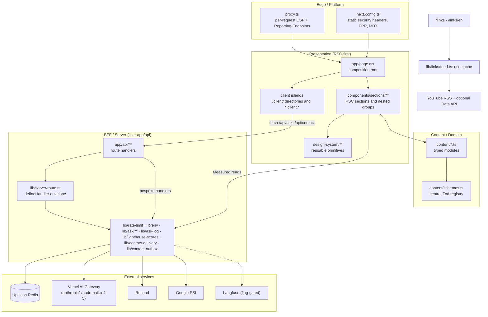
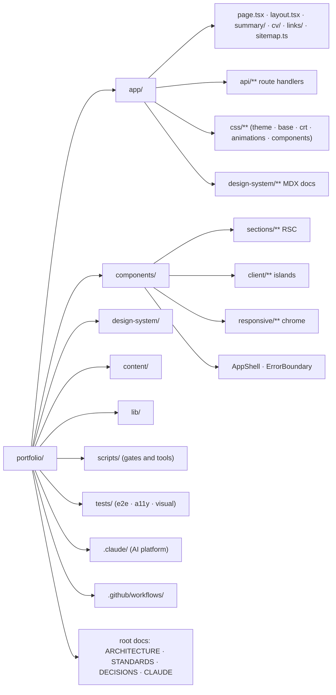
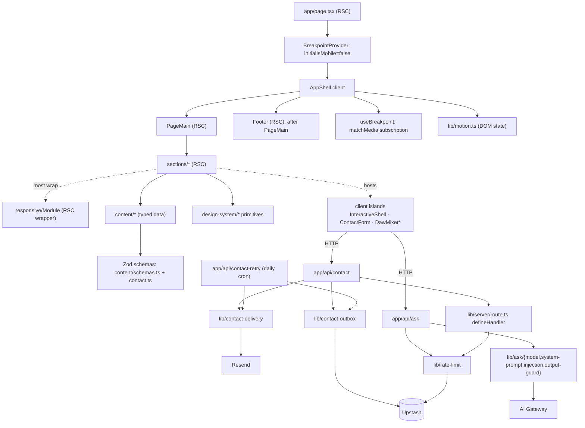

# Architecture Overview

> High-level architecture, repository structure, layers, and dependency graph. Read root `ARCHITECTURE.md` for the system design and trade-offs.

## Request model

A request hits Vercel's edge, passes through `proxy.ts` (which stamps CSP + reporting headers), and is served by Next.js. The page `/` is **partially prerendered**: a static shell (the chrome + above-the-fold Hero) is prerendered, while independent ASK and PSI data reads stream behind `<Suspense>`. Client islands hydrate for chrome, animation and interaction. Section content comes from **typed, build-validated `content/*.ts` modules**. A few `/api/*` handlers form a thin **BFF** over Upstash Redis, Resend, the Vercel AI Gateway, and Google PageSpeed Insights. Rate limiting and dedup fail open; the `/api/ask` budget reservation fails closed with 503; contact storage fails closed. Stored messages remain queued when delivery fails.

## System purpose

The site presents a professional profile through the terminal home page, printable `/summary` and `/cv` views, and Portuguese and English link pages. The API supplies contact delivery, grounded answers, machine-readable hiring data and operational probes.

## Architectural layers

**Layer ownership boundaries (who may import whom):**
- `content/*` holds typed data, schemas and shared presentation metadata. Server sections and client islands import different modules to control browser dependencies.
- `design-system/*` primitives use React and shared class utilities. Components import them through the public barrel or an internal module such as `Field`.
- `lib/*` is the server/BFF core. `lib/*.client.tsx` and a few browser utilities are the exception (client-side), clearly suffixed.
- `app/api/*` handlers depend on `lib`. The MCP adapter in `lib/agent/mcp-tools.ts` also imports the ask route for an in-process invocation.

## Repository structure (annotated)

## Dependency graph (module-level)

The main dependency direction is `app → components → {content, design-system}` and `app/api → lib`. Shared utilities and the MCP tool adapter also cross these groups; `lib/agent/mcp-tools.ts` imports the ask route for in-process calls.

Contact submission persists a 90-day KV audit record before calling the shared delivery function. Only Resend acceptance returns 200. Provider failure or timeout returns `202 queued` after adding the id and retry counter to Redis. `ContactForm` distinguishes queued from delivered and reads structured error messages. A `CRON_SECRET` bearer protects the daily 04:00 UTC retry, limited to 3 retries within 7 days. Removing an outbox entry leaves the audit record intact; contact logs contain only request and message ids.

## Build system

- **Bundler:** Turbopack (Next 16). MDX compiled via `@next/mdx`, with local remark wrapper paths and the `rehype-pretty-code` package configured as string-tuples.
- **Rendering:** `cacheComponents: true` enables PPR / dynamicIO. `typedRoutes: true` gives compile-time route safety. `trailingSlash: false` is explicit.
- **Scripts (`tsx`-run):** content validation, static gates, PR checks, the AI eval harness, and the design-system changelog generator. See doc 07.
- **CSS:** Tailwind v4 via the single `@tailwindcss/postcss` plugin; no Style Dictionary, no CSS modules. Tokens are `@theme` custom properties (doc 04).

## Key load-bearing files (read these first)

| File                                      | Why it matters                                                                     |
| ----------------------------------------- | ---------------------------------------------------------------------------------- |
| `app/page.tsx`                            | The composition root; shows the RSC/PPR posture for the whole site                 |
| `app/layout.tsx`                          | Fonts, JSON-LD, the pre-paint motion bootstrap, Vercel RUM gating                  |
| `next.config.ts` + `proxy.ts`             | The two-place header split (static vs per-request CSP), PPR, MDX                   |
| `lib/server/route.ts`                     | The `defineHandler` envelope - the API contract                                    |
| `lib/rate-limit.ts`                       | Redis access, the sliding-window + token-budget + dedup primitives                 |
| `lib/ask/system-prompt.ts`                | How the AI persona imports shared content                                          |
| `content/schemas.ts`                      | The domain schema registry                                                         |
| `components/responsive/Module/Module.tsx` | RSC wrapper for terminal modules; Hero, About, Career and Footer render separately |
