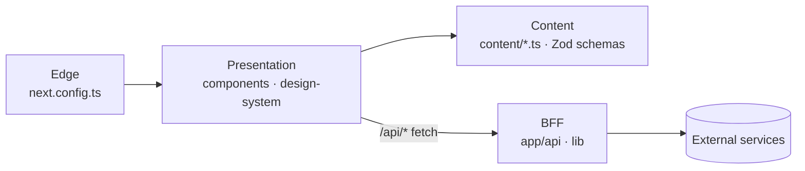
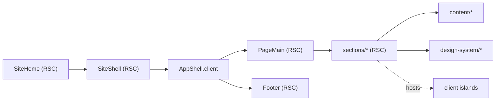
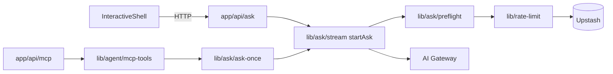
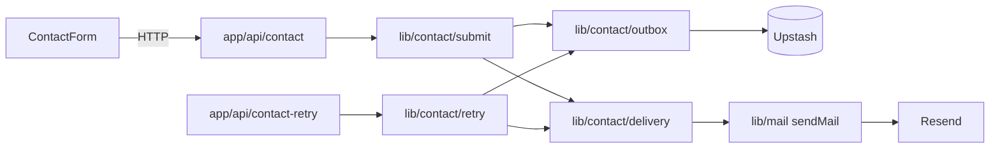
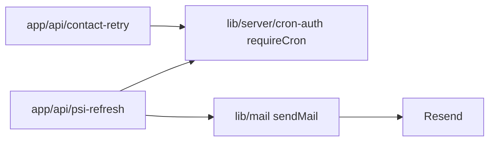

# Architecture Overview

> High-level architecture, repository structure, layers, and dependency graph. Read root `ARCHITECTURE.md` for the system design and trade-offs.

## Request model

A request hits Vercel's edge, receives the static security headers from `next.config.ts` (CSP and reporting included), and is served by Next.js, which renders React Server Components (RSC, components that run only on the server). The page `/` is **partially prerendered** (PPR): a static shell (the chrome + above-the-fold Hero) is prerendered, while independent ASK and PSI data reads stream behind `<Suspense>`. Client islands hydrate for chrome, animation and interaction. Section content comes from **typed, build-validated `content/*.ts` modules**. A few `/api/*` handlers form a thin **BFF** (backend for frontend: one server layer that shapes calls to outside services for this site) over Upstash Redis, Resend, the Vercel AI Gateway, and Google PageSpeed Insights (PSI). Rate limiting and dedup fail open; the `/api/ask` budget reservation fails closed with 503; contact storage fails closed. Stored messages remain queued when delivery fails.

## System purpose

The site presents a professional profile through the terminal home page, printable `/summary` and `/cv` views, and Portuguese and English link pages. The whole site is bilingual pt-BR/EN: the bare address serves English and `/pt` serves pt-BR, the address alone determines the language (no framework, negotiation or middleware), and each language names itself canonical with `alternates.languages` plus `x-default`. `/links` is the exception: it is the pt-BR page and `/links/en` the English one. The API supplies contact delivery, grounded answers, machine-readable hiring data and operational probes.

## Architectural layers



| Layer | What lives there |
| --- | --- |
| Edge | `next.config.ts` sets every security header (CSP, reporting endpoints, COOP, HSTS and the rest) as a static header, plus PPR and MDX. |
| Presentation | `components/SiteHome.tsx` is the composition root. `components/sections/**` are RSC sections; client islands live in `client/` directories and `.client.ts(x)` files; `design-system/**` holds reusable primitives. |
| Content | `content/*.ts` typed modules, the Zod registry `content/schemas.ts`, and the build-time parse site `content/_validate-client-content.ts`. |
| BFF | `app/api/**` route handlers, the `defineHandler` envelope in `lib/server/route.ts`, and the server core in `lib/` (rate limit, Redis, env, ask, contact, mail). Server sections also read `lib` directly for measured data. |
| External services | Upstash Redis, Vercel AI Gateway, Resend, Google PageSpeed Insights, the YouTube Data API (through `lib/links/feed.ts`) and Langfuse when its flag is on. |

**Layer ownership boundaries (who may import whom):**
- `content/*` holds typed data, schemas and shared presentation metadata. Server sections and client islands import different modules to control browser dependencies.
- `design-system/*` primitives use React and shared class utilities. Components import them through the public barrel or an internal module such as `Field`.
- `lib/*` is the server/BFF core. `lib/*.client.tsx` and a few browser utilities are the exception (client-side), clearly suffixed.
- `app/api/*` handlers depend on `lib`. The MCP adapter in `lib/agent/mcp-tools.ts` imports only `lib`: `ask_erik` calls `askOnce` (`lib/ask/ask-once.ts`), which drives the shared `startAsk` (`lib/ask/stream.ts`) in process.
- Biome `noRestrictedImports` overrides enforce the direction: `lib` imports neither `app` nor `components`, `content` imports only `content` and `zod`, `design-system` imports only `@/lib/cn`, `@/lib/join-class-names` and itself. Test files are excluded.

## Repository structure (annotated)

```text
portfolio/
├── app/
│   ├── (en)/ and (pt)/      route groups, each with its root layout, sitemap.ts, global-error.tsx, _lib/
│   ├── (en)/design-system/  MDX docs
│   ├── api/                 route handlers
│   └── css/                 theme, base, crt, animations, print, forced-colors, components-*
├── components/
│   ├── sections/            RSC sections
│   ├── client/              client islands
│   ├── responsive/          navigation chrome
│   ├── links/, reading/, ErrorPages/
│   └── SiteShell, AppShell, ErrorBoundary, RootShell
├── design-system/           reusable primitives
├── content/                 typed copy and Zod schemas
├── lib/                     server and BFF core
├── scripts/                 gates and tools
├── tests/                   e2e, a11y, visual
├── .agents/, .claude/            skills, rules and the review worker the CI review reads
├── .github/workflows/
├── docs/, evals/, metrics/  knowledge base, eval data, metrics
└── ARCHITECTURE, STANDARDS, DECISIONS, AGENTS, REVIEW
```

## Dependency graph (module-level)

The rendering chain:



- Most sections render inside the `responsive/Module` RSC wrapper.
- The client islands are `InteractiveShell`, `ContactForm` and the `DawMixer*` controls.
- Motion state lives on the DOM; the animated islands read it through `lib/motion.ts`.
- `InteractiveShell` and `GlobalMotion` read the breakpoint through `useBreakpoint`, a `matchMedia` subscription with no context.
- `content/_validate-client-content.ts` imports and parses every content module against the Zod schemas in `content/schemas.ts` and `contact.ts` at build time.

The API paths, one flow per diagram.

Ask: the shell island and MCP agents reach the same in-process pipeline.



Contact: the route saves, sends and queues on failure; the cron retries the queue.



Cron: both scheduled routes pass one auth check; the PageSpeed alert uses the same mail sender.



The main dependency direction is `app → components → {content, design-system}` and `app/api → lib`.

Contact submission persists a 90-day KV audit record before calling the shared delivery function. Only Resend acceptance returns 200. Provider failure or timeout returns `202 queued` after adding the id and retry counter to Redis. `ContactForm` distinguishes queued from delivered and reads structured error messages. A `CRON_SECRET` bearer protects the retry, which runs at 04:00 and 16:00 UTC while a message is under 24 hours old (the provider idempotency window), at most 3 times. Removing an outbox entry leaves the audit record intact; a delivery failure that cannot be queued (full or failing outbox) deletes the record, since nothing will retry it; contact logs contain only request and message ids.

## Build system

- **Bundler:** Turbopack (Next 16). MDX compiled via `@next/mdx`, with local remark wrapper paths and the `rehype-pretty-code` package configured as string-tuples.
- **Type check:** `pnpm typecheck` runs `tsgo` (the native TypeScript compiler preview); `typescript` itself stays on 6.x for the mutation runner.
- **Install-time scripts:** `postinstall` runs `scripts/strip-next-polyfills.mjs`, which replaces Next's legacy polyfill bundles in `node_modules` with a one-line comment. The `browserslist` floor (Chrome 93, Safari 15.4) never needs them, and left in place they count against the client-chunk gate and Lighthouse Best Practices. The script exits non-zero when Next moves those files. `prepare` installs the Husky hooks and skips CI and Vercel.
- **Rendering:** `cacheComponents: true` enables PPR / dynamicIO. `typedRoutes: true` gives compile-time route safety. `trailingSlash: false` is explicit.
- **Scripts (`tsx`-run):** content validation, static gates, PR checks, the AI eval harness, and the design-system changelog generator. See doc 07.
- **CSS:** Tailwind v4 via the single `@tailwindcss/postcss` plugin; no Style Dictionary, no CSS modules. Tokens are `@theme` custom properties (doc 04).

## Key load-bearing files (read these first)

| File                                      | Why it matters                                                                                                               |
| ----------------------------------------- | ---------------------------------------------------------------------------------------------------------------------------- |
| `components/SiteHome.tsx`                 | The composition root; shows the RSC/PPR posture for the whole site                                                           |
| `components/RootShell.tsx`                | Fonts, JSON-LD, the pre-paint motion bootstrap, Vercel RUM gating, shared by `app/(en)/layout.tsx` and `app/(pt)/layout.tsx` |
| `next.config.ts`                          | The static security headers (CSP and reporting included), PPR, MDX                                                           |
| `lib/server/route.ts`                     | The `defineHandler` envelope - the API contract                                                                              |
| `lib/rate-limit.ts`                       | The table of limiters (limit, window, prefix per name) and nine named getters; imports nothing from `lib/ask`                |
| `lib/redis.ts`                            | `getRedis`, `hasRedisCredentials`, the credential name pairs and `RedisNotConfiguredError`                                   |
| `lib/ask/budget.ts`                       | The monthly and daily spend budget and the reservation record that settle or abandon it                                      |
| `lib/ask/dedup.ts`                        | The identical-question lock: `checkIdenticalQuestion`, `releaseIdenticalQuestion`                                            |
| `lib/ask/system-prompt.ts`                | How the AI persona imports shared content                                                                                    |
| `content/schemas.ts`                      | The domain schema registry                                                                                                   |
| `content/site-locale.ts`                  | Locale codes, `<html lang>` values, localized paths and the hreflang alternates every page and the sitemap derive from       |
| `content/section-registry.ts`             | The nine home navigation destinations: ids, labels, icons and order                                                          |
| `components/responsive/Module/Module.tsx` | RSC wrapper for terminal modules; Hero, About, Career and Footer render separately                                           |
