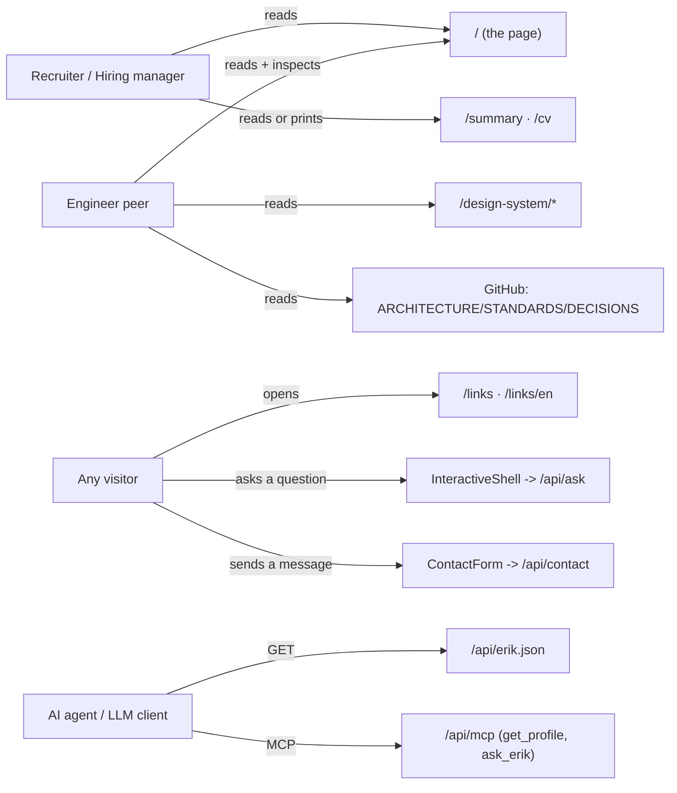
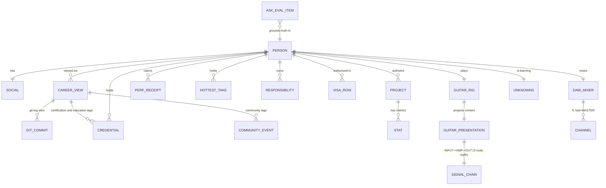

# Business Domain

> Professional identity, terminal navigation, contact delivery and grounded answers.

## What problem does this solve?

It is a **hiring and reference artifact** for one user (Erik Cunha, a software engineer). Two jobs-to-be-done:
1. **For human visitors (recruiters, hiring managers, engineers):** present credentials, projects, work-authorization, and opinions in a terminal interface, with automated performance and accessibility checks.
2. **For AI agents (and curious engineers):** answer questions about Erik via `/api/ask` (an LLM grounded in the site's own content) and expose a machine-readable hiring profile via `/api/erik.json` and a read-only MCP server (`/api/mcp`).

The terminal page has nine navigation entries in `content/section-registry.ts`. `app/page.tsx` also renders supporting modules outside that registry. `/summary` and `/cv` reuse professional content through `content/reading-views.ts`; `/links` and `/links/en` share localized link content.

## Users and how they move through the system

There is **no authentication, no accounts, no multi-tenancy**. The "user" is anonymous; rate-limit keys use the client IP, dedup uses its hash, and the monthly token budget is shared. Contact records and ask logs have retention periods; browser motion preference persists in localStorage.

## The core insight: content _is_ the domain model

Every section of the page is driven by a typed module in `content/`, and those types _are_ the domain entities. The terminal metaphor maps real professional data onto filesystem/Unix concepts:

| Terminal surface               | Real-world meaning                                | Content module        | Entity                                 |
| ------------------------------ | ------------------------------------------------- | --------------------- | -------------------------------------- |
| About panels                   | Positioning, Now rows, stack and retry code       | `about.ts`            | `AboutContent`                         |
| `git log ~/career`             | Career timeline with nested tag groups            | `git-log.ts`          | `GitCommit[]` (`type: career｜life`)   |
| `LS -LA ./PROJECTS`            | Nine projects with shared desktop/mobile content  | `projects.ts`         | `Project[]`                            |
| `PERF_RECEIPTS --HARD-NUMBERS` | Six impact receipts nested under Projects         | `perf-receipts.ts`    | `projectReceipts` from `PerfReceipt[]` |
| `MEASURED.JSON`                | ASK evaluation and desktop/mobile PSI             | `measured.ts`         | `Measured` presentation metadata       |
| About responsibilities panel   | Scope, as Unix permission bits                    | `responsibilities.ts` | `Responsibility[]` (`perms` regex)     |
| `git tag --list 'cert/*'`      | Certifications inside Career                      | `credentials.ts`      | `Credential[]`                         |
| `git tag --list 'edu/*'`       | Education inside Career                           | `education.ts`        | `Credential[]`                         |
| `cat ~/.visa`                  | Work authorization by jurisdiction                | `visa.ts`             | `VisaRow[]`                            |
| `git tag --list 'community/*'` | Community and speaking inside Career              | `community.ts`        | `CommunityEvent`                       |
| `cat ~/HOTTEST_TAKES.md`       | Opinions/theses                                   | `hottest-takes.ts`    | `HottestTake[]`                        |
| `cat ~/.guitar_rig`            | Hobby (guitar signal chain)                       | `guitar-rig.ts`       | `GuitarRig`                            |
| `./mix --live`                 | Hobby (DAW mixer, interactive)                    | `daw-mixer.ts`        | `DawMixer`                             |
| `cat ~/.unknowns`              | Learning and specialization lists inside Opinions | `unknowns.ts`         | `Unknowns`                             |

Opinions renders four ordered home takes and both Unknowns lists in one deferred module.
The design-system take renders at `/design-system#opinion-07`; `placement` selects its surface.

Career (`sec-git-log`) contains the `cert/*`, `edu/*`, and `community/*` tag groups.
`sec-credentials` and `sec-community` remain nested in-page anchors, without mobile order rules.
About (`sec-readme`) contains the Whoami, Now, Responsibilities, Stack and retry-code panels.

Opinions (`sec-hottest-takes`) contains the HOTTEST_TAKES list and Unknowns.
Contact (`sec-contact`) contains the contact form, alternative contact links, and work authorization table.
Unknowns and work authorization are not separate homepage modules.

Supporting content (not sections): `social.ts` (links), `seo.ts` (JSON-LD `Person`), `dmesg.ts` + `shell-commands.ts` + `terminal-chrome.ts` + `hero-client.ts` (client-imported flavor data), and the AI-eval domain below. Client-imported modules stay zod-free, so `content/_validate-client-content.ts` parses their schemas at build time: it is the only parse site for `terminal-chrome.ts`, whose `shellChrome`, `contactChrome` and `topbarChrome` reach the shell, the contact form and the topbar brand badge.

Projects uses one set of descriptions and stats across viewport sizes. Each card names its company; OSS cards include a public URL. The canonical receipt collection retains signed percentage deltas for consistency checks. Its six project receipts may display before/after values while keeping those deltas available to other consumers. `heroContent` validates Hero metrics, labels and actions on the server. `hero-client.ts` holds boot and system-failure copy with a type-only schema import. `heroContent.stats` supplies the Hero metrics; `heroStats` supplies the summary reading-view metrics.

Measured groups ASK and PSI presentation metadata without storing live values. The ASK adapter reads the eval aggregate; the PSI adapter supplies separate desktop and mobile scores. Each group keeps its own loading, unavailable and stale states.

ContactForm imports Zod-free `content/contact-copy.ts`; `content/contact.ts` validates that copy with Zod for server consumers. Both share the LinkedIn URL from `content/social-urls.ts`.

## Contact delivery

A `ContactMessage` contains `name`, `email`, `message`, `receivedAt` and `ipHash`. It is stored at `contact:msg:{msgId}` for 90 days before delivery is attempted. A KV write failure returns `502 storage_unavailable` and requires resubmission.

Resend acceptance returns 200. A provider error, timeout or missing key adds the id to `contact:outbox`, ordered by `receivedAt`, with a retry counter in `contact:outbox:attempts`. Only a successful outbox write returns `202 queued`. The visitor sees that the message is saved but undelivered, with a LinkedIn alternative. Other errors display the server's message string.

The daily retry permits at most 3 additional delivery attempts within 7 days. Success, expiry and exhaustion remove pending membership and its counter while preserving the audit message. Logs contain request and message ids, never the contact payload.

## Domain entity model

**Two notable invariants the schema enforces** (because they are silent-corruption risks):
- The guitar **presentation signal chain is a three-node Zod `tuple`** (`GuitarPresentationSchema` in `content/schemas.ts`). It fixes the rendered order to INPUT → AMP → OUT and rejects reordered, duplicate or missing roles. The source rig retains FX metadata outside the presentation tuple.
- The DAW mixer is `.length(6)` with `.refine(last.id === 'MASTER')` - the master channel must be last.

## The AI sub-domain (`/api/ask` and its evaluation)

The AI feature has its own domain:
- **`AskInteraction`** (`lib/ask-log.ts`): a question→answer event, status ∈ {`completed`, `errored`, `rate-limited`, `dedup-rejected`, `budget-exhausted`}, persisted to Redis (`ask:log:{date}:{requestId}`, 90-day TTL, IP hashed, truncated).
- **`AskEvalItem`** (`content/ask-eval-corpus.ts`): an evaluation case `{ id, question, expect, kind }`, `kind ∈ {factual, edge, jailbreak, output-validation}`. The `expect` is a natural-language criterion an LLM judge scores. Ground truth is pulled from the _live_ content modules, so content/persona drift becomes a failing eval.
- **`AskEvalCalibrationItem`** (`content/ask-eval-calibration.ts`): a gold case with a `canonicalAnswer` + a human `humanVerdict`, used to **gate the judge itself** (judge-human agreement must clear 0.85 before any corpus tokens are spent).

`AiMetricsSection` composes the Measured module. Its `AiMetricsData` child reads the latest eval aggregate through `lib/ask-metrics.ts`; `LivePerfSection` renders desktop and mobile PSI alongside it. The three data reads have independent Suspense boundaries, so one pending source does not hold the others.

## The 60-second introduction

"It's a terminal-themed portfolio with printable summary and CV pages, localized link pages and reference documentation. The page is server-rendered with client islands; every section uses typed data validated at build. The backend delivers contact messages with automatic retries, answers questions through a grounded LLM, and serves machine-readable profiles for AI agents. The engineering is part of the product: read `ARCHITECTURE.md` and `DECISIONS.md`, then this `/docs` folder."
