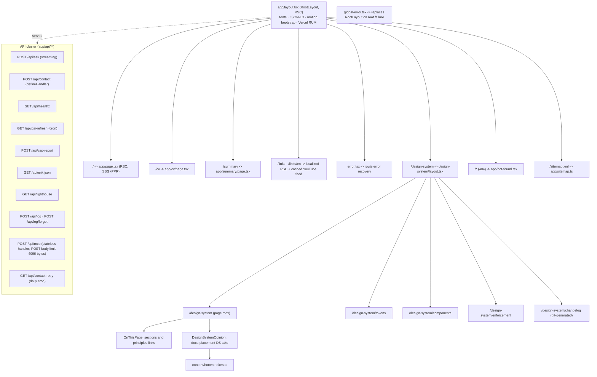
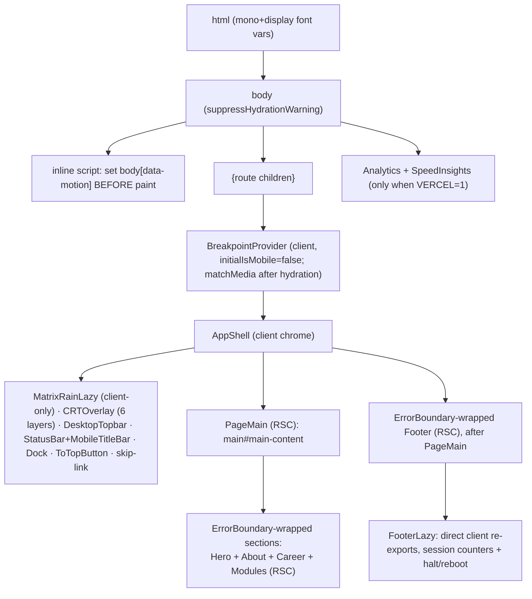
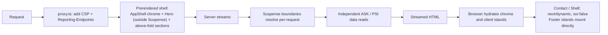
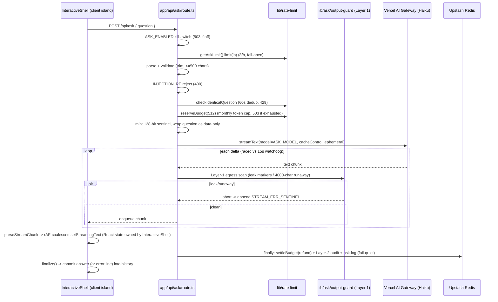
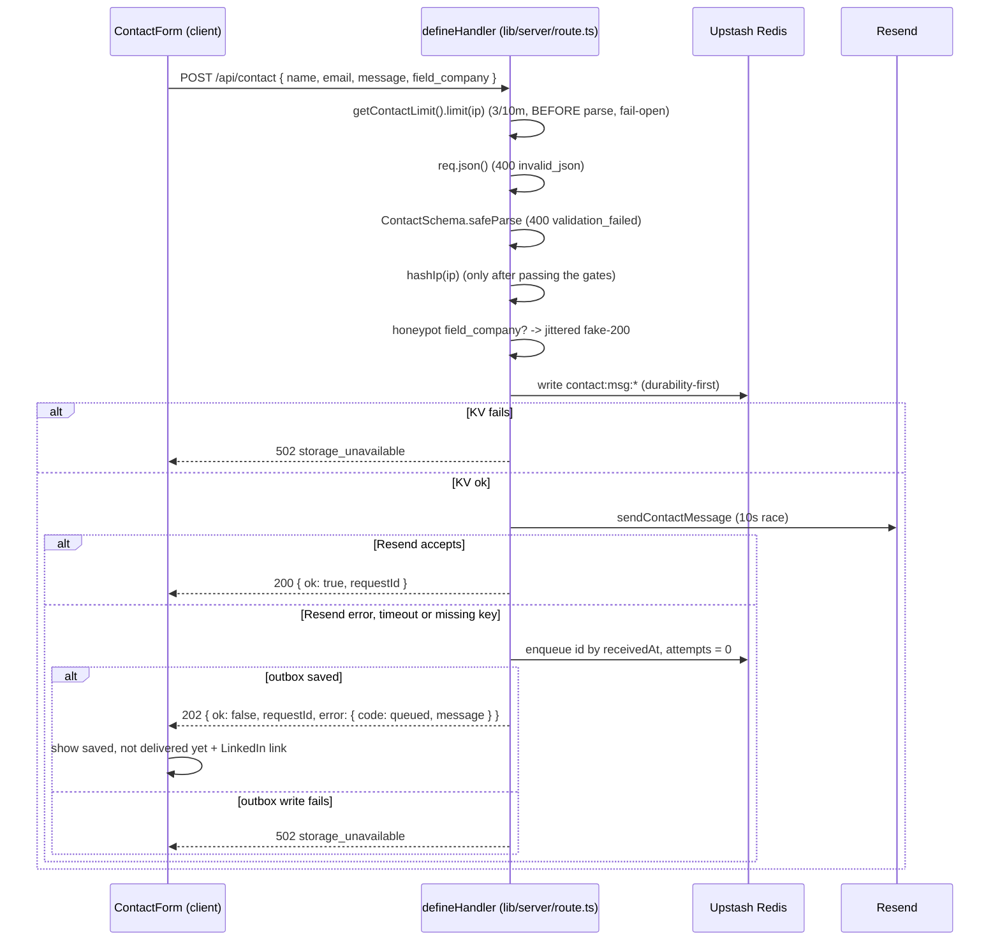
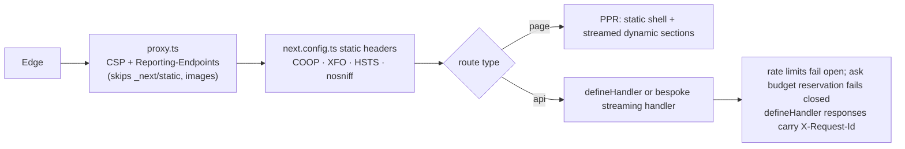

# Rendering & Data Flow

> Routing tree, the RSC/PPR rendering pipeline, and end-to-end data flows with sequence diagrams. This is the doc that explains _how a request becomes pixels_ and _how a user action becomes a persisted effect_.

## Routing tree



The user-facing routes are `/`, `/summary`, `/cv`, `/links` and `/links/en`, alongside the design-system docs, metadata routes and API cluster. Home sections use the client `ErrorBoundary` component. App Router failures also have `app/error.tsx` and `app/global-error.tsx`; there is no `loading.tsx`/`template.tsx`.

## Terminal sections and navigation

`content/section-registry.ts` defines nine navigation destinations: Home (`bio`), About, Projects, Career, Interactive shell, Measured, Opinions, Guitar and mixer, and Contact. It supplies aliases, icons, screen-reader labels and navigation order. `content/section-labels.ts` adds labels for supporting modules.

The JSX order in `app/page.tsx` is Hero, About, Shell, Measured, Projects, GitLog, HottestTakes (with Unknowns nested inside), Guitar, DawMixer and Contact (including work authorization). Footer follows `PageMain` as its sibling. CSS mobile ordering is a separate map in `app/css/base.css`.

About contains Whoami, Now, Responsibilities, Stack and retry-code panels. Responsibilities and retry code are named keyboard scroll regions inside About. Projects contains its receipts. Career contains certification, education and community tag groups. Measured contains independent ASK, desktop PSI and mobile PSI reads. These nested groups do not become separate navigation destinations.

## Layout hierarchy (what wraps what)



The motion bootstrap script is load-bearing: it reads `localStorage('erik.motion')` / OS preference and sets `body[data-motion]` **before first paint**, off the hydration path, so the initial motion preference does not wait for hydration.

## The rendering pipeline (RSC + PPR)

`cacheComponents: true` turns on Partial Prerendering. The mechanism in this codebase:



**Static vs dynamic, concretely:**
- **Static (prerendered):** `AppShell` chrome except the client-only MatrixRain canvas, `Hero` (outside Suspense so LCP never waits), `About`, `Shell`, the responsive `Guitar` presentation, Projects with its attached receipts, `DawMixer`, Contact with its work-authorization table, and section fallbacks. Projects uses one RSC tree with CSS controlling the responsive grid. `DawMixer` uses one synchronous RSC layout at every width; its interactive islands hydrate on phones too. The Visa table renders once and CSS adapts it.
- **UA-selected variants:** none on `/`. `getIsMobile()` (`lib/ua.ts`, which reads `headers()`) is available for a future dual-variant section.
- **Measured data:** `AiMetricsSection` renders the `sec-live-metrics` module. It composes `AiMetricsData` and `LivePerfSection`, with independent Suspense boundaries for ASK, desktop PSI and mobile PSI. Each fallback retains its metric layout and shows a loading state. Receipts remain inside Projects rather than a separate module.
- **The dual-variant pattern** (available, unused on `/`):

  ```
  <Module><Suspense fallback={<Desktop/>}><AsyncInner/></Suspense></Module>
  ```

  `AsyncInner` awaits `getIsMobile()` and renders a desktop or mobile variant, with the desktop variant as the fallback. `GuitarSection`, `DawMixerSection` and `VisaContent` use one responsive presentation without this UA boundary or variant swap.
- **`defer` prop:** the below-the-fold sections (`DEFERRED_SECTION_COUNT` in `components/responsive/Module/module.constants.ts`, held by `__tests__/content-visibility.test.ts`) pass `defer` to `Module`, which applies CSS `content-visibility` (defers render cost, not JS). Most use `Module`; Career applies the same attributes in its own wrapper.
- **`next/dynamic` boundaries:** `ContactFormLazy` and `InteractiveShellLazy` use `ssr: false` with accessible loading placeholders. `MatrixRainLazy` loads from `AppShell` with `ssr: false` as a decorative fixed overlay behind `main`; late hydration cannot shift layout. `Footer` is an RSC: content, cards, sitemap and shutdown log render on the server. `FooterLazy.client.tsx` directly re-exports session counters and halt/reboot controls from `Footer.client`, without a dynamic import; the netstat card uses the design-system `CopyButton` island. Counters start at mount to include commands before the footer is reached. The halt clock is empty on the server and reads the visitor’s clock after mount.

The terminal home combines prerendered output and dynamic Suspense children. Separately, `lib/links/feed.ts` uses `use cache` and `cacheLife` for the YouTube feed: stale after 900 seconds, revalidate after 3,600 seconds, expire after 86,400 seconds. `LinksPage` awaits that feed and falls back to `EMPTY_FEED` on failure.

## End-to-end data flow #1 - page render (read path)

```
build time:  content/*.ts imported -> Zod parse (gate) -> typed data baked into RSC output
eval run:    scripts/ask-eval.ts -> Redis ask:eval:latest
request:     proxy.ts headers -> static shell streamed -> getIsMobile() resolves per request
             -> section variants and independent ASK / PSI reads stream -> client hydrates islands
```

The content layer is build-time: static copy is already in the prerendered output. Measured reads live data through `lib/ask-metrics.ts` and `lib/lighthouse-scores.ts`. PSI uses its Redis cache and may fetch PageSpeed Insights when the cache is missing. Projects does not read the user agent or wait on live data.

## End-to-end data flow #2 - `/api/ask` (the streaming AI feature)

Transport is **plain `fetch` reading a raw `ReadableStream` of `text/plain`** - not SSE, and the AI SDK runs server-side only.



**Client-side rendering nuance (verified in code):** the streamed text lands in an _isolated_ `streamingText` state and is flushed at most once per animation frame (`requestAnimationFrame`), so chunks within one frame share a state update. The state lives in `InteractiveShell`, whose component renders again when it changes; the text is displayed in a dedicated span. This is the opposite of the Hero boot loop, which mutates `textContent` directly with no React state (see doc 04). Both limit update work.

**Server timeouts (defense in depth):** 30s whole-request `AbortSignal`, 15s mid-stream watchdog, 1s usage-resolve. The token budget is held **fail-closed** if usage can't be resolved (so a metering bug can't leak spend), while the rate limiters and dedup are **fail-open**. The one exception is the budget reservation: if Redis fails there, `/api/ask` returns 503 rather than answer without a spend cap.

## End-to-end data flow #3 - `/api/contact` (the write path via `defineHandler`)



The **ordering is a security property**: rate-limit and validate _before_ the work, hash the IP and touch storage _only_ for requests that pass. Every response carries `X-Request-Id`. See doc 05 for the full `defineHandler` contract and the other routes.

At 04:00 UTC daily (`0 4 * * *`), `/api/contact-retry` checks the `CRON_SECRET` bearer before reading pending ids in received-time order. Messages older than 7 days, or already at 3 retry attempts, leave the outbox. Each eligible message consumes an attempt before calling the same delivery function. Successful sends leave the outbox; failures remain pending. Audit messages retain their 90-day KV TTL. The success response is `{ ok: true, requestId, data: { sent, failed, expired, exhausted } }`, with a matching `X-Request-Id` header. Contact logs carry only `requestId` and `msgId`.

## Request lifecycle summary (every request)


