# Rendering & Data Flow

> Routing tree, the RSC/PPR rendering pipeline, and end-to-end data flows with sequence diagrams. This is the doc that explains _how a request becomes pixels_ and _how a user action becomes a persisted effect_.

## Routing tree

Three views make up the routing tree.

The shared shell renders both root layouts; the English group carries the home, reading, links and error routes:

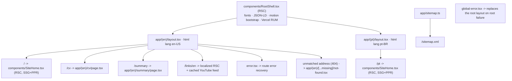

The design-system layout hangs its five top-level pages and their children off the English group:

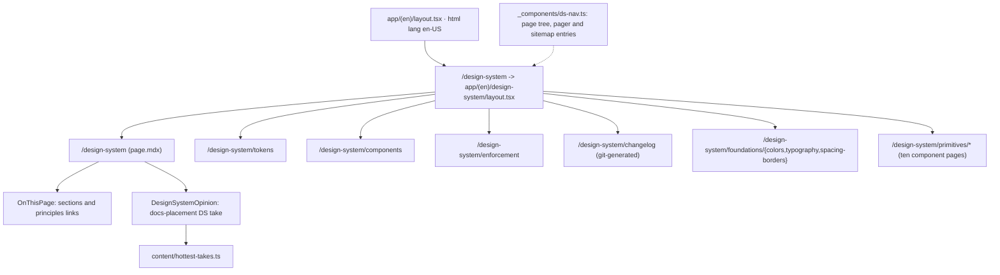

The pt-BR group mirrors the English one, and the shell serves the API cluster:

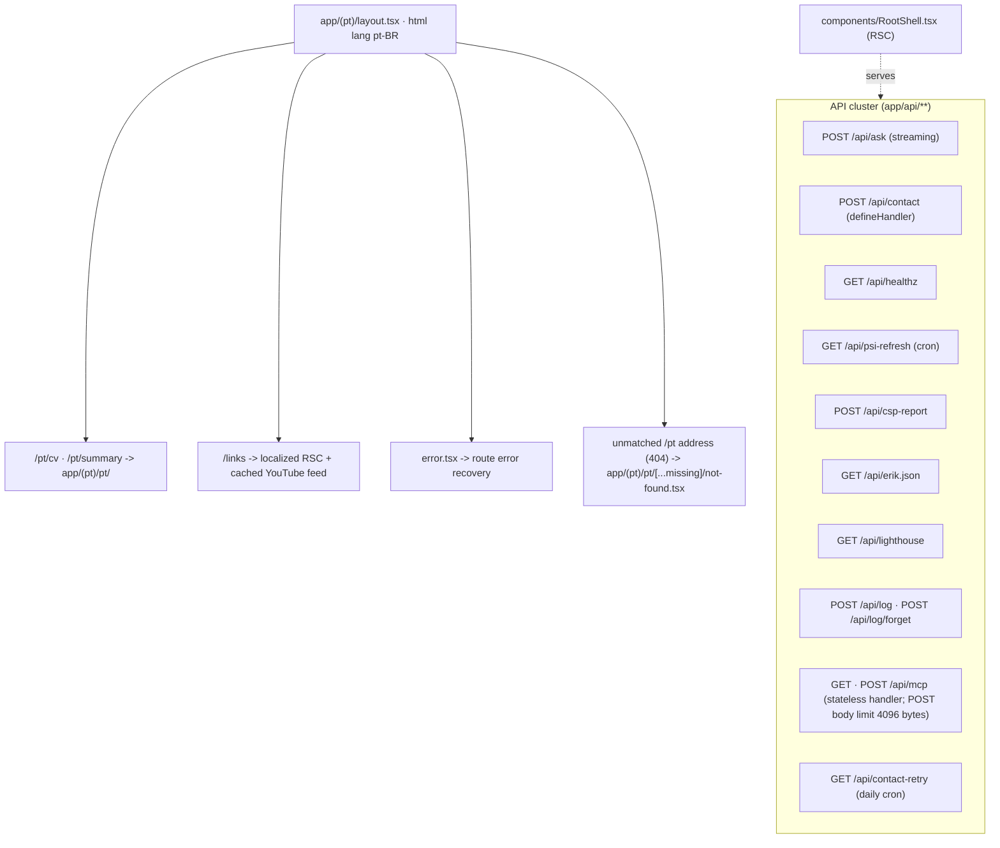

The user-facing routes are `/`, `/summary`, `/cv`, `/links`, `/links/en` and the pt-BR twins `/pt`, `/pt/cv` and `/pt/summary`, alongside the 18 design-system pages (the five top-level pages, three foundations and ten primitives listed in `ds-nav.ts`), metadata routes and API cluster. `app/sitemap.ts` lists every page with its language alternates; `robots.txt`, `llms.txt`, `.well-known/agent.json` and `og.png` are static files in `public/`. Home sections use the client `ErrorBoundary` component; its default fallback is a bordered box that keeps the island's `minHeight` (`--eb-min-height`), and decorative islands (CRT overlay, Matrix rain) pass `fallback={null}` and render nothing. The English and pt-BR routes live in two route groups, `app/(en)` and `app/(pt)`, each with its own root layout that sets `<html lang>` and renders `components/RootShell.tsx`. A navigation between the groups, such as the language switch, is a full document load. App Router failures also have `app/(en)/error.tsx`, `app/(pt)/error.tsx` and `app/global-error.tsx`; there is no `loading.tsx`/`template.tsx`. Each group's `[...missing]/page.tsx` renders `components/ErrorPages/MissingRoute.tsx`, which calls `notFound()` inside a `Suspense` boundary whose fallback is the 404 page, so the first bytes carry the page, the group's `<html lang>` and status 404; a `notFound()` outside a boundary prerenders Next's empty error shell instead.

## Terminal sections and navigation

`content/section-registry.ts` defines nine navigation destinations: Home (`bio`), About, Projects, Career, Interactive shell, Measured, Opinions, Guitar and mixer, and Contact. It supplies icons, screen reader labels and navigation order. `content/section-labels.ts` exposes those labels and adds the scroll region labels; each module header shows its section label as a visible name beside the icon.

The JSX order in `components/SiteHome.tsx` is Hero, About, Shell, Measured, Projects, GitLog, HottestTakes (with Unknowns nested inside), Guitar (the guitar rig with the DAW mixer below it) and Contact. Footer follows `PageMain` as its sibling. No CSS `order` reorders a top-level section, so the page reads in this order at every width; the navigation order in the registry is independent of it.

About contains Whoami, Now, Responsibilities, Stack and retry-code panels. Responsibilities and retry code are named keyboard scroll regions inside About. Projects contains its receipts. Career contains certification, education and community tag groups. Measured contains independent ASK, desktop PSI and mobile PSI reads. These nested groups do not become separate navigation destinations.

## Layout hierarchy (what wraps what)

The document shell, with the body-level islands and scripts:

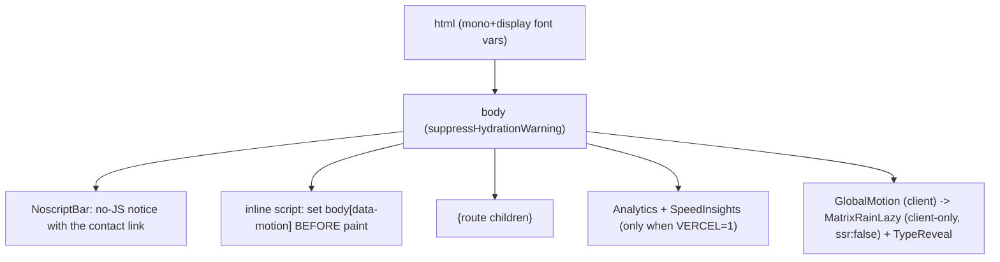

Inside the route children, the page frame wraps the chrome, the main content and the footer:

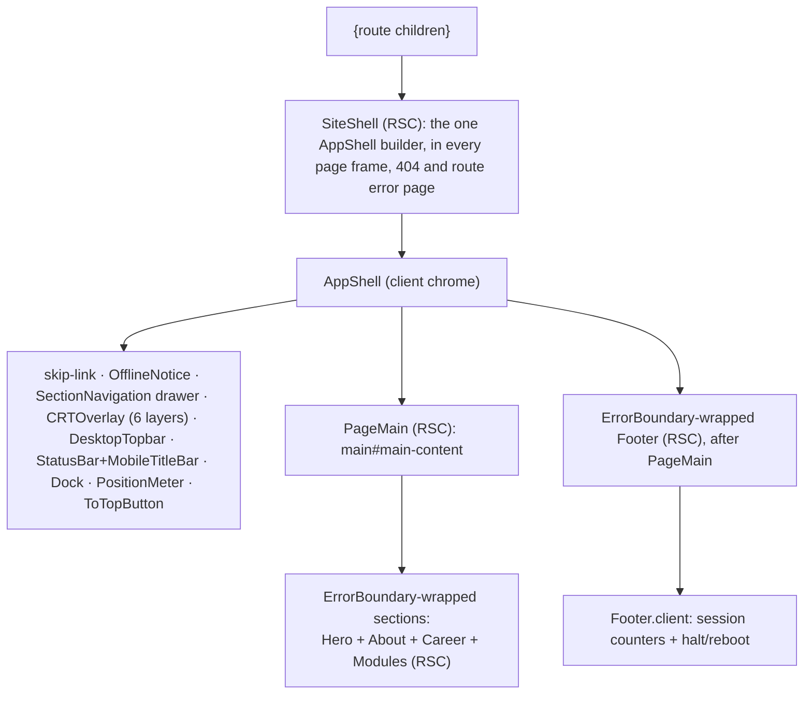

The motion bootstrap script is load-bearing: it reads `localStorage('erik.motion')` (anything but `off` means on, whatever the operating system asks) and sets `body[data-motion]` **before first paint**, off the hydration path, so the stored motion choice does not wait for hydration. The script lives in `lib/motion-bootstrap.ts`.

## The rendering pipeline (RSC + PPR)

`cacheComponents: true` turns on Partial Prerendering. The mechanism in this codebase:

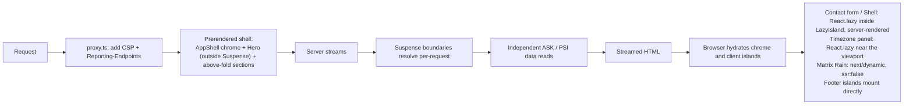

**Routes that must stay static.** `/cv`, `/summary`, `/links`, `/links/en`, `/pt/cv`, `/pt/summary` and the `/design-system` layout export `ensureStatic = 'navigation'`. Next then fails the build if the route reads `connection()`, `cookies()`, `headers()` or uncached data, so request-time rendering cannot return unseen. `__tests__/meta/ensure-static-routes.test.ts` lists the guarded files.

**Static vs dynamic, concretely:**
- **Static (prerendered):** `AppShell` chrome except the client-only MatrixRain canvas, `Hero` (outside Suspense so LCP never waits), `About`, `Shell`, the responsive `Guitar` presentation (EQ strip, signal chain and photo), Projects with its attached receipts, Contact, and section fallbacks. Projects uses one RSC tree with CSS controlling the responsive grid. The mixer selects its variant by user agent: desktop UAs get the three-channel table, mobile UAs get the three-card static mix, and only its islands hydrate. Contact renders on the server as two columns: the channels block (the email, a `[COPY EMAIL]` control, the LinkedIn call to action and GitHub) and five facts under the form, and the timezone panel's static first paint (dim land map and Erik's pin, no clock) beside it.
- **UA-selected variants:** only the DAW mixer on `/`. `DawMixerContent` awaits `getIsMobile()` (`lib/ua.ts`, which reads `headers()`) and renders the mobile or desktop variant behind a Suspense boundary inside the guitar module.
- **Measured data:** `AiMetricsSection` renders the `sec-live-metrics` module. It composes `AiMetricsData` and `LivePerfSection`, with two independent Suspense boundaries: one for ASK and one for PSI, which resolves desktop and mobile together. Each fallback retains its metric layout and shows a loading state. Receipts remain inside Projects rather than a separate module.
- **The dual-variant pattern** (used on `/` by the DAW mixer):

  ```
  <Module><Suspense fallback={<MixerLoading/>}><AsyncInner/></Suspense></Module>
  ```

  `AsyncInner` awaits `getIsMobile()` and renders the desktop or mobile variant behind a Suspense fallback, the `MixerLoading` boot log, whose `min-height` tracks the finished mixer. `GuitarSection` uses this pattern for its mixer content (`DawMixerContent`); the guitar rig and photo above it use one responsive presentation without this UA boundary or variant swap.
- **`defer` prop:** the below-the-fold sections (`DEFERRED_SECTION_COUNT` in `components/responsive/Module/module.constants.ts`, held by `__tests__/content-visibility.test.ts`) pass `defer` to `Module`, which applies CSS `content-visibility` (defers render cost, not JS). Most use `Module`; Career applies the same attributes in its own wrapper. A deferred module reserves an estimated placeholder height while its content is laid out at full height: 520px is only the default, with per-section and per-breakpoint overrides (Career 3340px, Opinions 3180px, Guitar and mixer 3320px, Contact 2640px) and `contain-intrinsic-size: auto var(--module-estimate)` remembering the rendered height, so the axe gate reveals the deferred modules before the scan: the audit then sees the painted page, the state the visual baselines capture.
- **Lazy boundaries:** `ContactFormLazy` and `InteractiveShellLazy` are `React.lazy` islands inside `LazyIsland`, rendered on the server, with accessible loading placeholders (`.shell-loading`, `.contact-loading`, each holding a per-breakpoint `min-height` and hidden when scripting is off) as the Suspense and error fallback. `ContactTimezoneLazy` is a `React.lazy` island instead: an `IntersectionObserver` with a 400px margin mounts it, the static panel (a dim map under a one-line `loading local time…` label, hidden when scripting is off or the chunk failed) stays as the Suspense and error fallback, the host holds a per-locale minimum height so the swap moves nothing, and its chunk stays out of first load. Its clocks tick only while the panel is on screen and the tab is visible. `MatrixRainLazy` loads from `GlobalMotion` (mounted in the root layout) with `ssr: false` as a decorative fixed overlay behind `main`; late hydration cannot shift layout. `Footer` is an RSC: content, cards, sitemap and shutdown log render on the server. It renders session counters and halt/reboot controls from `Footer.client` directly, without a dynamic import; the netstat card links each endpoint to its destination. The site map switches layout on its own width with container queries. Every folder is a full-width row (`./work/` and its file count) over its links, which hang off a vertical rule, with a faint divider between folders. Below 38rem the rows are native `<details name="footer-sitemap">` summaries with a `+`/`-` sign, one folder open at a time and `./work/` open on load. From 38rem all folders show in three columns, and from 68rem in six. Rows use `--text-body`, counts `--text-xs`, and links keep 44px targets. It needs no JavaScript and prints as the three-column grid. Counters start at mount to include commands before the footer is reached. The halt clock is empty on the server and reads the visitor’s clock after mount.

The terminal home combines prerendered output and dynamic Suspense children. Separately, `lib/links/feed.ts` uses `use cache` and `cacheLife` for the YouTube feed: stale after 900 seconds, revalidate after 3,600 seconds, expire after 86,400 seconds. Without `YOUTUBE_API_KEY` the loader reads the RSS feed's newest 15 uploads and drops Shorts by their `/shorts/` URL. With the key it pages the channel uploads playlist (up to four pages of 50) until six regular videos are collected (the featured video and the five history rows), dropping Shorts by URL and by a duration of 180 seconds or less, and keeps the first six regular videos; when the API cannot be read the loader falls back to the RSS feed, where the key still applies the duration filter. `LinksPage` awaits that feed and falls back to `EMPTY_FEED` on failure. An empty result shortens its own cache life (stale 30 seconds, revalidate 60 seconds, expire 300 seconds), so a transient upstream outage is retried within a minute and does not stay for an hour; the page then says the list did not load, not that the channel has no videos.

## End-to-end data flow #1 - page render (read path)

```
build time:  content/*.ts imported -> Zod parse (gate) -> typed data baked into RSC output
eval run:    scripts/ask-eval.ts -> Redis ask:eval:latest
request:     proxy.ts headers -> static shell streamed -> getIsMobile() resolves per request
             -> section variants and independent ASK / PSI reads stream -> client hydrates islands
```

The content layer is build-time: static copy is already in the prerendered output. Measured reads live data through `lib/ask-metrics.ts` and `lib/lighthouse-scores.ts`. PSI uses its Redis cache and may fetch PageSpeed Insights when the cache is missing. Projects does not read the user agent or wait on live data.

## End-to-end data flow #2 - `/api/ask` (the streaming AI feature)

Transport is **plain `fetch` reading a raw `ReadableStream` of `text/plain`** - not SSE, and the AI SDK runs server-side only.

The sequence runs in four parts, with the same participants throughout.

First the preflight chain - everything that has to pass before the model is called:

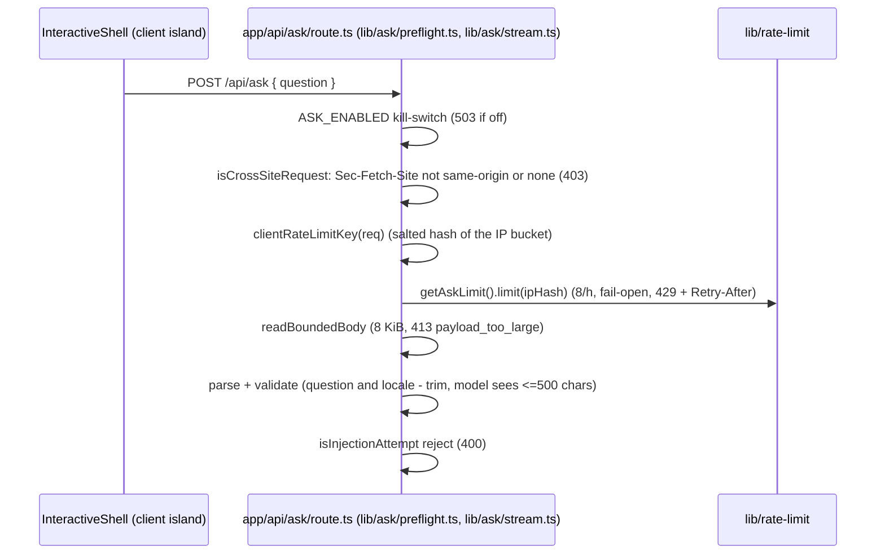

Then the dedup check, the budget reservation and the sentinel:

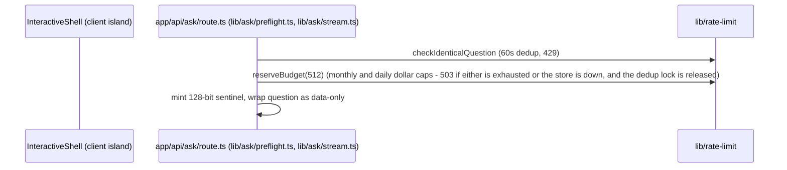

Then the model call and the streaming loop, with the egress guard on every delta:

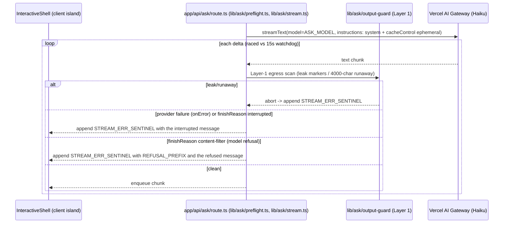

And finally the client-side rendering and the server-side settlement:

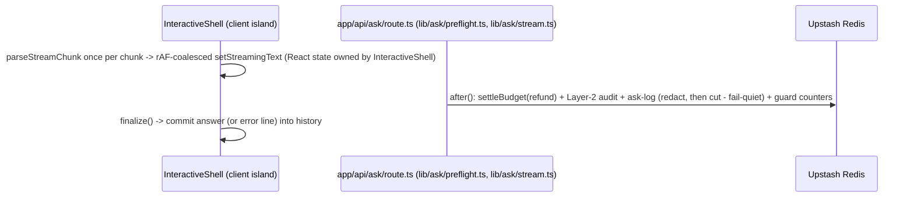

**Client-side rendering nuance (verified in code):** the streamed text lands in an _isolated_ `streamingText` state and is flushed at most once per animation frame (`requestAnimationFrame`), so chunks within one frame share a state update. Each chunk is parsed once; the frame callback and the stop path reuse that result. The state lives in `useAskStream` and is read by `InteractiveShell`, whose component renders again when it changes; the text is displayed in a dedicated span. This is the opposite of the Hero boot loop, which mutates `textContent` directly with no React state (see doc 04). Both limit update work.

**Server timeouts (defense in depth):** 30s whole-request `AbortSignal`, 15s mid-stream watchdog, 1s usage-resolve. A reader that cancels mid-answer (tab closed, navigation) aborts the upstream call and still runs settlement and the ask-log write from `after()`, with status `aborted`; before the first token the output share of the reservation is refunded. The shell client gives up after 15s with no token (idle timer, re-armed on every chunk) and offers a retry. The contact form and the shell's forget actions post through `lib/post-json.ts`, which aborts after 20s (body read included); the abort lands in the generic failed-send alert and the fields unlock. The spend budget is held **fail-closed** if usage can't be resolved (so a metering bug can't leak spend), while the rate limiters and dedup are **fail-open**. The one exception is the budget reservation: if Redis fails there, `/api/ask` returns 503 rather than answer without a spend cap.

## End-to-end data flow #3 - `/api/contact` (the write path via `defineHandler`)

The sequence runs in three parts, with the same participants throughout.

First the intake: the cross-site check, the rate limit, the bounded body, the schema and the honeypot - all before any work is done:

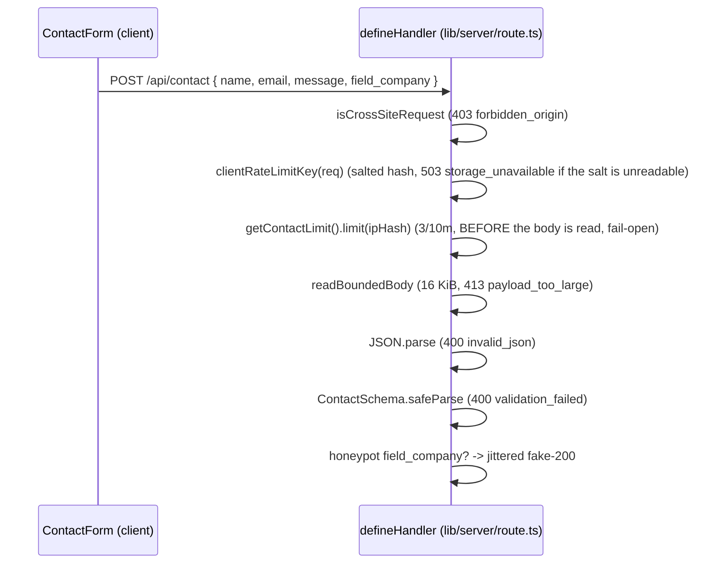

Then the durability-first write and the delivery attempt:

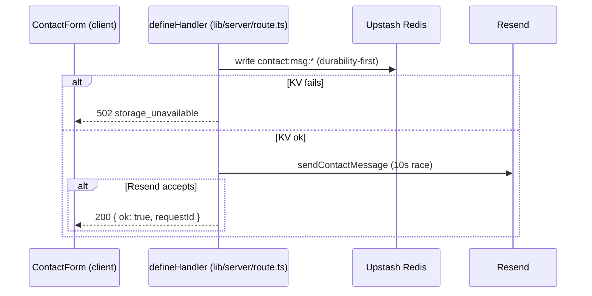

And the other branch of the delivery attempt - Resend errors, times out or the key is missing, so the message goes to the outbox:

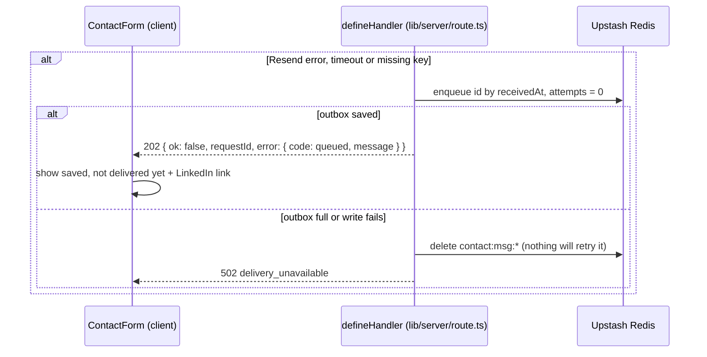

The **ordering is a security property**: refuse cross-site requests first, hash the IP so no limiter key holds the raw address, rate-limit and bound the body _before_ reading it, validate _before_ the work, and touch storage _only_ for requests that pass. Every response carries `X-Request-Id`. See doc 05 for the full `defineHandler` contract and the other routes.

At 04:00 UTC daily (`0 4 * * *`), `/api/contact-retry` checks the `CRON_SECRET` bearer before reading pending ids in received-time order. Messages older than 24 hours (the provider idempotency window), or already at 3 retry attempts, leave the outbox. Each eligible message consumes an attempt before calling the same delivery function. Successful sends leave the outbox; failures remain pending. Audit messages retain their 90-day KV TTL. The success response is `{ ok: true, requestId, data: { sent, failed, expired, exhausted } }`, with a matching `X-Request-Id` header. Contact logs carry only `requestId` and `msgId`.

## Request lifecycle summary (every request)

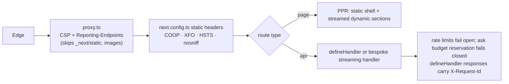
