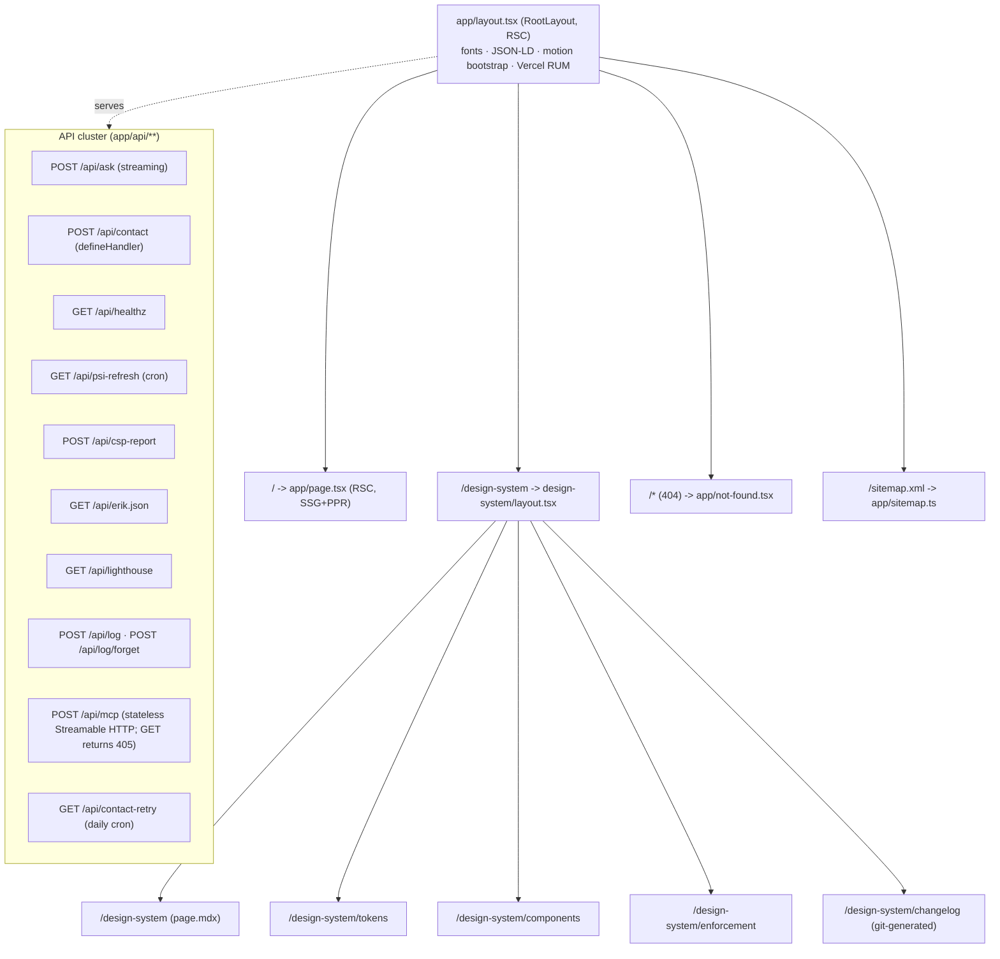
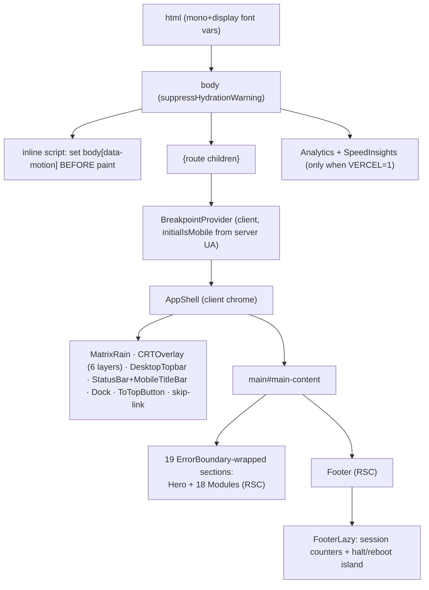
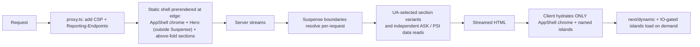
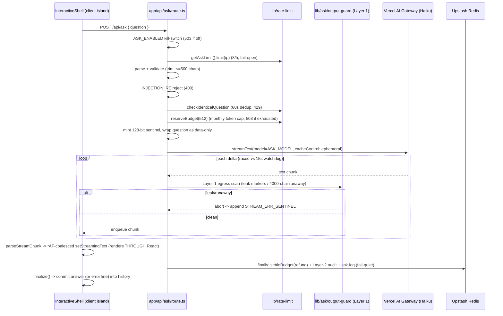
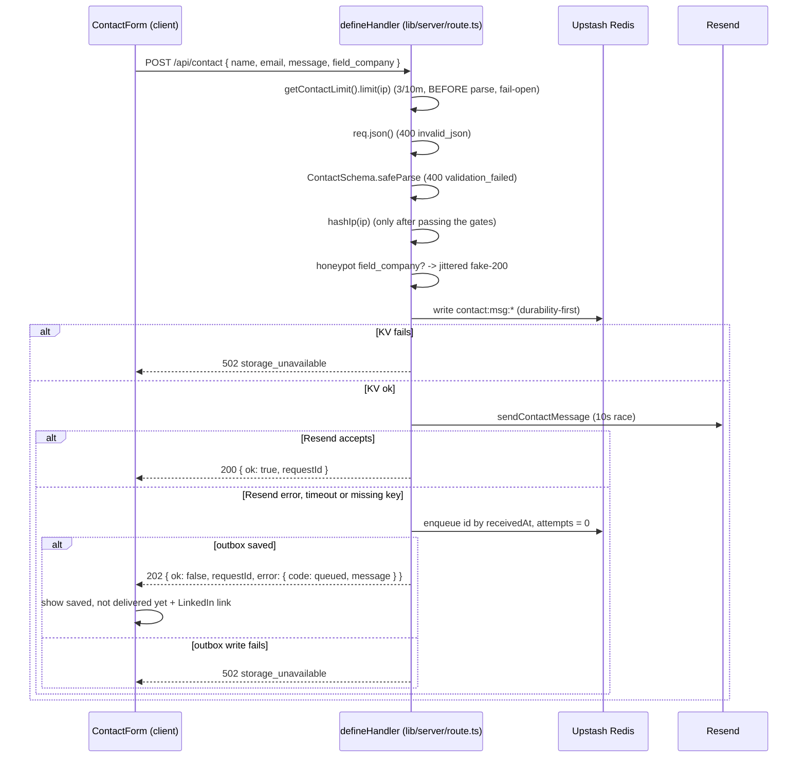
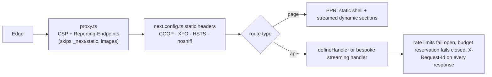

# Rendering & Data Flow

> Routing tree, the RSC/PPR rendering pipeline, and end-to-end data flows with sequence diagrams. This is the doc that explains _how a request becomes pixels_ and _how a user action becomes a persisted effect_.

## Routing tree



There is **one user-facing page** (`/`). Everything else is the design-system docs, metadata routes, and the API cluster. Error UI uses the client `ErrorBoundary` component (not the App Router `error.tsx` convention); there is no `loading.tsx`/`template.tsx`.

## Layout hierarchy (what wraps what)



The motion bootstrap script is load-bearing: it reads `localStorage('erik.motion')` / OS preference and sets `body[data-motion]` **before first paint**, off the hydration path, so CRT effects and the LCP element never flash or wait on JS.

## The rendering pipeline (RSC + PPR)

`cacheComponents: true` turns on Partial Prerendering. The mechanism in this codebase:



**Static vs dynamic, concretely:**
- **Static (prerendered):** the whole `AppShell` chrome, `Hero` (outside Suspense so LCP never waits), `Readme`, `Shell`, Projects with its attached receipts, and section fallbacks. Projects uses one RSC tree with CSS controlling the responsive grid.
- **UA-selected variants:** `ManPage`, `GitLog`, `Visa`, `Guitar` and `DawMixer` wrap an async RSC that calls `getIsMobile()` (`lib/ua.ts`, which reads `headers()`). Their fallbacks are prerendered; the selected variants stream per request.
- **Measured data:** `AiMetricsSection` renders the `sec-live-metrics` module. It composes `AiMetricsData` and `LivePerfSection`, with independent Suspense boundaries for ASK, desktop PSI and mobile PSI. Each fallback retains its metric layout and shows a loading state. Receipts remain inside Projects rather than a separate module.
- **The dual-variant pattern** (e.g. `ManPageSection.tsx`):

  ```
  <Module><Suspense fallback={<Desktop/>}><AsyncInner/></Suspense></Module>
  ```

  `AsyncInner` awaits `getIsMobile()` and renders `<ManPageDesktop/>` or `<ManPageMobile/>`. Fallback choice is per-section: the desktop variant for ManPage, GitLog and Visa; `null` for Guitar and DawMixer.
- **`defer` prop:** fourteen below-the-fold sections pass `defer` to `Module`, which applies CSS `content-visibility` to defer render cost.
- **`next/dynamic` lazy JS:** `ContactFormLazy`, `InteractiveShellLazy`, `DawMixerSection`. `Footer` is an RSC: content, cards, sitemap and shutdown log render on the server. `FooterLazy` loads only the session counters and halt/reboot island from `Footer.client`; the netstat card uses the design-system `CopyButton` island. Counters start at mount to include commands before the footer is reached. The halt clock is empty on the server and reads the visitor’s clock after mount.

There is **no `use cache` / `cacheLife` / `cacheTag` / `unstable_cache` / `generateStaticParams`** anywhere - the staticness comes from PPR + the absence of dynamic APIs, not explicit caching.

## End-to-end data flow #1 - page render (read path)

```
build time:  content/*.ts imported -> Zod parse (gate) -> typed data baked into RSC output
eval run:    scripts/ask-eval.ts -> Redis ask:eval:latest
request:     proxy.ts headers -> static shell streamed -> getIsMobile() resolves per request
             -> section variants and independent ASK / PSI reads stream -> client hydrates islands
```

The content layer is build-time: static copy is already in the prerendered output. Measured reads live data through `lib/ask-metrics.ts` and `lib/lighthouse-scores.ts`. PSI uses its Redis cache and may fetch PageSpeed Insights when the cache is missing. Projects does not read the user agent or wait on live data.

## End-to-end data flow #2 - `/api/ask` (the streaming AI feature)

This is the richest flow in the system. Transport is **plain `fetch` reading a raw `ReadableStream` of `text/plain`** - not SSE, and the AI SDK runs server-side only.



**Client-side rendering nuance (verified in code):** the streamed text lands in an _isolated_ `streamingText` state and is flushed at most once per animation frame (`requestAnimationFrame`), so a per-chunk update re-renders only one `<span>`, never the whole feed. This is the opposite of the Hero boot loop, which mutates `textContent` directly with no React state (see doc 04). Both are deliberate INP guards.

**Server timeouts (defense in depth):** 30s whole-request `AbortSignal`, 15s mid-stream watchdog, 1s usage-resolve. The token budget is held **fail-closed** if usage can't be resolved (so a metering bug can't leak spend), while the rate limiters and dedup are **fail-open**. The one exception is the budget reservation: if Redis fails there, `/api/ask` returns 503 rather than answer without a spend cap.

## End-to-end data flow #3 - `/api/contact` (the write path via `defineHandler`)



The **ordering is a security property**: rate-limit and validate _before_ the work, hash the IP and touch storage _only_ for requests that pass. Every response carries `X-Request-Id`. See doc 05 for the full `defineHandler` contract and the other routes.

At 04:00 UTC daily (`0 4 * * *`), `/api/contact-retry` checks the `CRON_SECRET` bearer before reading pending ids in received-time order. Messages older than 7 days, or already at 3 retry attempts, leave the outbox. Each eligible message consumes an attempt before calling the same delivery function. Successful sends leave the outbox; failures remain pending. Audit messages retain their 90-day KV TTL. The response counts `sent`, `failed`, `expired` and `exhausted`. Contact logs carry only `requestId` and `msgId`.

## Request lifecycle summary (every request)


