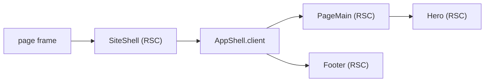
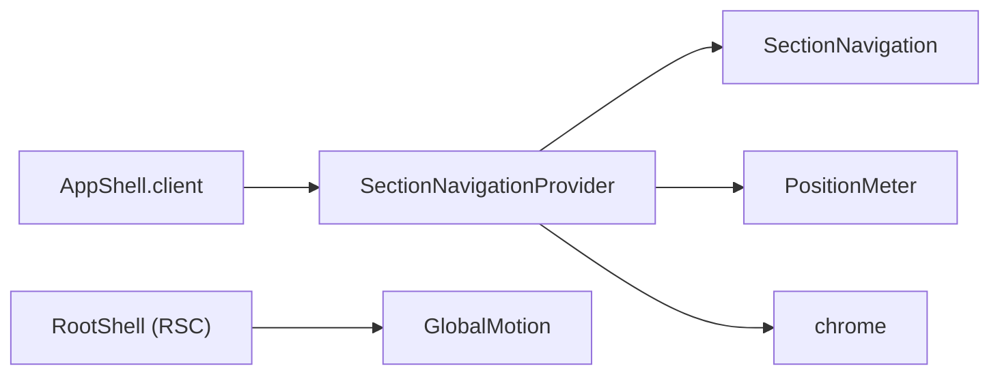
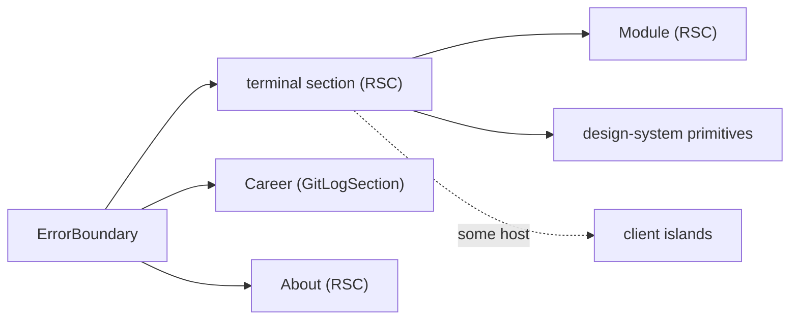
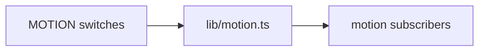
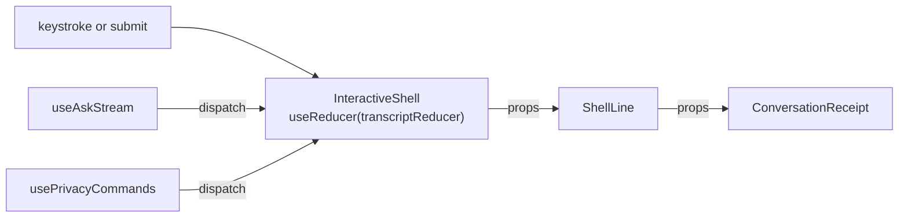

# Components & State

> Component hierarchy, the section/island/primitive taxonomy, the design system, the CSS/token architecture, and the (deliberately minimal) state model.

## Component taxonomy

Seven directories, seven roles. The directory tells you the layer:

| Directory                     | Role                            | Ships JS?                                 | Example                                                            |
| ----------------------------- | ------------------------------- | ----------------------------------------- | ------------------------------------------------------------------ |
| `components/sections/**`      | Page sections and nested groups | RSC, with client descendants where needed | `About`, `ProjectsSection`                                         |
| `components/client/**`        | Interactive islands             | Yes                                       | `InteractiveShell`, `ContactForm`, `ContactTimezone`, `DawMixer/*` |
| `components/responsive/**`    | Viewport chrome                 | Yes (except `Module`)                     | `MatrixRain`, `Dock`, `CRTOverlay`                                 |
| `design-system/components/**` | Reusable primitives             | Mostly No (RSC)                           | `Badge`, `Button`, `TerminalPanel`                                 |
| `components/links/**`         | The `/links` and `/links/en` page, one folder per component, with its own `client/` islands | RSC, with `client/` islands    | `LinksPage`, `IdentityCard`, `TaglineTyper`, `NavProgress`         |
| `components/reading/**`       | The `/cv` and `/summary` reading views, one folder per component | No                                | `ReadingShell`, `CvPage`, `SummaryPage`, `ReadingSection`          |
| `components/ErrorPages/**`    | Route error, global error and not-found pages | Mixed (`*.client.tsx` for error boundaries) | `NotFoundPage`, `MissingRoute`, `RouteErrorPage`, `GlobalErrorPage` |

Loose components in `components/` serve more than one layer: `RootShell` (the shared body of both root layouts), `SiteShell`, `SiteHome`, `AppShell`, `PageMain`, `ErrorBoundary`, `NoscriptBar`, `LocaleSwitch`, `BrandLink`, `BreakAfter`, `CommandText`, `KeepTail`, `HeroStats`, `StatusDot`, `Icons`, `OptimizedImage`, `CompanyLink` and `ExternalLink`.

`scripts/gates/check-client-naming.ts` accepts `*.client.tsx`/`*.client.ts`, files inside a `/client/` directory, and App Router error convention files. Inspect the client directive and imports when tracing a boundary. Components commonly use a `Foo/` directory and `index.ts` barrel. Vitest tests use `*.test.tsx`; component Playwright specs use `*.e2e.ts`. `*Lazy` files are code-split wrappers: `ContactFormLazy`, `InteractiveShellLazy` and `ContactTimezoneLazy` use `React.lazy` through `LazyIsland`, and `MatrixRainLazy` in `responsive/MatrixRain/` uses `next/dynamic` with `ssr: false` (consumed by `GlobalMotion` from the root layout).

The naming gate scans `app`, `components` and `lib`; `/client/` is an explicit directory-based exception.

`components/CompanyLink` renders every employer link: through `components/ExternalLink` (the shared `target="_blank"` and `rel="noopener noreferrer"` pair; `externalLinkProps(external)` spreads the pair onto a `Button` or a conditional anchor), a new-tab disclosure from `content/company-link.ts`, chosen by the required `locale` prop (an `sr-only` suffix, or `aria-describedby` to one shared note where the link sits inside a `data-type-reveal` heading, whose clip is sized from its text), a persistent underline and a 28px (`--spacing-target-compact`) hit area drawn by the `.company-link::before` pseudo-element. The hit area stays that small because the links sit inside dense inline text, where a 44px zone would cover the neighbouring lines and take their taps. `CompanyMention` links the company name inside an existing sentence and throws when the sentence stops naming it.

`Panel` (`design-system/components/Panel`) is the `.panel` frame (`.panel-head`, `.panel-marker`, `.panel-title`; marker, `h3` title, optional action) shared by About and Contact; `as` picks `div`, `section` or `aside`, `titleId` names the landmark, and `reveal` marks the heading for the app-wide `TypeReveal` island. The frame rules live in `app/css/components-panel.css`; a section scopes its own tweaks under its section class in its own partial. `components/PageMain` owns `MAIN_CONTENT_ID` and renders every `main#main-content` (home, reading views, error pages); `className` swaps its layout class. `components/reading/ReadingSection/ReadingSection` and `ReadingActions` hold the section heading and the hire, secondary and print row that `/cv` and `/summary` share. `lib/defer-props.ts` returns the `module-deferred` class and `data-cv-defer` marker for a deferred section. `lib/json-ld.ts` `serializeJsonLd` escapes `<`, U+2028 and U+2029 so a value cannot end the script element it sits in.

`links-thumb` frames every `/links` video cover at 16:9 with the image filling the frame (no crop). The cover is grayscale under a multiplied signal-green layer from the `--links-thumb-*` tokens; hover or focus on the parent link restores the cover colour, and the transition stops while the MOTION switch is off. Documented with a live example in the design system components page.

### Page frames

Two root layouts exist and neither shares a parent: `app/(en)/layout.tsx` and `app/(pt)/layout.tsx` both render `RootShell` for their locale and set `<html lang>` (`en-US` or `pt-BR`). Every page frame except the global error page wraps its content in `SiteShell`, which supplies `AppShell` (the chrome) for that locale and route; the design-system layout also passes its section list to the drawer through `drawerExtra`.

| Route group | Routes | Frame |
| --- | --- | --- |
| Home | `/`, `/pt` | `SiteHome`: `Hero`, `About`, `ShellSection`, `AiMetricsSection` (Measured), `ProjectsSection`, `GitLogSection` (Career), `HottestTakesSection`, `GuitarSection` (with the DAW mixer), `ContactSection`, then `Footer`; the section order, ids and labels come from `content/section-registry.ts` |
| Reading views | `/cv`, `/summary`, `/pt/cv`, `/pt/summary` | `ReadingShell` (`PageMain` inside `.reading-view`), filled by `CvPage` or `SummaryPage` |
| Links | `/links` (Portuguese), `/links/en` | `LinksPage` with the cached YouTube feed behind `Suspense` |
| Design system | `/design-system/**` | MDX pages under `app/(en)/design-system/` with their own layout and sidebar |
| Errors | unmatched paths, route errors, global errors | the `[...missing]` catch-alls call `notFound()` inside `MissingRoute`; `error.tsx` and `global-error.tsx` render `RouteError` and `GlobalErrorPage`, which read the locale from the path |

The Hero identity line is static server-rendered text. Desktop and mobile share `HeroIdentity`, with metrics and accessible labels passed into `HeroStats`. `Hero` passes the boot and system-failure islands their copy for the page locale from `content/hero-client.ts` as props, so the client bundle carries one locale and server content validation stays out of it. The About "Open to [role] roles" status line mounts the `RoleTyper` client island (`components/client/RoleTyper`), which types the single role `Senior` over the server-rendered text. `About` contains Whoami, Now, Responsibilities, Stack and retry-code panels. Career (`sec-git-log`) owns the `cert/*`, `edu/*` and `community/*` tag groups; community content comes from `content/community.ts`.

Barrels beside `ContactFormLazy`, `InteractiveShellLazy` and `MatrixRainLazy` export only the lazy wrapper. `ContactTimezoneLazy` differs: it mounts on an intersection trigger, and its barrel also exports the server-rendered `ContactTimezoneStatic` that the lazy wrapper takes as its fallback. Tests import the real component directly, keeping it out of the initial client references. All three lazy wrappers render through `LazyIsland` (`ErrorBoundary` around `Suspense`), so a chunk that fails to load shows the fallback instead of a permanent loading state. A crashed island keeps its box: `ContactFormLazy` and `InteractiveShellLazy` pass a `minHeight` (named constants) that the default fallback applies as `--eb-min-height`, `ContactTimezoneLazy` keeps its server-rendered panel inside the `.ctz-host` that reserves the height, and the decorative CRT overlay in `AppShell` and Matrix rain in `GlobalMotion` use `fallback={null}` so a crash renders nothing. `useAskStream`, `AnimatedPlaceholder` and `ConversationReceipt` hold the shell's request, placeholder loop and conversation receipt. The pending answer shows an elapsed `[ thinking 1.2s ]` line, a block caret and, over the bottom edge of the log, a floating stop pill (a sibling of the `role="log"` element, so the live region never announces it): one button labelled with the elapsed time, with the `esc` hint inside it (hidden where there is no hover, since a touch screen has no Escape key), which stays in view while the log scrolls, takes focus back to the input when it is activated, and leaves when the answer completes, stops or fails (Escape is handled on the shell wrapper only); failures print as `ask: <status>` stderr lines with a local fallback, a 429 with `Retry-After` becomes an ASCII countdown, and 15s of silence ends the request with a `[ RETRY ]` button. A failed or stopped question returns to the prompt only while the visitor has not edited the prompt since sending it, so text typed meanwhile, or a prompt emptied on purpose, is never refilled. `OfflineNotice` (in `AppShell`) fills a fixed `role=status` region while the browser is offline, and takes its copy resolved in `chrome.offline` so the client bundle holds one locale; `TerminalChromeBar` renders the shell and contact header; when the content gives a `mobileLabel` it renders both label variants and `max-md:hidden` / `md:hidden` pick one in CSS, so the bar has the same height before and after hydration.

## Component hierarchy

The hierarchy reads in three parts: the shell chain, the chrome and the global motion, and the sections.

The shell chain:

- Page frames: `SiteHome`, `ReadingShell`, `LinksPage`, the design-system layout, `NotFoundPage`, `RouteErrorPage`.
- `PageMain` renders `main#main-content`; the Hero sits inside an `ErrorBoundary` and owns its section. `HeroIdentity` holds the shared desktop and mobile identity, actions and `HeroStats` props; the boot and system-failure islands read typed hero-client copy.
- The footer sits inside an `ErrorBoundary` and holds the cards, sitemap and shutdown log. `Footer.client` holds the session counters (four hooks in `session-counters.ts`: `useUptime`, `useScrollDepth`, `useCommandCount`, `useSeenSections`, each owning one interval or listener and writing its server-rendered node through a ref), the halt and reboot island and the last-request receipt; the netstat cells are outbound links with a glyph.

The chrome and the global motion:

- `SectionNavigationProvider` holds stable actions and copy, plus a store for the current section, drawer and motion.
- `SectionNavigation` owns the menu trigger, the drawer focus trap and focus return; its header holds the title and the close control.
- `PositionMeter` is a decorative scroll progress line (`aria-hidden`), at the top from 1024px and on the left edge below. It writes `--posf` to every `data-position-target`, the Dock included.
- The chrome is `CRTOverlay` (6 layers), `DesktopTopbar`, `StatusBar`, `MobileTitleBar`, `Dock` and `ToTopButton`.
- `GlobalMotion` is mounted by `RootShell` in both root layouts and runs `MatrixRainLazy` (client only) and `TypeReveal`. On `/links` and `/links/en`, `TaglineTyper` cycles the localized tagline.

The sections inside the error boundary:

- `Module` wraps a section with its CSS typing header.
- Primitives: `Badge`, `Button`, `CmdLine`, `Panel`, `StatTile`, `TerminalPanel`, `WindowChrome`, `KbdKey`, `BrandIcon`, `Field`.
- Islands: `InteractiveShell`, `ContactForm`, `ContactTimezone`, the `DawMixer` controls (`Fader`, `Knob`, `Vu`, `Rms`), `HeroBoot`, `RoleTyper`.
- Career owns its section and header. About owns its section and hosts the `RoleTyper` island; its responsibilities and retry code are named keyboard scroll regions.

### The section drawer

The section menu is a modal drawer at every width. It opens from the icon-only menu trigger (`Open menu`) or the dock `MENU` control, keeps Tab inside the panel, and closes on Escape, the close control or the scrim. Closing it returns focus to the control that opened it. A viewport change can stop that control from being rendered (the dock is `display: none` from 1024px), and focusing an element in a `display: none` subtree is a no-op. In that case the drawer falls back to the first rendered menu trigger. Focus always lands on a control the visitor can see.

### The `Module` wrapper

`components/responsive/Module/Module.tsx` (RSC) wraps terminal modules. Hero, About, Career and Footer render separately. It renders a `<section id tabIndex={-1} aria-labelledby>` containing a non-interactive `<header>` with an `<h2>`; there is no collapse affordance on any viewport. The `<h2>` reads the section name, the icon and the typed command; every module passes `name`. Props: `id`, `header`, `mobileHeader?`, `srLabel?`, `name?`, `icon?`, `defer?`, `variant?: 'green'`. The `defer` prop still drives `content-visibility` deferral via `data-cv-defer`/`module-deferred`. `content/section-labels.ts` supplies readable labels. It derives the registry labels and adds the scroll region labels.

Module headers use CSS scroll-driven typing with a stepped text reveal and caret. The caret blinks four times, then stays solid. Unsupported browsers and the MOTION switch off show static text. The text remains in the DOM and accessibility tree; no client JavaScript is added. `html` and `body` use `overflow-x: clip` so the view timeline follows page scrolling.

### CRT overlay layering

`CRTOverlay.client.tsx` renders 6 fixed, `aria-hidden`, `pointer-events:none` overlay divs, z-stacked in `crt.css` by the five `--z-crt-*` steps of the `--z-*` scale in `theme.css`, so noise and flicker share step 4: vignette (1) · scanlines (2) · RGB sub-pixel mask (3) · noise and flicker (4) · scan beam (5). `MatrixRain` sits at `--z-rain` (0), `<main>` at `--z-content` (10). The CRT colors derive from theme tokens (`color-mix` over the palette plus the `--color-crt-phosphor-*` primaries), and the rain reads `--color-rain-head`, `--color-rain-body` and `--rain-tail-alpha` through `readRainPalette`. All of it disables under `body[data-motion="reduce"]`, and freezes during the system-failure overlay (`html.sysfail-on`). `CRTOverlay` also runs the frame governor (`lib/frame-governor.ts`): while `html[data-crt-level]` is above 0, `crt.css` pauses the noise, flicker and beam and the governor steps their clocks (`lib/crt-effect-stepper.ts`); `MatrixRain` reads the same level for its tick interval. `MatrixRain` and the governor each start and stop their frame loop through `createRunGates` (`lib/run-gates.ts`): one set of named gates, one callback when the combined answer flips.

## The design system

Eleven primitives in `design-system/components/` (all server components); **nine exported** from `design-system/index.ts` (`Field` uses a direct import in `ContactForm` and the docs; `BrandIcon` is imported by path, because a barrel export kept its path data in the client chunks of seven routes and pushed `/` past the first-load budget). The docs also provide the client `CopyButton` under `app/(en)/design-system/_components/`.

| Primitive       | Type       | Variant surface                                                                |
| --------------- | ---------- | ------------------------------------------------------------------------------ |
| `Badge`         | RSC        | `variant: default｜dot`, `size: sm｜md`                                        |
| `BrandIcon`     | RSC        | inline SVG brand mark, `size` px wide, `currentColor` fill, `aria-hidden`      |
| `Button`        | RSC        | polymorphic `as: button｜a`, `variant: primary｜secondary`, `size: sm｜md｜lg` |
| `CmdLine`       | RSC        | terminal command line (`user`, `command`, `output`, `prompt`)                  |
| `Field`         | RSC        | input/textarea + label + error/ARIA (not exported)                             |
| `KbdKey`        | RSC        | `size: sm｜md`                                                                 |
| `NavItem`       | RSC        | navigation link with `current` state and decorative `index`                    |
| `Panel`         | RSC        | framed section panel, `as: div｜section｜aside`, marker, `h3` title, optional action |
| `StatTile`      | RSC        | `<dl>` stat tile, `variant: default｜compact｜display`                         |
| `TerminalPanel` | RSC        | bordered container, polymorphic `as`, optional header                          |
| `WindowChrome`  | RSC        | macOS traffic-light dots for panel headers, `size` px                          |

Design-system primitives join class names with `lib/cn.ts`, which imports `clsx` and not `tailwind-merge`: a base class list and a variant list never set the same property (`__tests__/design-system-class-conflicts.test.tsx` fails when they do), because without a merge the stylesheet order, not the call order, picks the winner. The **DS docs site** (`app/(en)/design-system/**`) is MDX; `_lib/theme-tokens.ts` parses `app/css/theme.css` with the _same regex_ as `scripts/gates/contrast-check.ts`, to read the same token declarations. Changes to either parser still need checking. The changelog page is git-generated by `scripts/codegen/sync-changelog.ts` (`pnpm changelog:sync`), grouped by date under Added, Changed and Fixed with an ON THIS PAGE list of its dates. Every DS page carries that list; below 768px it follows the intro.

## CSS / token architecture

Import order (`app/globals.css`, every route): `tailwindcss` → `theme.css` → `base.css` → `crt.css` → `animations.css` → `components-*.css` (flat partials, imported in the cascade order) → `print.css` → `forced-colors.css`, with the layer order `theme, base, components, utilities, overrides` declared on the first line. The home route (`/`, `/pt`) also loads `app/css/home.css`, imported by `SiteHome`, after it: the home section partials (hottest takes, projects, career, mixer, contact, shell, mixer controls, guitar, footer, hero, about) in their cascade order. Every other route ships without those partials. The few rules a home partial held that also style other routes stay global, at the position the partial had: `components-to-top.css` (the to-top button on every route), `components-eq.css` (the EQ strip the design-system demos render) and `components-panel-head.css` (the narrow panel header). Those `@import` lines are the cascade order, and they are the only place it is recorded: the stylesheet-reading test helper (`__tests__/helpers/components-css.ts`) derives the partial order from them (`app/globals.css`, then `app/css/home.css`) rather than sorting filenames, so a stylesheet assertion sees the cascade the browser resolves on the home route, and `__tests__/home-css-entry.test.ts` holds that no partial ships from both entries; `__tests__/css-layer-order.test.ts` holds the layer order. Tailwind v4 via the single `@tailwindcss/postcss` plugin. No CSS modules, no Style Dictionary.

| File               | `@layer`     | Holds                                                                                                                              |
| ------------------ | ------------ | ---------------------------------------------------------------------------------------------------------------------------------- |
| `theme.css`        | `@theme`     | The token system (below)                                                                                                           |
| `base.css`         | `base`       | resets, focus-visible rings, skip-link, `.sr-only`, `.mobile-only`/`.desktop-only`                  |
| `crt.css`          | `components` | the 6 CRT classes + keyframes + MOTION-off disables + the `html[data-crt-level]` pause rule                                    |
| `animations.css`   | -            | section keyframes (`boot-blink`, `guitar-scan-beam`, `hero-shake-*`, ...)                                          |
| `components-*.css` | `components` | named layout and effect classes (`.module-*`, `.signal-glow`, DawMixer `.mx-fader`/`.mx-dial`, `.contact-*`, `.shell-cursor`, ...) |
| `components-utilities.css` | `utilities` | shared utility classes and the `leading-ratio-*` `@utility` blocks, each with a doubled selector so it beats the line height of a font-size utility |
| `print.css`        | `overrides`  | one `@media print` block: ink-on-paper palette overrides on `:root`, hides the shell chrome, CRT layers and rain, drops glows; reading views add their page layout in `components-reading.css` |
| `forced-colors.css` | `overrides` | one `@media (forced-colors: active)` block, imported once by `globals.css`: hides the CRT overlays and aria-hidden canvases, gives state-carrying controls system-color borders and outlines, and outranks Tailwind utilities through the layer order (focus ring, primary and current buttons, pressed toggles, meter fills) |

`theme.css` also declares the `motion-off`, `motion-on` and `reveal-motion-on` custom variants. `motion-off` matches `body[data-motion="reduce"]` and `motion-on` its negation. `reveal-motion-on` matches the same negation under an `html.type-reveal-ready` ancestor, which the type-reveal rules need.

**Tokens (`@theme`):** Tailwind's default `--color-*`, `--radius-*` and `--shadow-*` scales are reset to `initial`, so `bg-red-500`, `rounded-lg` and `shadow-md` emit nothing and only project tokens produce utilities. Eleven role tokens (`surface`, `surface-raised`, `border`, `border-strong`, `accent`, `on-accent`, `text-muted`, `focus`, `warning`, `danger`, `scrim`) alias primitives declared in `:root` inside `@layer base`, so they generate no utilities; a class string reads one as `bg-(color:--color-surface)` and a stylesheet as `var(--color-surface)`. `text` is the twelfth role token and lives in `@theme`. The color ramps keep only the steps with a consumer (primary 200 to 900, secondary 900 and 950, tertiary 50, 300, 400, 500 and 900; `lint:css-tokens` fails on an unused token) plus the status exception (`coral-300` alerts, `coral-500` and `gold-500` window-chrome dots), with the brand palette mapped onto specific stops: `--color-signal-500: #00ff41` (signal green), `--color-carbon-950: #000000` (surface black), `--color-sage-50: #e6ffe6` (body text). Fixed-opacity stops (`-subtle` 40%, `-border` 20%, `-faint` 12%, `-quiet` 10%) are kept as explicit hex (byte-identical, no `color-mix`). **No raw hex outside `theme.css`** - enforced by `lint:css-tokens` (see doc 06/07).

## State architecture

This is a near-static site; the state model is intentionally tiny. Four mechanisms, in order of how much you'll touch them:

1. **React contexts.** `SectionNavigationProvider` (`useSectionNavigation`) holds stable actions, copy and chrome. The current section, drawer and motion live in a store read with `useSyncExternalStore`. Consumers: `SectionNavigation`, `DesktopTopbar`, `Dock`, `MobileTitleBar`, `ToTopButton`.
2. **DOM as motion state.** `lib/motion.ts` keeps the choice in `body[data-motion]` and `localStorage('erik.motion')` and broadcasts a `motionchange` CustomEvent:

   - Writers: the `DesktopTopbar` MOTION toggle (xl tier) and the `SectionNavigation` drawer row (every width).
   - Subscribers through `lib/motion-change.ts`: `MatrixRain`, `RoleTyper`, `TypeReveal`, `HeroBootAnimation`. The `InteractiveShell` placeholder reads it on mount.
3. **Window CustomEvent bus** (`lib/events.ts`): `motionchange`, `shell-cmd-run`, `hero:sysfail:show|hide`, `sysfail:start|end`.
4. **Per-island local state.** Each island owns its `useState` and `useRef`. One exception: the `ContactForm` and the `ContactTimezone` slot of one contact section share a `messageStore` instance that `ContactIslandProvider` creates per mount.

**There is no state-management library and no URL/`searchParams` state.** Three islands use `useReducer` for state that several handlers change: `InteractiveShell` (the transcript, through `transcriptReducer` in `components/client/InteractiveShell/transcript.ts`) and `ConversationReceipt` (`receiptViewReducer` in `receipt-view.ts`) and `ContactForm` (`contactSubmitReducer` in `contact-submit-state.ts`). The router reads in the app are all `usePathname()`: the design-system `Sidebar.client.tsx`, `DesktopTopbar` (which marks the current page in the site navigation), `LanguageSwitch` (the twin route of each language), the global `TypeReveal` (mounted on every route by `GlobalMotion`), and the error pages, `LazyIsland` and `useContactSubmit`, which read the page locale from the path. Section navigation shares state through `SectionNavigationProvider`: its context value (actions, copy, chrome, locale and the store) never changes after the first render, and the current section, the drawer and the motion state live in a small external store that `useCurrentSection`, `useDrawerOpen` and `useMotionOn` read with `useSyncExternalStore`, whose server snapshot is the initial state. The viewport is read with `useBreakpoint`, a `useSyncExternalStore` hook over `matchMedia` whose server snapshot is desktop; it has no provider, because a context value that changes after hydration forces every dehydrated Suspense boundary below it, the lazy shell and the contact form included, to discard their server DOM and client-render. The same rule is why the navigation provider keeps scroll, drawer and motion state out of its context value; text typed into the server-rendered fields before an island hydrates stays in the kept DOM, and the island adopts it into its state on mount. Other cross-island coordination uses window `CustomEvent`s. For example, `InteractiveShell` dispatches `shell-cmd-run` and the `Footer.client` session counter listens to increment a counter, with no shared parent state.

### Per-island state, and the two rendering disciplines

Islands fall into two camps, and the split is a deliberate INP strategy:
- **Render _through_ React (rAF-coalesced state):** `InteractiveShell` - the streamed `/api/ask` answer lands in an isolated `streamingText` state flushed once per `requestAnimationFrame`. This is the one place per-token updates go through React, and coalescing limits component state updates to animation frames. A dedicated span displays the text, but the state belongs to `InteractiveShell`.
- **Mutate the DOM directly (no per-frame React state):** the Hero boot loop (`HeroBootAnimation` → `lib/boot-animation.ts`, with the command-then-dialog timing shared by desktop and mobile in `lib/boot-timing.ts`) and `RoleTyper` use `node.textContent =` typewriter mutation with `setTimeout`, **never** per-character `useState`. The DAW faders/knobs/VU meters update `style`/`setAttribute`/`className` directly on drag. `FaderDbIsland` and `VuMeter` hold no React state at all.

Keep animation and drag updates off per-character React state. Streaming text is the exception: `InteractiveShell` coalesces React state updates with requestAnimationFrame. See its behavioral tests and doc 09.

The shell's other state stays `useState` (`input`, `busy`, `streamingText`). Pure modules hold its rules: `shell-input.ts` parses a submitted line and history keys, `settled-lines.ts` builds the lines that settle an answer, and `ask-request.ts` owns one `AbortController` per request. `useAskStream` and `usePrivacyCommands` dispatch transcript actions (append, remove, settle, forget-conversation, clear). The announcer (`lib/use-announcer.client.tsx`) is shared with `ContactTimezone`. `InteractiveShell.render-count.test.tsx` pins one render per keystroke and per later streamed frame, two on the first.

Other islands hold ordinary local state.

- `ContactForm` sends through `contactSubmitReducer` (`components/client/ContactForm/contact-submit-state.ts`): the phases are `idle`, `submitting`, `invalid`, `failed`, `queued` and `success`, and `useContactSubmit` dispatches `validated`, `delivered`, `queued`, `rejected`, `edited` and `dismissed`. An action that does not fit the current phase returns the same state. The hook keeps the one-request-at-a-time guard and a honeypot, and derives the message error in render from the shared message. The form moves focus with callback refs: the failure summary takes it on every failure, and the message field takes it when the form returns after a dismissed notice. One polite `role="status"` line says waiting, sending, which fields are marked, or that the send failed.
- The message field is not local. It lives in a `messageStore` instance (`createMessageStore`), a string store read with `useSyncExternalStore` and created once per mount by `ContactIslandProvider` in `ContactSection`, so `ContactTimezone` can append a proposed slot without prop drilling and typing re-renders only the form. `useContactSubmit` resets that same instance (read with `useMessageStore()`) after a delivered or queued send.
- `ContactTimezone` holds the chosen zone. `ProposeSlot` (`ProposeSlot.client.tsx`, remounted per zone) holds the proposed line and a boolean `useSyncExternalStore` read of whether that line is still in the message, so the confirmation ends on a send or a deletion, and proposing or editing the message re-renders only that child, never the clocks, map or rows. A `useNow` clock ticks only while the panel is on screen and the tab is visible. The map, overlap and pin layout are memoised on the current minute.
- `ToTopButton` keeps `visible` true only after the page has scrolled past 400px and the reader then scrolls up by at least 12px (`nextToTopState` in `scroll-direction.ts`), and false again on a scroll down or back within the first 400px. Its scroll listener attaches after hydration. Smaller moves are ignored.
- `StatusBar` (through `useVisibleInterval`) and the `Footer.client` uptime counter (`useUptime`, which starts no interval in a hidden tab) are interval clocks that pause on `visibilitychange`. The `Footer.client` halt clock captures visitor time once after mount.
- `RmsButtons` is a `Set<string>` toggle group. `CopyButton` shows a transient "COPIED".
- The request-ref store (`lib/request-refs.client.ts`) keeps this tab's request ids in `sessionStorage`, capped, with an in-memory fallback when storage throws. The shell `privacy` command and the footer receipt read it through `useSyncExternalStore`. It records the id of every ask response that carries the header and of delivered or queued contact messages, and a confirmed forget removes the id.
- The ask conversation store (`lib/ask/conversation.client.ts`) keeps one random conversation id per tab in `sessionStorage`, minted at the first question, with the question count and the request ids of streamed answers. The shell sends the id with each question, the privacy receipt reads the count through `useSyncExternalStore`, and a forget that reaches any id of the conversation drops its ids from the request-ref store and clears the conversation, so the next question starts a new one. A stored value that is not a UUID with a count and an id list is discarded.
