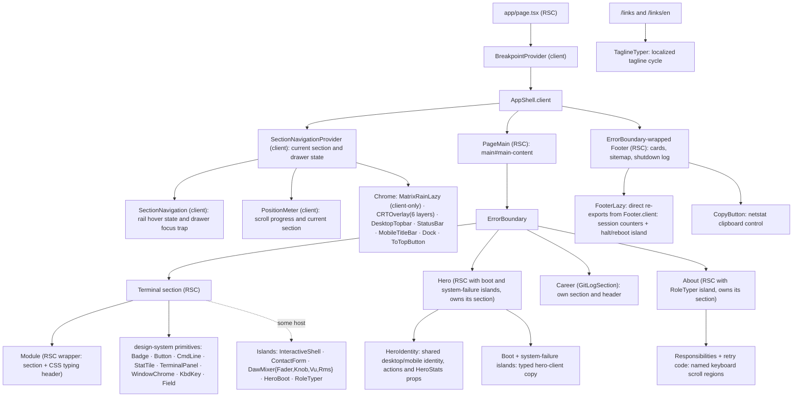
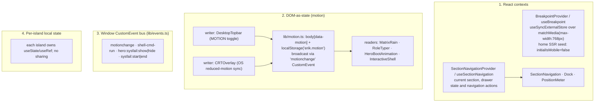

# Components & State

> Component hierarchy, the section/island/primitive taxonomy, the design system, the CSS/token architecture, and the (deliberately minimal) state model.

## Component taxonomy

Four directories, four roles. The directory tells you the layer:

| Directory                     | Role                            | Ships JS?                                 | Example                                         |
| ----------------------------- | ------------------------------- | ----------------------------------------- | ----------------------------------------------- |
| `components/sections/**`      | Page sections and nested groups | RSC, with client descendants where needed | `About`, `ManPageSection`                       |
| `components/client/**`        | Interactive islands             | Yes                                       | `InteractiveShell`, `ContactForm`, `DawMixer/*` |
| `components/responsive/**`    | Viewport chrome                 | Yes (except `Module`)                     | `MatrixRain`, `Dock`, `CRTOverlay`              |
| `design-system/components/**` | Reusable primitives             | Mostly No (RSC)                           | `Badge`, `Button`, `TerminalPanel`              |

`check-client-naming.mjs` accepts `*.client.tsx`/`*.client.ts`, files inside a `/client/` directory, and App Router error convention files. Inspect the client directive and imports when tracing a boundary. Components commonly use a `Foo/` directory and `index.ts` barrel. Vitest tests use `*.test.tsx`; component Playwright specs use `*.e2e.ts`. `*Lazy` files are `next/dynamic` wrappers (`ContactFormLazy`, `InteractiveShellLazy`, `MatrixRainLazy` in `responsive/MatrixRain/`, consumed by `AppShell.client`), except `FooterLazy.client.tsx`, a plain re-export of the footer's session-counter and halt/reboot islands (no dynamic import is used there).

The naming gate scans `app`, `components` and `lib`; `/client/` is an explicit directory-based exception.

The Hero identity line is static server-rendered text. Desktop and mobile share `HeroIdentity`, with metrics and accessible labels passed into `HeroStats`. Boot and system-failure islands import their copy from `content/hero-client.ts`, keeping server content validation out of those client imports. The About "Open to [role] roles" status line mounts the `RoleTyper` client island (`components/client/RoleTyper`), which cycles Senior, Staff and Principal over the server-rendered text. `About` contains Whoami, Now, Responsibilities, Stack and retry-code panels. Career (`sec-git-log`) owns the `cert/*`, `edu/*` and `community/*` tag groups; community content comes from `content/community.ts`.

Barrels beside `ContactFormLazy`, `InteractiveShellLazy` and `MatrixRainLazy` export only the lazy wrapper. Tests import the real component directly, keeping it out of the initial client references.

## Component hierarchy

### The `Module` wrapper

`components/responsive/Module/Module.tsx` (RSC) wraps terminal modules. Hero, About, Career and Footer render separately. It renders a `<section id tabIndex={-1} aria-labelledby>` containing a non-interactive `<header>` with an `<h2>`; there is no collapse affordance on any viewport. Props: `id`, `header`, `mobileHeader?`, `srLabel?`, `name?`, `icon?`, `defer?`, `variant?: 'green'`. The `defer` prop still drives `content-visibility` deferral via `data-cv-defer`/`module-deferred`. `content/section-labels.ts` supplies readable labels. It derives registry labels and adds supporting module labels.

Module headers use CSS scroll-driven typing with a stepped text reveal and caret. The caret blinks four times, then stays solid. Unsupported browsers, OS reduced motion and the MOTION toggle show static text. The text remains in the DOM and accessibility tree; no client JavaScript is added. `html` and `body` use `overflow-x: clip` so the view timeline follows page scrolling.

### CRT overlay layering

`CRTOverlay.client.tsx` renders 6 fixed, `aria-hidden`, `pointer-events:none` overlay divs, z-stacked in `crt.css`: vignette (1) · scanlines (2) · RGB sub-pixel mask (3) · noise (4) · flicker (5) · scan beam (6). `MatrixRain` sits at z-0, `<main>` at z-10. All of it disables under `prefers-reduced-motion: reduce` **and** `body[data-motion="reduce"]`, and freezes during the system-failure overlay (`html.sysfail-on`).

## The design system

Nine primitives in `design-system/components/`; **eight exported** from `design-system/index.ts` (`Field` uses a direct import in `ContactForm` and the docs). The docs also provide the client `CopyButton` under `app/design-system/_components/`.

| Primitive       | Type       | Variant surface                                                                |
| --------------- | ---------- | ------------------------------------------------------------------------------ |
| `Badge`         | RSC        | `variant: default｜dot`, `size: sm｜md`                                        |
| `Button`        | RSC        | polymorphic `as: button｜a`, `variant: primary｜secondary`, `size: sm｜md｜lg` |
| `CmdLine`       | RSC        | terminal command line (`user`, `command`, `output`, `prompt`)                  |
| `Field`         | **client** | input/textarea + label + error/ARIA (not exported)                             |
| `KbdKey`        | RSC        | `size: sm｜md`                                                                 |
| `NavItem`       | RSC        | navigation link with `current` state and decorative `index`                    |
| `StatTile`      | RSC        | `<dl>` stat tile, `variant: default｜compact｜display`                         |
| `TerminalPanel` | RSC        | bordered container, polymorphic `as`, optional header                          |
| `WindowChrome`  | RSC        | macOS traffic-light dots, `size` px                                            |

`design-system/lib/cx.ts` joins truthy class names. Several primitives use `lib/cn.ts`, which imports `clsx`; neither helper uses `tailwind-merge`. The **DS docs site** (`app/design-system/**`) is MDX; `_lib/theme-tokens.ts` parses `app/css/theme.css` with the _same regex_ as `scripts/contrast-check.mjs`, to read the same token declarations. Changes to either parser still need checking. The changelog page is git-generated by `scripts/sync-changelog.ts` (`pnpm changelog:sync`).

## CSS / token architecture

Import order (`app/globals.css`): `tailwindcss` → `theme.css` → `base.css` → `crt.css` → `animations.css` → `components.css`. Tailwind v4 via the single `@tailwindcss/postcss` plugin. No CSS modules, no Style Dictionary.

| File             | `@layer`     | Holds                                                                                                                              |
| ---------------- | ------------ | ---------------------------------------------------------------------------------------------------------------------------------- |
| `theme.css`      | `@theme`     | The token system (below)                                                                                                           |
| `base.css`       | `base`       | resets, focus-visible rings, skip-link, `.sr-only`, the `#sec-*` mobile-order map, `.mobile-only`/`.desktop-only`                  |
| `crt.css`        | `components` | the 6 CRT classes + keyframes + reduced-motion disables                                                                            |
| `animations.css` | -            | section keyframes (`boot-blink`, `dmesg-reveal`, `guitar-scan-beam`, `hero-shake-*`, ...)                                          |
| `components.css` | `components` | named layout and effect classes (`.module-*`, `.signal-glow`, DawMixer `.mx-fader`/`.mx-dial`, `.contact-*`, `.shell-cursor`, ...) |

**Tokens (`@theme`):** six ordinal color families (primary/secondary/tertiary/quaternary/quinary/senary), each a 50 to 900 ramp, with the brand palette mapped onto specific stops: `--color-primary-500: #00ff41` (signal green), `--color-secondary-950: #000000` (surface black), `--color-tertiary-50: #e6ffe6` (body text). Fixed-opacity stops (`-subtle` 40%, `-border` 20%, `-faint` 12%, `-quiet` 10%) are kept as explicit hex (byte-identical, no `color-mix`). **No raw hex outside `theme.css`** - enforced by `lint:css-tokens` (see doc 06/07).

## State architecture

This is a near-static site; the state model is intentionally tiny. Four mechanisms, in order of how much you'll touch them:

**There is no global store, no `useReducer`, and no URL/`searchParams` state.** The only router read in the entire app is `usePathname()` in the design-system `Sidebar.client.tsx`. Section navigation shares React state through `SectionNavigationProvider`. Other cross-island coordination uses window `CustomEvent`s. For example, `InteractiveShell` dispatches `shell-cmd-run` and the `Footer.client` session counter listens to increment a counter, with no shared parent state.

### Per-island state, and the two rendering disciplines

Islands fall into two camps, and the split is a deliberate INP strategy:
- **Render _through_ React (rAF-coalesced state):** `InteractiveShell` - the streamed `/api/ask` answer lands in an isolated `streamingText` state flushed once per `requestAnimationFrame`. This is the one place per-token updates go through React, and coalescing limits component state updates to animation frames. A dedicated span displays the text, but the state belongs to `InteractiveShell`.
- **Mutate the DOM directly (no per-frame React state):** the Hero boot loop (`HeroBootAnimation` → `lib/boot-animation.ts`) and `RoleTyper` use `node.textContent =` typewriter mutation with `setTimeout`, **never** per-character `useState`. The DAW faders/knobs/VU meters update `style`/`setAttribute`/`className` directly on drag. `FaderDbIsland` and `VuMeter` hold no React state at all.

Keep animation and drag updates off per-character React state. Streaming text is the exception: `InteractiveShell` coalesces React state updates with requestAnimationFrame. See its behavioral tests and doc 09.

Other islands hold ordinary local state: `ContactForm` (controlled fields + a `idle→submitting→success｜queued｜error` status machine + honeypot), `ToTopButton` (`visible` on scroll>400), `StatusBar` and the `Footer.client` uptime counter (interval clocks with `visibilitychange` pause), the `Footer.client` halt clock (visitor time captured once after mount), `RmsButtons` (`Set<string>` toggle group), `CopyButton` (transient "COPIED").
