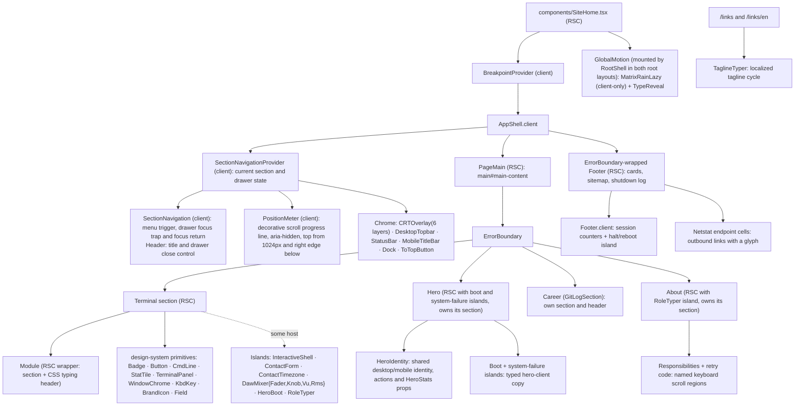
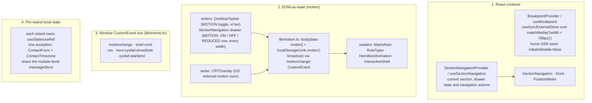

# Components & State

> Component hierarchy, the section/island/primitive taxonomy, the design system, the CSS/token architecture, and the (deliberately minimal) state model.

## Component taxonomy

Four directories, four roles. The directory tells you the layer:

| Directory                     | Role                            | Ships JS?                                 | Example                                                            |
| ----------------------------- | ------------------------------- | ----------------------------------------- | ------------------------------------------------------------------ |
| `components/sections/**`      | Page sections and nested groups | RSC, with client descendants where needed | `About`, `ProjectsSection`                                         |
| `components/client/**`        | Interactive islands             | Yes                                       | `InteractiveShell`, `ContactForm`, `ContactTimezone`, `DawMixer/*` |
| `components/responsive/**`    | Viewport chrome                 | Yes (except `Module`)                     | `MatrixRain`, `Dock`, `CRTOverlay`                                 |
| `design-system/components/**` | Reusable primitives             | Mostly No (RSC)                           | `Badge`, `Button`, `TerminalPanel`                                 |

`check-client-naming.mjs` accepts `*.client.tsx`/`*.client.ts`, files inside a `/client/` directory, and App Router error convention files. Inspect the client directive and imports when tracing a boundary. Components commonly use a `Foo/` directory and `index.ts` barrel. Vitest tests use `*.test.tsx`; component Playwright specs use `*.e2e.ts`. `*Lazy` files are code-split wrappers: `ContactFormLazy`, `InteractiveShellLazy` and `ContactTimezoneLazy` use `React.lazy` through `LazyIsland`, and `MatrixRainLazy` in `responsive/MatrixRain/` uses `next/dynamic` with `ssr: false` (consumed by `GlobalMotion` from the root layout).

The naming gate scans `app`, `components` and `lib`; `/client/` is an explicit directory-based exception.

`components/CompanyLink` renders every employer link: through `components/ExternalLink` (the shared `target="_blank"` and `rel="noopener noreferrer"` pair; `externalLinkProps(external)` spreads the pair onto a `Button` or a conditional anchor), a new-tab disclosure from `content/company-link.ts`, chosen by the required `locale` prop (an `sr-only` suffix, or `aria-describedby` to one shared note where the link sits inside a `data-type-reveal` heading, whose clip is sized from its text), a persistent underline and a 28px (`--spacing-target-compact`) hit area drawn by the `.company-link::before` pseudo-element. The hit area stays that small because the links sit inside dense inline text, where a 44px zone would cover the neighbouring lines and take their taps. `CompanyMention` links the company name inside an existing sentence and throws when the sentence stops naming it.

`components/Panel` is the `.ab-panel` frame (marker, `h3` title, optional action) shared by About and Contact; `as` picks `div`, `section` or `aside`, and `titleId` names the landmark. `components/PageMain` owns `MAIN_CONTENT_ID` and renders every `main#main-content` (home, reading views, error pages); `className` swaps its layout class. `components/reading/ReadingSection` and `ReadingActions` hold the section heading and the hire, secondary and print row that `/cv` and `/summary` share. `lib/defer-props.ts` returns the `module-deferred` class and `data-cv-defer` marker for a deferred section. `lib/json-ld.ts` `serializeJsonLd` escapes `<`, U+2028 and U+2029 so a value cannot end the script element it sits in.

`links-thumb` frames every `/links` video cover at 16:9 with the image filling the frame (no crop). The cover is grayscale under a multiplied signal-green layer from the `--links-thumb-*` tokens; hover or focus on the parent link restores the cover colour, and reduced motion removes the transition. Documented with a live example in the design system components page.

The Hero identity line is static server-rendered text. Desktop and mobile share `HeroIdentity`, with metrics and accessible labels passed into `HeroStats`. Boot and system-failure islands import their copy from `content/hero-client.ts`, keeping server content validation out of those client imports. The About "Open to [role] roles" status line mounts the `RoleTyper` client island (`components/client/RoleTyper`), which types the single role `Senior` over the server-rendered text. `About` contains Whoami, Now, Responsibilities, Stack and retry-code panels. Career (`sec-git-log`) owns the `cert/*`, `edu/*` and `community/*` tag groups; community content comes from `content/community.ts`.

Barrels beside `ContactFormLazy`, `InteractiveShellLazy` and `MatrixRainLazy` export only the lazy wrapper. `ContactTimezoneLazy` differs: it mounts on an intersection trigger, and its barrel also exports the server-rendered `ContactTimezoneStatic` that the lazy wrapper takes as its fallback. Tests import the real component directly, keeping it out of the initial client references. All three lazy wrappers render through `LazyIsland` (`ErrorBoundary` around `Suspense`), so a chunk that fails to load shows the fallback instead of a permanent loading state. A crashed island keeps its box: `ContactFormLazy` and `InteractiveShellLazy` pass a `minHeight` (named constants) that the default fallback applies as `--eb-min-height`, `ContactTimezoneLazy` keeps its server-rendered panel inside the `.ctz-host` that reserves the height, and the decorative CRT overlay in `AppShell` and Matrix rain in `GlobalMotion` use `fallback={null}` so a crash renders nothing. `useAskStream`, `AnimatedPlaceholder` and `ResponseReference` hold the shell's request, placeholder loop and reference copy. The pending answer shows an elapsed `[ thinking 1.2s ]` line, a block caret and `[ Esc ] stop` (Escape is handled on the shell wrapper only); failures print as `ask: <status>` stderr lines with a local fallback, a 429 with `Retry-After` becomes an ASCII countdown, and 15s of silence ends the request with a `[ RETRY ]` button. `OfflineNotice` (in `AppShell`) fills a fixed `role=status` region while the browser is offline; `TerminalChromeBar` renders the shell and contact header.

## Component hierarchy

### The section drawer

The section menu is a modal drawer at every width. It opens from the icon-only menu trigger (`Open menu`) or the dock `MENU` control, keeps Tab inside the panel, and closes on Escape, the close control or the scrim. Closing it returns focus to the control that opened it. A viewport change can stop that control from being rendered (the dock is `display: none` from 1024px), and focusing an element in a `display: none` subtree is a no-op. In that case the drawer falls back to the first rendered menu trigger. Focus always lands on a control the visitor can see.

### The `Module` wrapper

`components/responsive/Module/Module.tsx` (RSC) wraps terminal modules. Hero, About, Career and Footer render separately. It renders a `<section id tabIndex={-1} aria-labelledby>` containing a non-interactive `<header>` with an `<h2>`; there is no collapse affordance on any viewport. The `<h2>` reads the section name, the icon and the typed command; every module passes `name`. Props: `id`, `header`, `mobileHeader?`, `srLabel?`, `name?`, `icon?`, `defer?`, `variant?: 'green'`. The `defer` prop still drives `content-visibility` deferral via `data-cv-defer`/`module-deferred`. `content/section-labels.ts` supplies readable labels. It derives the registry labels and adds the scroll region labels.

Module headers use CSS scroll-driven typing with a stepped text reveal and caret. The caret blinks four times, then stays solid. Unsupported browsers, OS reduced motion and the MOTION toggle show static text. The text remains in the DOM and accessibility tree; no client JavaScript is added. `html` and `body` use `overflow-x: clip` so the view timeline follows page scrolling.

### CRT overlay layering

`CRTOverlay.client.tsx` renders 6 fixed, `aria-hidden`, `pointer-events:none` overlay divs, z-stacked in `crt.css`: vignette (1) · scanlines (2) · RGB sub-pixel mask (3) · noise (4) · flicker (5) · scan beam (6). `MatrixRain` sits at z-0, `<main>` at z-10. All of it disables under `prefers-reduced-motion: reduce` **and** `body[data-motion="reduce"]`, and freezes during the system-failure overlay (`html.sysfail-on`).

## The design system

Ten primitives in `design-system/components/`; **eight exported** from `design-system/index.ts` (`Field` uses a direct import in `ContactForm` and the docs; `BrandIcon` is imported by path, because a barrel export kept its path data in the client chunks of seven routes and pushed `/` past the first-load budget). The docs also provide the client `CopyButton` under `app/(en)/design-system/_components/`.

| Primitive       | Type       | Variant surface                                                                |
| --------------- | ---------- | ------------------------------------------------------------------------------ |
| `Badge`         | RSC        | `variant: default｜dot`, `size: sm｜md`                                        |
| `BrandIcon`     | RSC        | inline SVG brand mark, `size` px wide, `currentColor` fill, `aria-hidden`      |
| `Button`        | RSC        | polymorphic `as: button｜a`, `variant: primary｜secondary`, `size: sm｜md｜lg` |
| `CmdLine`       | RSC        | terminal command line (`user`, `command`, `output`, `prompt`)                  |
| `Field`         | **client** | input/textarea + label + error/ARIA (not exported)                             |
| `KbdKey`        | RSC        | `size: sm｜md`                                                                 |
| `NavItem`       | RSC        | navigation link with `current` state and decorative `index`                    |
| `StatTile`      | RSC        | `<dl>` stat tile, `variant: default｜compact｜display`                         |
| `TerminalPanel` | RSC        | bordered container, polymorphic `as`, optional header                          |
| `WindowChrome`  | RSC        | macOS traffic-light dots for panel headers, `size` px                          |

`design-system/lib/cx.ts` joins truthy class names. Several primitives use `lib/cn.ts`, which imports `clsx`; neither helper uses `tailwind-merge`. The **DS docs site** (`app/(en)/design-system/**`) is MDX; `_lib/theme-tokens.ts` parses `app/css/theme.css` with the _same regex_ as `scripts/contrast-check.mjs`, to read the same token declarations. Changes to either parser still need checking. The changelog page is git-generated by `scripts/sync-changelog.ts` (`pnpm changelog:sync`).

## CSS / token architecture

Import order (`app/globals.css`): `tailwindcss` → `theme.css` → `base.css` → `crt.css` → `animations.css` → `components-*.css` (20 flat partials, imported in the original cascade order). That `@import` order is the cascade order, and it is the only place it is recorded: the stylesheet-reading test helper (`__tests__/helpers/components-css.ts`) derives the partial order from these `@import` lines rather than sorting filenames, so a stylesheet assertion sees the same cascade the browser resolves. Tailwind v4 via the single `@tailwindcss/postcss` plugin. No CSS modules, no Style Dictionary.

| File               | `@layer`     | Holds                                                                                                                              |
| ------------------ | ------------ | ---------------------------------------------------------------------------------------------------------------------------------- |
| `theme.css`        | `@theme`     | The token system (below)                                                                                                           |
| `base.css`         | `base`       | resets, focus-visible rings, skip-link, `.sr-only`, the `#sec-*` mobile-order map, `.mobile-only`/`.desktop-only`                  |
| `crt.css`          | `components` | the 6 CRT classes + keyframes + reduced-motion disables                                                                            |
| `animations.css`   | -            | section keyframes (`boot-blink`, `dmesg-reveal`, `guitar-scan-beam`, `hero-shake-*`, ...)                                          |
| `components-*.css` | `components` | named layout and effect classes (`.module-*`, `.signal-glow`, DawMixer `.mx-fader`/`.mx-dial`, `.contact-*`, `.shell-cursor`, ...) |

**Tokens (`@theme`):** six ordinal color families (primary/secondary/tertiary/quaternary/quinary/senary), each a 50 to 900 ramp, with the brand palette mapped onto specific stops: `--color-primary-500: #00ff41` (signal green), `--color-secondary-950: #000000` (surface black), `--color-tertiary-50: #e6ffe6` (body text). Fixed-opacity stops (`-subtle` 40%, `-border` 20%, `-faint` 12%, `-quiet` 10%) are kept as explicit hex (byte-identical, no `color-mix`). **No raw hex outside `theme.css`** - enforced by `lint:css-tokens` (see doc 06/07).

## State architecture

This is a near-static site; the state model is intentionally tiny. Four mechanisms, in order of how much you'll touch them:

**There is no state-management library, no `useReducer`, and no URL/`searchParams` state.** The router reads in the app are `usePathname()` in the design-system `Sidebar.client.tsx`, in `DesktopTopbar` (which marks the current page in the site navigation) and in the global `TypeReveal` (mounted on every route by `GlobalMotion`). Section navigation shares React state through `SectionNavigationProvider`. Other cross-island coordination uses window `CustomEvent`s. For example, `InteractiveShell` dispatches `shell-cmd-run` and the `Footer.client` session counter listens to increment a counter, with no shared parent state.

### Per-island state, and the two rendering disciplines

Islands fall into two camps, and the split is a deliberate INP strategy:
- **Render _through_ React (rAF-coalesced state):** `InteractiveShell` - the streamed `/api/ask` answer lands in an isolated `streamingText` state flushed once per `requestAnimationFrame`. This is the one place per-token updates go through React, and coalescing limits component state updates to animation frames. A dedicated span displays the text, but the state belongs to `InteractiveShell`.
- **Mutate the DOM directly (no per-frame React state):** the Hero boot loop (`HeroBootAnimation` → `lib/boot-animation.ts`) and `RoleTyper` use `node.textContent =` typewriter mutation with `setTimeout`, **never** per-character `useState`. The DAW faders/knobs/VU meters update `style`/`setAttribute`/`className` directly on drag. `FaderDbIsland` and `VuMeter` hold no React state at all.

Keep animation and drag updates off per-character React state. Streaming text is the exception: `InteractiveShell` coalesces React state updates with requestAnimationFrame. See its behavioral tests and doc 09.

Other islands hold ordinary local state: `ContactForm` (a `idle→submitting→success｜queued｜error` status machine + honeypot, read out through one polite `role="status"` line that says waiting, sending, which fields are marked, or that the send failed; the message field is not local: it lives in `messageStore`, a module-level string store read with `useSyncExternalStore`, so `ContactTimezone` can append a proposed slot without prop drilling and typing re-renders only the form; the form resets the store after a delivered or queued send), `ContactTimezone` (the chosen zone, the proposed line, a boolean `useSyncExternalStore` read of whether that line is still in the message so the confirmation ends on a send or a deletion, and a `useNow` clock that ticks only while the panel is on screen and the tab is visible; the map, overlap and pin layout are memoised on the current minute), `ToTopButton` (`visible` on scroll>400), `StatusBar` and the `Footer.client` uptime counter (interval clocks with `visibilitychange` pause), the `Footer.client` halt clock (visitor time captured once after mount), `RmsButtons` (`Set<string>` toggle group), `CopyButton` (transient "COPIED").
