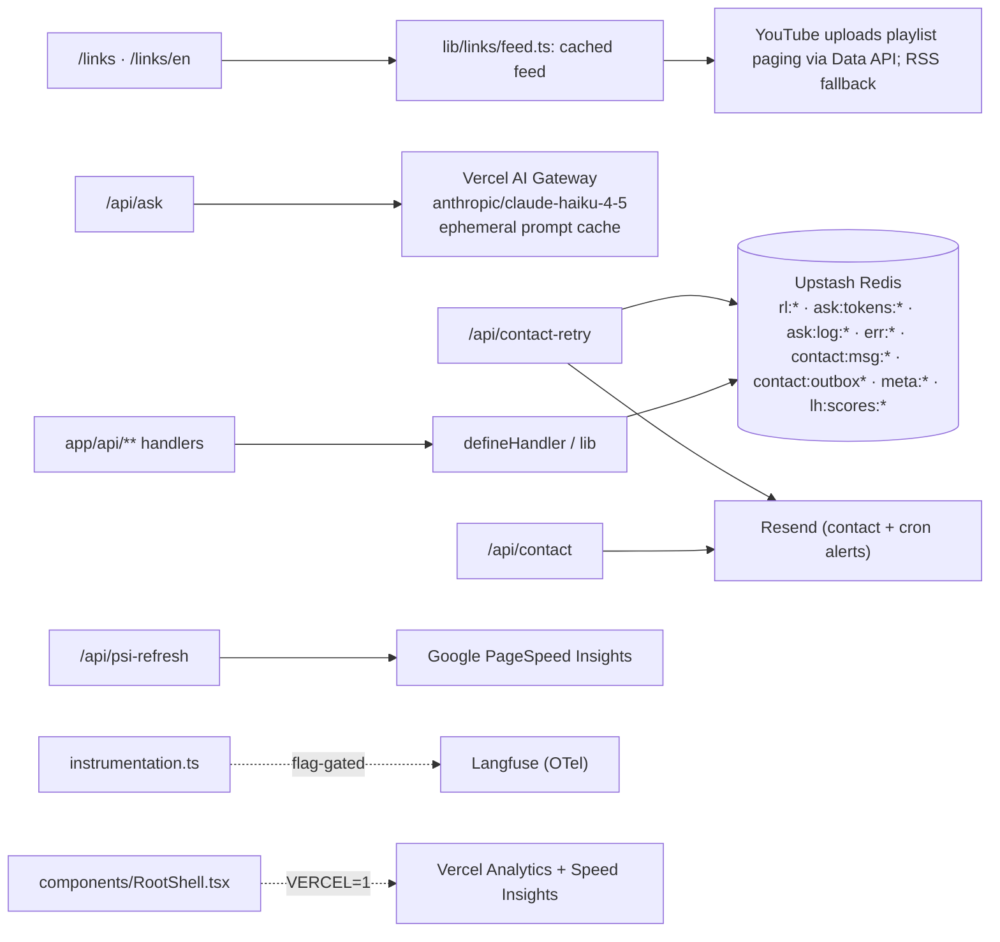

# API & Integrations

> The BFF layer: the `defineHandler` contract, every API route, the external integrations, and the security surface. For the request sequence diagrams see doc 03.

## The `defineHandler` envelope (`lib/server/route.ts`)

The shared API contract. Contact, error logging and log erasure use it. Streaming, cron, health, document and MCP routes use bespoke handlers.

```ts
export function defineHandler<TSchema extends ZodTypeAny>(
  opts: DefineHandlerOpts<TSchema>,
): (req: NextRequest) => Promise<Response>;
// opts: { schema, rateLimit, rateLimitErrorMessage?, handler }
// ctx passed to handler: { body, ip, ipHash, requestId, req }
```

**Enforced pipeline order (this ordering is the security property):**
1. `requestId = crypto.randomUUID()`. A request whose `Sec-Fetch-Site` is neither `same-origin` nor `none` is refused with `403 forbidden_origin` before anything else runs (`isCrossSiteRequest` in `lib/server/fetch-metadata.ts`): the routes parse any body as JSON, so a cross-site `text/plain` form post would otherwise spend a visitor's rate limit and write records. A request with no `Sec-Fetch-Site` header (curl, server calls) passes. Then `ipHash = clientRateLimitKey(req)`: the salted hash of the `getClientIp` bucket. If the salt cannot be resolved the request ends with `503 storage_unavailable` before the limiter or the body read.
2. **Rate-limit BEFORE body parse** - `rateLimit().limit(ipHash)`. On Redis throw: log and **fail-open** (allow). On `!success`: `429` with `Retry-After` in whole seconds (rounded up, at least 1) taken from the limiter's `reset`; no header when the limiter returns no usable reset. The shell turns the header into a countdown and invents no duration without it.
3. **Parse** `req.json()` → `400 invalid_json` on throw.
4. **Validate** `schema.safeParse(raw)` → `400 validation_failed` (with `issues`).
5. Call `handler(ctx)` with the `ipHash` from step 1. The context carries no raw IP.

**Envelope:** success `{ ok: true, requestId, data? }`; error `{ ok: false, requestId, error: { code, message, issues? } }`. Every response carries `X-Request-Id`. `ApiErrorCode ∈ { rate_limited, invalid_json, invalid_body, validation_failed, forbidden_origin, unauthorized, storage_unavailable }`; `withBodyLimit` also returns `payload_too_large` (HTTP 413) in the same envelope. The GET and cron routes (`/api/healthz`, `/api/lighthouse`, `/api/psi-refresh`, `/api/contact-retry`) return their 429 and 401 failures in this envelope too; their success bodies stay bare JSON. `/api/ask` answers its pre-stream failures as `{ error: string }`, which `useAskStream` and the MCP `ask_erik` tool parse.

Contact delivery also uses `202 { ok: false, requestId, error: { code: 'queued', message } }`. The message is saved under `contact:msg:<requestId>` for retry, but Resend has not accepted delivery; the daily `/api/contact-retry` cron tries it up to `CONTACT_MAX_RETRY_ATTEMPTS` times. `ContactForm` shows it as saved with delivery pending, its full ref, and LinkedIn for a faster reply. It never shows a server `error.message`: it maps `error.code` to locale copy (`contactErrorMessage` in `content/contact-rules.ts`, `rate_limited` to the rate-limit line, anything else to the generic retry line). A `200` carries the `requestId`, the same id stored as the message key and printed as `Ref:` in the email. The success state shows it as a receipt with `[COPY REF]` and `[FORGET MESSAGE]`, which POSTs it to `/api/log/forget`. ContactForm imports the Zod-free `content/contact-rules.ts`; `content/contact.ts` validates the copy table in `content/contact-copy.ts` with Zod for server consumers. Both share the LinkedIn URL from `content/social-urls.ts`.

## API route table

| Route                | Method     | Built on                        | What it does                                                                        | Auth/secret                  | Failure mode                                                                                                                                                                                                             |
| -------------------- | ---------- | ------------------------------- | ----------------------------------------------------------------------------------- | ---------------------------- | ------------------------------------------------------------------------------------------------------------------------------------------------------------------------------------------------------------------------ |
| `/api/ask`           | POST       | bespoke (streaming)             | LLM "ask Erik", `text/plain` stream                                                 | AI Gateway key/OIDC; Upstash | rate-limit and dedup fail-open (429 carries `Retry-After`); mid-stream errors → `STREAM_ERR_SENTINEL`; 30s/15s/1s timeouts; budget fail-closed                                                                           |
| `/api/contact`       | POST       | `defineHandler`                 | contact form → KV (90-day audit) → Resend                                           | `RESEND_API_KEY`             | honeypot → fake-200 with jitter; KV fail → 502 `storage_unavailable`; accepted → 200; provider error/10s timeout → outbox + 202 `queued`; outbox write failure or full outbox (200 pending) → stored message deleted, 502 `delivery_unavailable` |
| `/api/contact-retry` | GET (cron) | bespoke                         | retries pending contact messages, oldest first                                      | **`CRON_SECRET`** Bearer     | 401 for missing/wrong secret; counts in `data`; daily `0 4 * * *`; up to 3 retries within 7 days; each drop is logged with its reason                                                                                    |
| `/api/healthz`       | GET        | bespoke                         | health probe: SHA + PSI freshness                                                   | none                         | 200 fresh, **503 degraded** if `meta:psi-last-run` missing/stale(>25h); `no-store`                                                                                                                                       |
| `/api/psi-refresh`   | GET (cron) | bespoke                         | daily PSI refresh, writes freshness key                                             | **`CRON_SECRET`** Bearer     | 401 on bad secret; partial-fail still writes key; forced refresh retries HTTP 429/5xx (2 attempts, 500ms backoff) within the remaining time budget (`0 3 * * *`)                                                         |
| `/api/csp-report`    | POST       | none                            | CSP violation sink                                                                  | none                         | returns 204, body unread                                                                                                                                                                                                 |
| `/api/erik.json`     | GET        | exempt                          | machine-readable hiring profile                                                     | none                         | static-cached `public, max-age=86400`                                                                                                                                                                                    |
| `/api/lighthouse`    | GET        | bespoke                         | stored PSI metrics                                                                  | `PSI_API_KEY` (in lib)       | per-IP rate limit (429, fail-open); falls back to all-zero `LIGHTHOUSE_FALLBACK`                                                                                                                                         |
| `/api/log`           | POST       | `defineHandler`                 | client error capture → KV (7d TTL, stack cut to 4096 chars)                         | none                         | KV fail → 503; **no IP stored** (forget-exempt)                                                                                                                                                                          |
| `/api/log/forget`    | POST       | `defineHandler`                 | GDPR/LGPD erasure by `requestId`: ask logs, `contact:msg:<id>` and its outbox entry | none                         | deletes across 91 day-partitions (the 90-day TTL plus today); **never returns count** (existence-oracle prevention)                                                                                                                                            |
| `/api/mcp`           | POST       | `withRateLimit` + `withBodyLimit` + `mcp-handler` | read-only MCP server over stateless Streamable HTTP                                 | none                         | per-IP sliding window of 60 requests a minute on GET and POST, fail-open, `429 rate_limited` with `Retry-After`; POST bodies over 4096 bytes return 413 before parsing; subscriptions disabled; GET returns 405; `maxDuration=60`                                                                                                         |

`/api/contact-retry` returns `{ ok: true, requestId, data: { sent, failed, expired, exhausted } }` with a matching `X-Request-Id` header.

Every body-reading POST route reads its body only after the cross-site check and the rate limiter admit the request, through `readBoundedBody` (`lib/server/read-body.ts`), and answers `413 payload_too_large` past its cap. `defineHandler` takes the cap as `maxBodyBytes`, `/api/ask` reads inside its handler, and `/api/mcp` wraps `withBodyLimit` inside `withRateLimit`. The caps: 8192 bytes for `/api/ask`, 16384 for `/api/contact`, 32768 for `/api/log`, 1024 for `/api/log/forget` and 4096 for `/api/mcp`. `/api/csp-report` never reads its body, so it has no cap. Both cron routes check the `CRON_SECRET` bearer through `isCronAuthorized` (`lib/server/cron-auth.ts`), a constant-time digest comparison. The links feed sends the YouTube key in the `x-goog-api-key` header, never in the URL.

`/api/mcp` delegates GET and POST to `createMcpHandler`. POST has a 4096-byte body limit, and `maxSubscriptions: 0` configures stateless operation. Every request passes a per-IP limit (`getMcpLimit`, 60 a minute, fail-open) before the body is read, so `get_profile` is limited too. `ask_erik` additionally shares the ask limits and token budget.

`app/api/mcp/route.ts` wraps its POST in `withBodyLimit` (`lib/server/body-limit.ts`), which checks the declared `Content-Length` and buffers at most
`MAX_MCP_BODY_BYTES` (4096 bytes) before handing a bounded request to the
transport. Missing, invalid, or understated lengths cannot bypass the byte
count. An oversized stream is cancelled before JSON parsing. The limit fits
the largest tool argument: a 500-character `ask_erik` question using six-byte
JSON escapes, plus its JSON-RPC envelope. Accepted requests retain MCP
responses; size rejections use the shared error envelope with
`payload_too_large`, HTTP 413, and `X-Request-Id`. A body stream that fails
before it is fully read returns `invalid_body`, HTTP 400.

## Rate limits & token budget (`lib/rate-limit.ts`)

Upstash sliding-window factories (lazy singletons over `Redis.fromEnv()`):

| Key             | Limit                       | Used by                                                                                       |
| --------------- | --------------------------- | --------------------------------------------------------------------------------------------- |
| `rl:ask`        | 8 / 1h                      | `/api/ask`                                                                                    |
| `rl:contact`    | 3 / 10m                     | `/api/contact`                                                                                |
| `rl:healthz`    | 120 / 1m                    | `/api/healthz`                                                                                |
| `rl:lighthouse` | 30 / 1m                     | `/api/lighthouse`                                                                             |
| `rl:errlog`     | 10 / 1m                     | `/api/log`                                                                                    |
| `rl:errlog:day` | 500 / 1d fixed, all clients | `/api/log` (past it the route answers ok and drops the record; a failed check records anyway) |
| `rl:errlog:ipday` | 50 / 1d fixed, per client | `/api/log` (checked before the shared cap, so one client cannot spend the shared budget) |
| `rl:forget`     | 21 / 1h                     | `/api/log/forget` (one tab's full id list plus a contact receipt fit one window; `privacy forget --all` stops at the first 429 and prints the wait) |

`getClientIp` precedence: `x-forwarded-for[0]` → `x-real-ip` → `'unknown'` (local dev keys everything to `'unknown'`). The value becomes the rate-limit bucket: an IPv4 address stays as is, an IPv6 address is reduced to its `/64` prefix (a client owns a whole `/64`, so a per-address bucket resets at will), an IPv4-mapped IPv6 address becomes the IPv4 address, and a value that is not an IP address goes to `'unknown'`. No limiter sees that bucket: `clientRateLimitKey` (`lib/server/rate-limit-key.ts`) hashes it with the salt first, and every client limiter takes the branded `RateLimitIdentifier` only that helper returns, so a key reads `rl:<name>:<16 hex>`. The shared `/api/log` daily cap keeps its one fixed key inside `getErrorLogDailyLimit`.

**Token budget (the `/api/ask` cost cap):** `MONTHLY_TOKEN_BUDGET = 3,000,000`, key `ask:tokens:{yyyy-mm}` (32-day window), plus a daily slice of one twentieth of it (150,000 tokens), key `ask:tokens:day:{yyyy-mm-dd}` (2-day window), so one client cannot spend the month in a few days. `reserveBudget(maxOutput)` reserves `~2700` tokens up front on both keys (`INCRBY` + `EXPIRE NX`); rejects if either is over budget or Redis fails, returning the monthly reservation when the daily one is the one that fails, and warns at ≥80%. Both rejection cases return the existing `/api/ask` HTTP 503 `{ error: "AI answers are paused for this month. Email … instead." }` response before any model call. `settleBudget(...)` refunds the unused reservation on both keys from an `after()` callback, so it survives the end of the response; no positive reservation means no settlement. A stream that ends before its first token (client abort, timeout) keeps the input tokens charged and refunds the output share. A refused ask (rate limit, duplicate, budget) writes no `ask:log` row: it leaves an `ask refused` log line and adds to the per-day counter `ask:refused:{yyyy-mm-dd}:{status}`. `checkIdenticalQuestion(ipHash, q)` is a 60s `SET NX EX` dedup and remains fail-open, like rate limiting.

## Integrations



| Service                                          | Env vars                                                                                             | Role                                                                                                                                                                                        | Failure mode                                                                                                                                                                                                                                                                                                                                                                                                            |
| ------------------------------------------------ | ---------------------------------------------------------------------------------------------------- | ------------------------------------------------------------------------------------------------------------------------------------------------------------------------------------------- | ----------------------------------------------------------------------------------------------------------------------------------------------------------------------------------------------------------------------------------------------------------------------------------------------------------------------------------------------------------------------------------------------------------------------- |
| **Vercel AI Gateway** (`ai` SDK v7 `streamText`) | `AI_GATEWAY_API_KEY` or Vercel OIDC                                                                  | `/api/ask` LLM; model string `anthropic/claude-haiku-4-5`; ephemeral cache via `providerOptions.anthropic.cacheControl`; `maxOutputTokens=512`; `telemetry: { functionId: 'ask', recordInputs: false, recordOutputs: false }` | errors throw from `textStream` → sentinel; layered timeouts                                                                                                                                                                                                                                                                                                                                                             |
| **Upstash Redis**                                | `UPSTASH_REDIS_REST_URL/TOKEN` or `KV_REST_API_URL/TOKEN` (`Redis.fromEnv()`, `hasRedisCredentials`) | stateful keys: rate limits, budgets, logs, contact audit and outbox, PSI freshness, LH cache                                                                                                | rate limiting and dedup fail open; budget reservation fails closed with 503; contact audit/outbox writes fail closed with 502                                                                                                                                                                                                                                                                                           |
| **Resend**                                       | `RESEND_API_KEY`                                                                                     | contact delivery shared by submission and retry via `lib/contact-delivery.ts`; PSI cron failure alerts                                                                                      | contact errors, missing key and 10s timeout → 202 `queued` after outbox persistence; only acceptance returns 200                                                                                                                                                                                                                                                                                                        |
| **YouTube RSS / Data API**                       | optional `YOUTUBE_API_KEY`                                                                           | cached latest videos (Shorts excluded), history and channel statistics for both link pages                                                                                                  | With a key the uploads playlist is paged (up to four pages of 50) until five regular videos are collected, then the RSS feed when the API cannot be read; without a key the feed is the newest 15 RSS entries alone, so a Shorts-heavy channel can leave a short history; Shorts are dropped by their `/shorts/` URL and, with a key, by a duration of 60 seconds or less; enrichment failure retains the listed videos |
| **Google PSI**                                   | `PSI_API_KEY`                                                                                        | live Lighthouse scores for the perf section                                                                                                                                                 | 8s req timeout → fallback; 45s cron timeout                                                                                                                                                                                                                                                                                                                                                                             |
| **Langfuse**                                     | `LANGFUSE_ENABLED` (exact `'true'`) + keys                                                           | flag-gated AI trace exporter: `@vercel/otel` tracer provider plus `LegacyOpenTelemetry` from `@ai-sdk/otel` registered once (no message bodies)                                                                                                                                            | inert unless `==='true'` (fail-closed); heavy imports behind dynamic `import()`                                                                                                                                                                                                                                                                                                                                         |
| **Vercel Cron**                                  | `CRON_SECRET` Bearer                                                                                 | daily PSI refresh at 03:00 UTC and contact retry at 04:00 UTC                                                                                                                               | 401 on missing/wrong secret; contact retries at most 3 times within 7 days                                                                                                                                                                                                                                                                                                                                              |
| **Vercel Analytics/Speed Insights**              | none                                                                                                 | web vitals                                                                                                                                                                                  | client SDK; gated on `VERCEL=1`                                                                                                                                                                                                                                                                                                                                                                                         |

## The AI subsystem (`lib/ask/**`)

| File                | Purpose                                                                                                                                                                                        |
| ------------------- | ---------------------------------------------------------------------------------------------------------------------------------------------------------------------------------------------- |
| `preflight.ts`      | `preflightAsk`: kill switch, cross-site check, rate limit, bounded parse, injection gate, duplicate check and budget reservation; returns the rejection `Response` or an `AskContext`                       |
| `stream.ts`         | `createAskStream`: the model call, the pump loop with its watchdog and guard, and budget settlement plus the log write; `app/api/ask/route.ts` only composes the two                           |
| `model.ts`          | `ASK_MODEL` single source of truth (route + eval import it)                                                                                                                                    |
| `system-prompt.ts`  | composes `SYSTEM_TEXT` from a hand-written narrative + **live `content/*` data** (stack lines, work authorization and targeting come from `content/ask-facts.ts`, which the eval fact sheet also reads), to share source data with the page; exports `PROMPT_VERSION = sha256(SYSTEM_TEXT)[:12]` (prompt fingerprint) |
| `prompt-version.ts` | sync `sha256Hex` (works in both the Node route and the tsx eval)                                                                                                                               |
| `injection.ts`      | `isInjectionAttempt` input reject (role tokens, ChatML delimiters, "ignore instructions"; quoted mentions pass); ReDoS-safe                                                                                                |
| `output-guard.ts`   | **Layer 1** streaming guard (per-chunk leak/runaway scan, abort→sentinel, cross-chunk-seam safe) + **Layer 2** post-hoc audit; both **fail-open**                                              |

The defense model for `/api/ask`: input `isInjectionAttempt` + a per-request unguessable 128-bit sentinel wrapping the user text ("data only") + an in-prompt non-disclosure instruction; output Layer-1 stream guard + Layer-2 audit. Egress guards are monitoring, not a guarantee: they catch verbatim and whitespace-reflowed prompt echoes, and a paraphrased or translated leak passes both layers. Paraphrase leakage is owned by the prompt-side controls. A Layer-1 abort is recorded as a finding in the persisted verdict and adds to the `ask:guard:{date}:{kind}` counter (`lib/ask/guard-count.ts`), as does every Layer-2 finding, so the rate is readable without grepping logs.

## Security surface

- **Per-request CSP + reporting → `proxy.ts`** (Next middleware). `script-src 'self' 'unsafe-inline'` (deliberately **nonce-less**: `/` is static-generated, so a nonce would break all inline RSC flight scripts per CSP-3); `frame-ancestors 'none'`, `object-src 'none'`, `form-action 'self'`; `report-to`/`report-uri /api/csp-report`; `connect-src` allows Vercel vitals but **excludes `api.anthropic.com`** (AI calls are server-side only). The dynamic `Reporting-Endpoints` header uses an absolute origin (Chrome ignores relative).
- **Static headers → `next.config.ts`** `headers()`: COOP `same-origin`, `X-Frame-Options: DENY`, `X-Content-Type-Options: nosniff`, `Referrer-Policy: strict-origin-when-cross-origin`, `Permissions-Policy` (camera/mic/geo off), HSTS preload. The split (per-request in proxy, static at config) is intentional.
- **Kill switch `ASK_ENABLED`:** off-keywords (`false｜0｜off｜no｜disabled`) → 503 with an email fallback. **Fails OFF** by design (a typo during a billing emergency must still disable). This is the inverse of Langfuse, which fails OFF on _enabling_.
- **IP hashing (`lib/ip-hash.ts`):** `SHA-256(ip + salt)[:16]`; salt from `DEPLOY_SALT` when set, else auto-generated 32-byte base64 in prod (`meta:deploy-salt`, SETNX), `'portfolio'` literal only in non-prod. The hash is the rate-limit key and the stored `ipHash`, so a salt change restarts every limiter window.
- **API review:** `.claude/rules/api-boundary.md` is the implementation guidance for API, rate-limit and proxy edits. No hook blocks a push on a review; the hard gates are the API behavioural tests, `pnpm lint:semgrep` and CodeQL.
