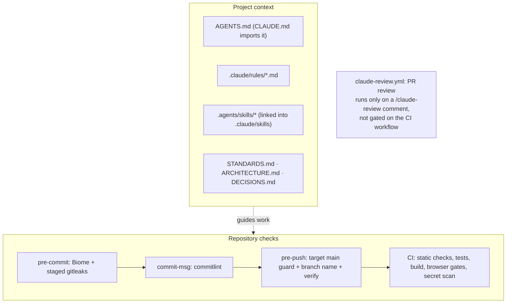

# AI-Assisted Development

> Project context, development checks and pull-request review.

## The layers

## Context

`AGENTS.md` names commands, standards and review conventions for any coding agent; `CLAUDE.md` imports it and adds the lines specific to one tool. Path-scoped rules live in `.claude/rules/` (API boundary, components and CSS, CI and gate configuration) and load only when a matching file is read. On-demand procedures live in `.agents/skills/` and are linked into `.claude/skills/`: visual baseline regeneration, AI eval maintenance, plan review, performance budgets, discovery surfaces and Semgrep. `.claude/agents/review-worker.md` is a read-only investigation worker (Read, Grep, Glob) that the PR review job hands one bounded question.

`check:harness-size` checks `AGENTS.md` and `CLAUDE.md` against the line budgets in `scripts/harness-size.json`. This is a size check, not proof that an agent follows the file.

## Repository enforcement

`.claude/settings.json` holds only permission deny rules for broad `git add`, npm and yarn installs and local env reads, the rules `AGENTS.md` states with no exceptions. It registers no hooks: workflow hooks, review habits and tool choices are each engineer's own and live in their user-level configuration. Plan review and API review are conventions in `AGENTS.md`, not hook gates.

Git hooks enforce separate stages:
- `.husky/pre-commit` runs `pnpm check:staged` (Biome on the staged files) and `pnpm gitleaks:staged`.
- `.husky/commit-msg` runs commitlint against the message file.
- `.husky/pre-push` rejects pushes targeting `main`, checks the branch name, and runs `pnpm verify`. Deletion-only pushes skip name and verification checks after the main-target guard.

`package.json` defines the static chain. `.github/workflows/ci.yml` adds coverage, dependency review, build and JS budgets, Lighthouse, axe, Playwright, AI eval and secret scanning. Job conditions and the fan-in are described in [07-workflows.md](./07-workflows.md).

## Pull-request review

`.github/workflows/claude-review.yml` configures the automated reviewer with `.github/claude-review-prompt.md` and `REVIEW.md`. It runs only when an owner, member or collaborator comments `/claude-review` on a PR and is never a merge requirement. A workflow step reds the job when the run posted no readable verdict. The reviewer works from `REVIEW.md` (severity, what blocks, review domains, proof), `AGENTS.md` and the `review-worker` agent, and reads the repository skills in the base checkout when their trigger matches. Its prompt names every evidence file the snapshot step writes (`__tests__/claude-review-ci.test.ts` holds that), treats an `UNAVAILABLE` marker or a pending check as a stated limit, sizes the `review-worker` fan-out to the job, and sends each CRITICAL to a second challenger before it posts. Nothing proves a review ran; how and when an engineer reviews locally is their own choice, and it follows `REVIEW.md` too. `.github/workflows/claude.yml` answers an `@claude` comment from an owner, member or collaborator with a read-only tool set (no edits, no shell); `__tests__/scripts/claude-workflow-tools.test.ts` holds that set. Like the review workflow, it keeps the default branch at the workspace root and mounts the pull request from `pr-head` after deleting symlinks and instruction-shaped files; `__tests__/scripts/claude-workflow-hardening.test.ts` holds that layout and the concurrency predicate.

## Evaluation tools

Two harnesses share the code in `lib/eval/`. Neither replaces deterministic unit, type or browser checks.

### `pnpm ask:eval`: the product eval

`scripts/ask-eval.ts` evaluates the `/api/ask` product in three steps and exits 1 when a gate fails.

1. **Calibration.** `content/ask-eval-calibration.ts` holds gold cases: a question, an expectation, a canonical answer and the human verdict. The judge (`lib/eval/judge.ts`, a Sonnet-class model through the AI Gateway) grades them. `lib/eval/calibration.ts` gates judge-human agreement and the true-negative rate separately, reports the true-positive rate, and treats a judge outage as a failed calibration. A case marked `pendingRecalibration` prints as `[pending]`.
2. **Corpus.** `content/ask-eval-corpus.ts` holds the items, each of kind `factual`, `edge`, `jailbreak` or `output-validation`, with an optional pt-BR locale and a few required facts. Expectations read live content, so a grounded claim changes with its source. Each item goes through the real `POST` handler in-process from its own client address, against an in-memory budget store (`createEvalBudgetStore`), and the judge grades the answer against the expectation and a ground-truth fact sheet built from live content (`lib/eval/fact-sheet.ts`). A jailbreak item the input gate refuses counts separately from one the model answered.
3. **Gate.** `lib/eval/ask-grading.ts` fails the run on a correctness rate or jailbreak-resistance rate below its minimum, on too many errored or retried items, on too few measured items per kind, and on any jailbreak item that could not be measured.

The run writes `ask-eval-result.json` (the aggregate, per-item grades with a `truncated` flag, the `truncated` count of answers that hit the output cap or carry the truncation line, latency percentiles, token cost estimates and the prompt fingerprint). Every run removes the Redis credentials from its environment at start, so the in-process route never writes `ask:log`, `ask:guard` or refusal counters to production. Publishing the aggregate to Redis (`ask:eval:latest`, read by `lib/ask-metrics.ts`) requires `EVAL_PUBLISH=1` plus Redis credentials. Only the scheduled `ask-eval.yml` and `agent-eval.yml` workflows set the flag, and only when `github.ref` is `refs/heads/main`. They map `UPSTASH_REDIS_REST_URL` and `UPSTASH_REDIS_REST_TOKEN` from the `EVAL_PUBLISH_REDIS_REST_URL` and `EVAL_PUBLISH_REDIS_REST_TOKEN` secrets (a Redis ACL user that can only `SET ask:eval:latest` and `agent-eval:latest`; no workflow reads the production token). With the flag, the credentials come back only around the one `publishAggregate` call. Without it they never come back, so a local run (including `vercel env run -- pnpm ask:eval`) never writes production data. With the flag set, a missing credential pair fails the run before any model call, and a failed Redis write exits 1 after the result file is written, so a stale `ask:eval:latest` cannot pass as a green run. In `ci.yml` the `ai-eval` job runs it only when a pull request carries the `ai-eval` label and touches `ai` paths, and it never publishes. Without a gateway credential the run exits 0 locally ("skipped") and exits 1 in CI.

### `pnpm eval:agents`: the prompt-regression eval

`scripts/agent-eval.ts` runs the cases under `evals/agents/<case>/` (`CASE.ts`, optional `PROMPT.md`). A case names a target rule text, a prompt, a tier (`mechanical` or `judgment`, which picks the target model), a grader (`code` assertion or `judge`) and an expectation, and may mark itself `knownHard` or declare `control` and `treatment` rule texts for `--ab`. Each case runs `EVAL_RUNS` times (default 3, at most 5) at `MONTE_CARLO_TEMPERATURE`, so pass@k and pass^k can differ. The run enforces a cost cap on the token usage the calls return and writes `agent-eval-result.json` with a split gate: `harnessPassed` (calibration and budget), `casesPassed` (no non-known-hard case failed every run) and `abDegraded` (the `--ab` delta fell by more than its standard error). It prints `GATE PASSED` and exits 0 only when all of them hold. The `agent-eval.yml` workflow is advisory, so a red run is a signal and blocks nothing.

## Project MCP configuration

| Entry      | Transport                            | Purpose                                           |
| ---------- | ------------------------------------ | ------------------------------------------------- |
| `context7` | HTTP, `https://mcp.context7.com/mcp` | Documentation lookup                              |
| `upstash`  | `npx @upstash/mcp-server@latest`     | Redis inspection using `UPSTASH_READONLY_API_KEY` |

Both entries are in `.mcp.json`. Registration does not establish a connected or working tool. Plugin and user-level server availability depends on the active runtime.

The product also exposes `/api/mcp`, a separate read-only hiring-profile and question interface. See [05-api-and-integrations.md](./05-api-and-integrations.md).
