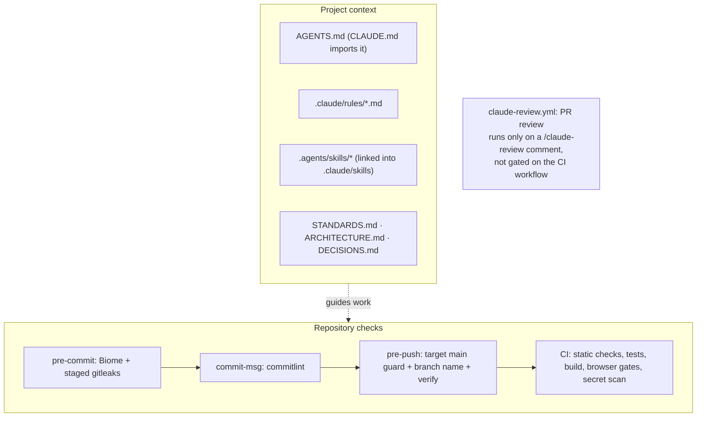

# AI-Assisted Development

> Project context, development checks and pull-request review.

## The layers

## Context

`AGENTS.md` names commands, standards and review conventions for Codex and Claude Code; `CLAUDE.md` imports it and adds the Claude-only lines. Path-scoped rules live in `.claude/rules/` (API boundary, components and CSS, CI and gate configuration). On-demand procedures live in `.agents/skills/` and are linked into `.claude/skills/`: visual baseline regeneration, AI eval maintenance, plan review, performance budgets, discovery surfaces, PR review and Semgrep.

`check:harness-size` checks `AGENTS.md` and `CLAUDE.md` against the line budgets in `scripts/harness-size.json`. This is a size check, not proof that an agent follows the file.

## Repository enforcement

`.claude/settings.json` holds only permission deny rules for broad `git add`, npm and yarn installs and local env reads, the rules `AGENTS.md` states with no exceptions. It registers no hooks: workflow hooks, review habits and tool choices are each engineer's own and live in their user-level configuration. Plan review and API review are conventions in `AGENTS.md`, not hook gates.

Git hooks enforce separate stages:
- `.husky/pre-commit` runs `pnpm check` and `pnpm gitleaks:staged`.
- `.husky/commit-msg` runs commitlint against the message file.
- `.husky/pre-push` rejects pushes targeting `main`, checks the branch name, and runs `pnpm verify`. Deletion-only pushes skip name and verification checks after the main-target guard.

`package.json` defines the static chain. `.github/workflows/ci.yml` adds coverage, dependency review, build and JS budgets, Lighthouse, axe, Playwright, AI eval and secret scanning. Job conditions and the fan-in are described in [07-workflows.md](./07-workflows.md).

## Pull-request review

`.github/workflows/claude-review.yml` configures the automated reviewer with `.github/claude-review-prompt.md` and `REVIEW.md`. It runs only when an owner, member or collaborator comments `/claude-review` on a PR and is never a merge requirement. A workflow step reds the job when the run posted no readable verdict. `pnpm pr:gate` checks review thread resolution and replies, and runs in `quality-fast`. Neither proves a local pre-PR review ran; how and when an engineer reviews locally is their own choice.

## Evaluation tools

`pnpm ask:eval` evaluates the `/api/ask` product with calibration, corpus cases and aggregate gates. Calibration gates judge agreement and the true-negative rate separately and reports the true-positive rate. It writes `ask-eval-result.json`; publishing the latest aggregate to Redis requires `EVAL_PUBLISH=1` plus Redis credentials, and only the scheduled `ask-eval.yml` and `agent-eval.yml` workflows set it. Every run removes the Redis credentials from its environment at start, so the in-process route never writes `ask:log`, `ask:guard` or refusal counters to production. With the flag set, the credentials come back only around the one `publishAggregate` call and are dropped again; without it they never come back, so a local run (including `vercel env run -- pnpm ask:eval`) never writes production data.

`pnpm eval:agents` evaluates platform prompts separately. Each run samples the target at `MONTE_CARLO_TEMPERATURE` (so pass@k and pass^k can differ), enforces the cost cap on the token usage the calls return, and writes `agent-eval-result.json` with a split gate: `harnessPassed` (calibration and budget), `casesPassed` (no non-known-hard case failed every run) and `abDegraded` (the `--ab` delta fell by more than its standard error). The run prints `GATE PASSED` and exits 0 only when all of them hold; the corresponding workflow is advisory, so a red run is a signal and blocks nothing. Neither command is a replacement for deterministic unit, type or browser checks.

## Project MCP configuration

| Entry      | Transport                            | Purpose                                           |
| ---------- | ------------------------------------ | ------------------------------------------------- |
| `context7` | HTTP, `https://mcp.context7.com/mcp` | Documentation lookup                              |
| `upstash`  | `npx @upstash/mcp-server@latest`     | Redis inspection using `UPSTASH_READONLY_API_KEY` |

Both entries are in `.mcp.json`. Registration does not establish a connected or working tool. Plugin and user-level server availability depends on the active runtime.

The product also exposes `/api/mcp`, a separate read-only hiring-profile and question interface. See [05-api-and-integrations.md](./05-api-and-integrations.md).
