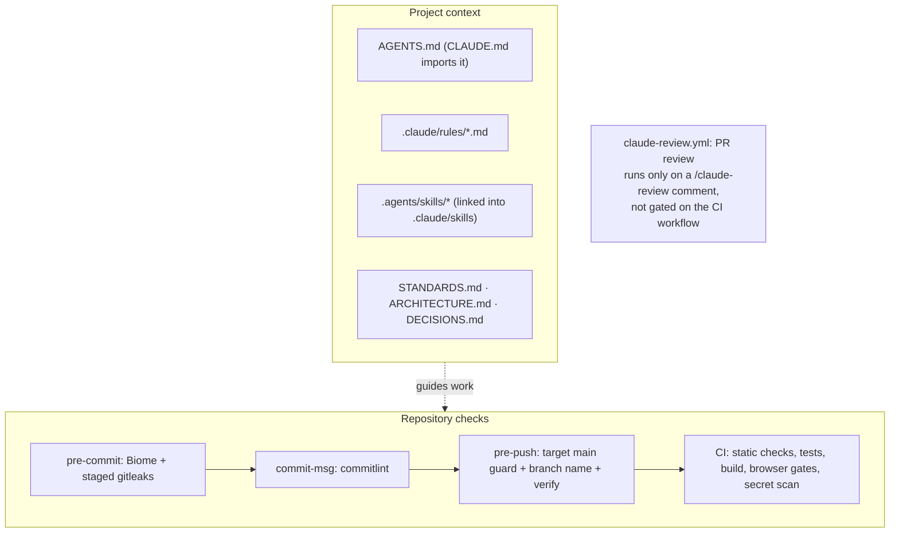

# AI-Assisted Development

> Project context, development checks and pull-request review.

## The layers

## Context

`AGENTS.md` names commands, standards and review conventions for Codex and Claude Code; `CLAUDE.md` imports it and adds the Claude-only lines. Path-scoped rules live in `.claude/rules/` (API boundary, components and CSS, CI and gate configuration). On-demand procedures live in `.agents/skills/` and are linked into `.claude/skills/`: visual baseline regeneration, AI eval maintenance, plan review, performance budgets, discovery surfaces, PR review and Semgrep.

`check:harness-size` checks `AGENTS.md` and `CLAUDE.md` against the line budgets in `scripts/harness-size.json`. This is a size check, not proof that an agent follows the file.

## Repository enforcement

The repository registers three Claude Code hooks, a `Stop` hook running `scripts/stop-verify.mjs` (Biome on changed files and the typecheck; skipped in CI), a `PreToolUse` hook running `scripts/guard-merge-main.mjs` (blocks `gh pr merge` when the PR base is `main` or unknown) and a `PreToolUse` hook running `scripts/guard-test-edits.mjs` (refuses edits to existing test files while `FIX_MODE=1` or `.claude/fix-mode` declares a fix task), and permission deny rules for broad `git add`, npm and yarn installs and local env reads. Plan review and API review are conventions in `AGENTS.md`, not hook gates. User-level runtime policies are configured outside this repository.

Git hooks enforce separate stages:
- `.husky/pre-commit` runs `pnpm check` and `pnpm gitleaks:staged`.
- `.husky/commit-msg` runs commitlint against the message file.
- `.husky/pre-push` rejects pushes targeting `main`, checks the branch name, and runs `pnpm verify`. Deletion-only pushes skip name and verification checks after the main-target guard.

`package.json` defines the static chain. `.github/workflows/ci.yml` adds coverage, dependency review, build and JS budgets, Lighthouse, axe, Playwright, AI eval and secret scanning. Job conditions and the fan-in are described in [07-workflows.md](./07-workflows.md).

## Pull-request review

`.github/workflows/claude-review.yml` configures the automated reviewer with `.github/claude-review-prompt.md` and `REVIEW.md`. It runs only when an owner, member or collaborator comments `/claude-review` on a PR and is never a merge requirement. `pnpm claude-gate` is an optional check of its approval against the current head. `pnpm pr:gate` checks review thread resolution and replies, and runs in the `pr-gate` workflow on PR updates and review events. These commands do not prove a local pre-PR review ran.

The pre-PR review procedure and the merge restriction are documented in `AGENTS.md`. For Claude Code, the `guard-merge-main` hook blocks an agent merge into `main` through `gh pr merge`, `gh api` and the GitHub MCP merge tool; other tools and merge paths rely on the written rule.

## Evaluation tools

`pnpm ask:eval` evaluates the `/api/ask` product with calibration, corpus cases and aggregate gates. It writes `ask-eval-result.json`; configured Upstash credentials allow publishing the latest aggregate.

`pnpm eval:agents` evaluates platform prompts separately. It writes `agent-eval-result.json`; the corresponding workflow is advisory. Neither command is a replacement for deterministic unit, type or browser checks.

## Project MCP configuration

| Entry      | Transport                            | Purpose                                           |
| ---------- | ------------------------------------ | ------------------------------------------------- |
| `context7` | HTTP, `https://mcp.context7.com/mcp` | Documentation lookup                              |
| `upstash`  | `npx @upstash/mcp-server@latest`     | Redis inspection using `UPSTASH_READONLY_API_KEY` |

Both entries are in `.mcp.json`. Registration does not establish a connected or working tool. Plugin and user-level server availability depends on the active runtime.

The product also exposes `/api/mcp`, a separate read-only hiring-profile and question interface. See [05-api-and-integrations.md](./05-api-and-integrations.md).
