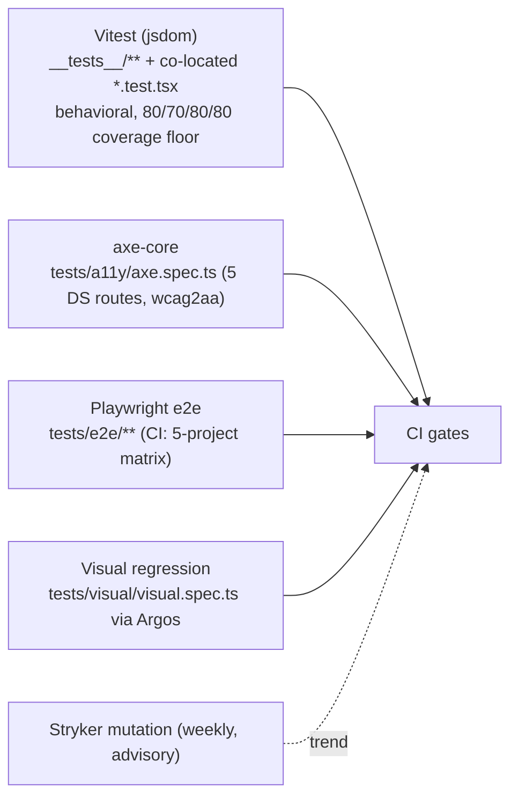
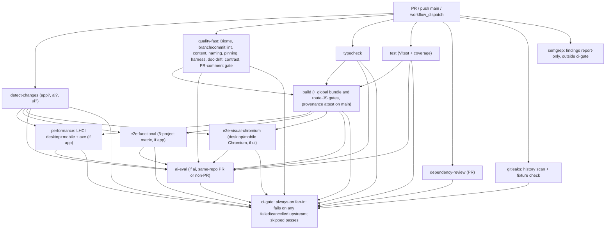

# Workflows

> Local development, build, testing, CI/CD, releases, and debugging - from scratch.

## Prerequisites

- Use `.nvmrc` for the local Node version. `package.json` accepts `^22.22.2 || ^24.15.0 || >=26.0.0`, requires pnpm 10+, and pins the package manager to `pnpm@10.15.0`.
- Install: `pnpm install` (CI uses `--frozen-lockfile`).
- For full local runs you'll want the env vars in `.env.example` (Upstash, AI Gateway, Resend, PSI). The public pages have fallbacks for missing services. API behavior differs: ask budget reservation requires Redis and fails closed; contact storage also fails closed. See doc 05 for individual failure modes.

## Local development

| Command                         | Purpose                                              |
| ------------------------------- | ---------------------------------------------------- |
| `pnpm dev`                      | Turbopack dev server                                 |
| `pnpm build`                    | production build (PPR)                               |
| `pnpm start`                    | serve the production build                           |
| `pnpm check` / `pnpm check:fix` | Biome lint + format                                  |
| `pnpm typecheck`                | `tsgo --noEmit` (strict, TypeScript native compiler) |

> **Gotcha:** `pnpm build` rewrites `next-env.d.ts`'s route-types import to the prod path; `pnpm dev` rewrites it back. Inspect any `next-env.d.ts` diff after switching build modes before deciding whether to keep it.

## The verify chain (the local CI mirror)

`pnpm verify` runs the full static gate chain (also the heart of pre-push):

```
check (Biome) -> typecheck -> validate-content -> check:client-naming -> check:dep-pinning
  -> check:harness-size -> check:section-order -> check:doc-drift
  -> check:detect-changes-paths -> lint:css-tokens -> test (Vitest)
```

`pnpm ci:local` == `pnpm verify`. `pnpm ci` == `verify + build + bundle-check + route-js-check`. Before opening a PR, also run `pnpm bundle-check`, `pnpm route-js-check`, and `pnpm gates:runtime`.

### The gate scripts (what each protects)

| Script                 | Enforces                                                                                         |
| ---------------------- | ------------------------------------------------------------------------------------------------ |
| `validate-content`     | every `content/*.ts` Zod schema parses (build gate)                                              |
| `check:client-naming`  | client directive files use `*.client.*`, a `/client/` directory, or an App Router error filename |
| `check:dep-pinning`    | no `latest`/`*`/tag deps                                                                         |
| `check:harness-size`   | `CLAUDE.md` ≤ 275 lines                                                                          |
| `check:section-order`  | section ids have mobile order rules or a listed nested-anchor exemption                          |
| `check:doc-drift`      | `ARCHITECTURE.md` directory-tree paths exist on disk                                             |
| `lint:css-tokens`      | no raw hex outside `app/css/theme.css`                                                           |
| `lint:contrast`        | documented text/surface pairs meet WCAG AA                                                       |
| `check:component-docs` | each DS component is documented                                                                  |
| `check:pkg-age`        | supply-chain: flags <7-day-old package versions                                                  |
| `bundle-check`         | global gzipped client chunks ≤ 220KB                                                             |
| `route-js-check`       | every manifest route ≤ 164.7KB total first-load JS; app-owned split reported                     |

## Testing



- **Unit (Vitest):** behavioral assertions only; a `no-source-grep` test bans `readFileSync`-style source-grep tests. Run `pnpm test` / `pnpm test:coverage` / `pnpm test:watch`.
- **a11y (axe-core):** zero-violation gate over the design-system routes, tags `wcag2a/2aa/21aa`.
- **e2e (Playwright):** CI selects a 5-project matrix (`chromium`, `chromium-mobile`, `webkit-desktop`, `webkit-mobile`, `chromium-components`). `playwright.config.ts` also defines mobile Chromium and desktop/mobile WebKit component projects. The DS component visual spec is darwin-only (CI ignores it on Ubuntu).
- **Visual regression:** Argos-backed snapshots of page sections; a color/layout/typography change requires regenerated baselines (see the `visual-baseline-regen` skill).
- **AI eval (`pnpm ask:eval`):** calibration → corpus → gate for `/api/ask` (doc 02). Gated in CI when `ai`-paths change.

## CI/CD

`.github/workflows/ci.yml` (the authoritative gate). A `detect-changes` job emits `app`, `ai` and `ui` booleans so heavy jobs skip on docs-only PRs (GitHub treats skipped required checks as satisfied). Matrix jobs skipped at job level report ONE unsuffixed check, so matrix-named required contexts (`e2e-functional (chromium)` etc.) hang forever on path-skipped PRs; required checks therefore point at always-reporting contexts and the conditional jobs are enforced through the `ci-gate` fan-in below.



`ci-gate` runs with `if: always()`, includes gitleaks and all build/test jobs above, and excludes semgrep, and is the terminal required status check. `__tests__/scripts/ci-gate-job.test.ts` asserts its `needs` list equals the full job set minus the self-reporting jobs, so adding a conditional job without fanning it in fails `pnpm test`.

Other workflows: `codeql.yml` (SAST, weekly + PR), `mutation.yml` (Stryker, weekly), `smoke.yml` (post-deploy: healthz + 7 security headers + apex→www + `/api/ask`,`/api/contact` liveness), `claude-review.yml` (pull-request review), `claude.yml` (`@claude` interaction), and `agent-eval.yml` (advisory prompt evaluation).

**Lighthouse budgets (LHCI, hard gates):** desktop perf ≥95 / a11y =100 / BP ≥95 / SEO =100, LCP ≤1800ms, CLS ≤0.05, TBT ≤200ms; mobile perf ≥90, LCP ≤3500ms. Never disable a gate to merge - fix the property (doc 08).

## The PR lifecycle

```
commit (scope blocks) -> (self-review the diff before opening the PR)
  -> pnpm ci:local + gates:runtime -> gh pr create (fill the template)
  -> resolve every review thread (rebase before each push) -> pnpm pr:gate
  -> repo owner runs gh pr merge (project policy; no agent hook enforces it)
```

Large features use an **integration branch + sub-PRs** (`feat/<feature>` ← `feat/<feature>-<part>`) to group independently reviewable changes. See `CLAUDE.md` "Working agreement".

## Releases & deployment

- **Platform:** Vercel (Fluid Compute, Node runtime) end-to-end. Push to `main` (via PR) deploys.
- **Cron:** `vercel.json` runs `/api/psi-refresh` at `0 3 * * *` and `/api/contact-retry` at `0 4 * * *`.
- **Post-deploy:** `smoke.yml` verifies the production deployment (healthz, headers, liveness) and emails on a 503.
- **Emergency rollback:** fast = `vercel promote <previous-url>` (30s, no code); slow = `git revert HEAD && git push --no-verify` (the `--no-verify` is the documented escape hatch for the main-push guard). Verify with `curl https://erikunha.dev/api/healthz | jq .sha`.

## Debugging

| Symptom                    | Where to look                                                                            |
| -------------------------- | ---------------------------------------------------------------------------------------- |
| `/api/healthz` 503         | `meta:psi-last-run` missing/stale (>25h) - the PSI cron failed; check `/api/psi-refresh` |
| `/api/ask` returns 503     | `ASK_ENABLED` off, or monthly token budget exhausted (`ask:tokens:{month}`)              |
| `/api/ask` stream cuts off | mid-stream 15s watchdog, or Layer-1 egress guard fired (`STREAM_ERR_SENTINEL`)           |
| Push blocked               | inspect the main-target guard, branch name or `pnpm verify` failure in `.husky/pre-push` |
| CLS / visual regression    | regenerate Argos baselines via the `visual-baseline-regen` skill                         |
| Client error in prod       | it was POSTed to `/api/log` (`err:{date}:{id}`, 30-day TTL) by `error-bridge.client.ts`  |

See `UI_PATHS`/`APP_PATHS` in `scripts/detect-changes-paths.mjs` for the current CI path filters.
