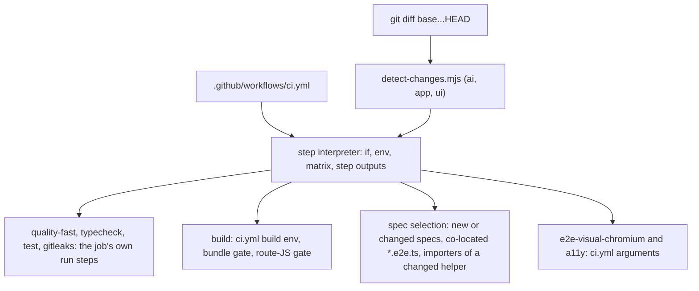
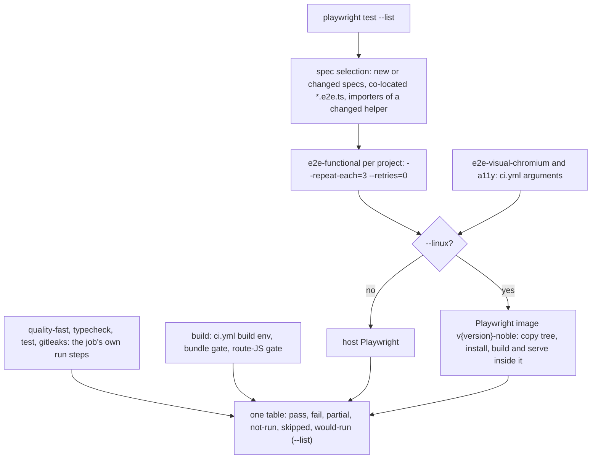
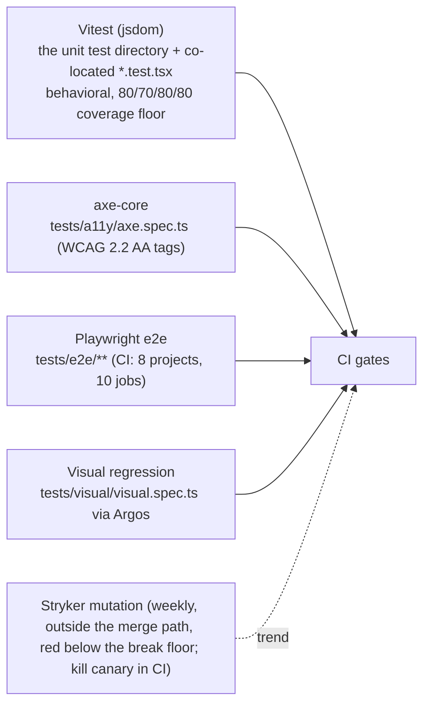
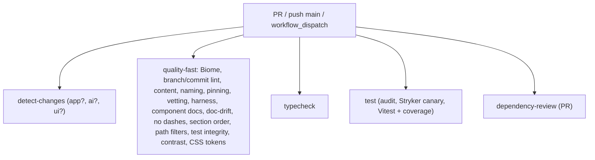
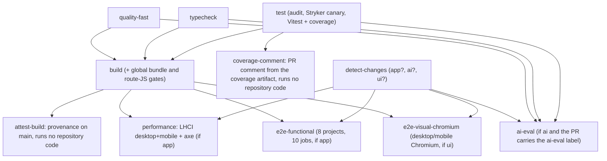
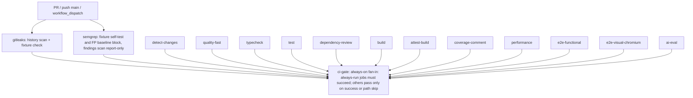
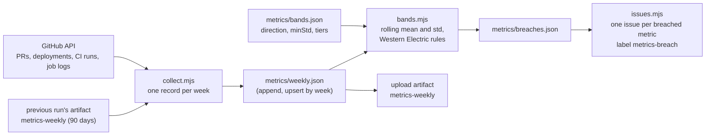
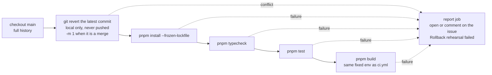

# Workflows

> Local development, build, testing, CI/CD, releases, and debugging - from scratch.

## Prerequisites

- Use `.nvmrc` for the local Node version. `package.json` accepts `^22.22.2 || ^24.15.0 || >=26.0.0`, requires pnpm 10+, and pins the package manager to `pnpm@10.34.9`.
- Install: `pnpm install` (CI uses `--frozen-lockfile`). Two lifecycle scripts run with it: `prepare` installs the Husky hooks through `scripts/prepare-hooks.mjs` (skipped when `CI`, `VERCEL` or `NODE_ENV=production` is set), and `postinstall` runs `scripts/strip-next-polyfills.mjs`, which empties Next's two legacy polyfill bundles in `node_modules` (the site targets modern browsers, and the Lighthouse Best Practices score counts that legacy JavaScript). It exits non-zero when the files are missing or have an unexpected shape.
- For full local runs you'll want the env vars in `.env.example` (Upstash, AI Gateway, Resend, PSI). The public pages have fallbacks for missing services. API behavior differs: ask budget reservation requires Redis and fails closed; contact storage also fails closed. See doc 05 for individual failure modes.

## Local development

| Command                         | Purpose                                              |
| ------------------------------- | ---------------------------------------------------- |
| `pnpm dev`                      | Turbopack dev server                                 |
| `pnpm build`                    | production build (PPR)                               |
| `pnpm start`                    | serve the production build                           |
| `pnpm check` / `pnpm check:fix` | Biome lint + format                                  |
| `pnpm typecheck`                | `tsgo --noEmit` (strict, TypeScript native compiler) |

> **Gotcha:** `pnpm build` rewrites `next-env.d.ts`'s route-types import to the prod path; `pnpm dev` rewrites it back. Inspect any `next-env.d.ts` diff after switching build modes before deciding whether to keep it.

## The verify chain (the local CI mirror)

`pnpm verify` runs the full static gate chain (also the heart of pre-push):

```
check (Biome, warnings fail) -> typecheck -> validate-content -> check:client-naming
  -> check:dep-pinning -> check:dependency-vetting -> check:harness-size -> check:component-docs
  -> check:section-order -> check:doc-drift -> check:no-dashes -> check:detect-changes-paths -> check:test-integrity
  -> lint:contrast -> lint:css-tokens -> test:coverage (Vitest with the coverage thresholds)
```

Two `quality-fast` steps stay CI-only: the branch-name lint (the pre-push hook enforces it) and the commit-message lint (the commit-msg hook).

`pnpm ci:local` == `pnpm verify`. `pnpm ci` == `verify + build + bundle-check + route-js-check`. Before opening a PR, also run `pnpm bundle-check`, `pnpm route-js-check`, and `pnpm gates:runtime`.

### The gate scripts (what each protects)

| Script                 | Enforces                                                                                         |
| ---------------------- | ------------------------------------------------------------------------------------------------ |
| `validate-content`     | every `content/*.ts` Zod schema parses (build gate)                                              |
| `check:client-naming`  | client directive files use `*.client.*`, a `/client/` directory, or an App Router error filename |
| `check:test-integrity` | no focused test, no test without an assertion, no skip without a reason                          |
| `check:dep-pinning`    | no `latest`/`*`/tag deps or open overrides                                                                       |
| `check:dependency-vetting` | every direct dependency has a purpose and license in `dependency-vetting.json`; the installed license matches it; an install script needs `pnpm.onlyBuiltDependencies` or `pnpm.ignoredBuiltDependencies` |
| `check:harness-size`   | `AGENTS.md` and `CLAUDE.md` within the line budgets in `scripts/harness-size.json`               |
| `check:section-order`  | no `#sec-*` rule reorders a section with CSS `order`, and every `#sec-*` selector matches a rendered id |
| `check:detect-changes-paths` | every git-tracked root file and `scripts/` file is listed in `AI_PATHS`, `APP_PATHS`, `UI_PATHS` or `IGNORED_PATHS`, so a new file cannot skip a gated job |
| `check:doc-drift`      | `ARCHITECTURE.md` directory-tree paths exist on disk                                             |
| `check:no-dashes`      | no tracked text file holds an em or en dash, apart from the `next dev` block in `AGENTS.md` |
| `lint:css-tokens`      | no raw hex or color function (`rgb`, `hsl`, `hwb`, `lab`, `lch`, `oklab`, `oklch`, `color()`) outside `app/css/theme.css` and the named allowlist, in `app/css` and `*-tokens.ts`; no literal `z-index` or `--z-*` declaration outside the scale in `theme.css` (stylesheets and `*.tsx`); no focus rule that writes its own ring instead of `--focus-ring` on `:focus-visible` |
| `lint:contrast`        | documented text/surface pairs meet WCAG AA                                                       |
| `check:component-docs` | each DS component is documented                                                                  |
| `bundle-check`         | global gzipped client chunks ≤ 220KB                                                             |
| `route-js-check`       | every manifest route ≤ 164.2KB total first-load JS; app-owned split reported                     |

`check:dependency-vetting` reads the installed `package.json` of each direct dependency (`dependencies`, `devDependencies`, `optionalDependencies`). It fails on a dependency with no entry, an entry for a package that left `package.json`, an entry with no purpose, an installed license that differs from the recorded one, and a `preinstall`, `install` or `postinstall` script on a package outside `pnpm.onlyBuiltDependencies`. A license change on upgrade therefore needs the recorded license updated, which is the re-vetting step. Vulnerabilities and GPL/AGPL licenses are not checked there: the `dependency-review` job already blocks high-severity advisories and `GPL-3.0`, `AGPL-3.0` and `GPL-2.0` on pull requests.

`check:section-order` runs both directions: no rule in `app/css` may reorder a section with the CSS `order` property, so the visual order always equals the DOM order, and every `#sec-*` selector in `app/css` must match an id some source renders, so a deleted section cannot leave dead rules behind.

## Predicting CI before a push

`pnpm ci:predict` (`scripts/ci-predict.ts`) runs locally what CI runs for the commits on the current branch against their base. It reads `.github/workflows/ci.yml` instead of copying it: job conditions, step commands, the build env and the e2e and visual project matrices all come from the workflow, and `detect-changes` runs the same `scripts/detect-changes.mjs` CI runs. A pure-TypeScript evaluator handles the workflow expressions the file uses (`needs.*`, `contains`, `endsWith`, `hashFiles` with globs, `&&`, `||`). It never reads an unknown context or key as empty: an expression root it does not populate, a function it does not implement, and a workflow, job or step key it does not execute (`container`, `services`, a new step field) throw, so the step is reported as not reproducible and the drift guard fails instead of the construct being skipped.

The predictor reads the diff and the workflow, then interprets the steps:



The selected specs, the Linux branch and the single result table:



| Flag | Effect |
| --- | --- |
| `--base <ref>` | Base to diff against. Default: the open PR's base (`gh`), else the nearest of `origin/main` and `origin/feat/*` (fewest commits ahead, printed with the alternatives); pass `--base` when that is not the branch you will merge into. The base branch is fetched first. |
| `--branch <name>` | Branch name CI would see. Needed on a detached HEAD. |
| `--linux` | Runs Playwright (e2e, visual, a11y) in a container from the official Linux image whose tag is the installed `@playwright/test` version. The container copies the working tree, installs dependencies (pnpm store kept in the `ci-predict-pnpm-store` volume), builds with the ci.yml env and serves the app on `localhost:3000` inside itself, so browser, fonts and server origin all match CI. Catches font and layout metric differences that a macOS run hides. The first run pulls the image (about 2.5 GB). |
| `--full` | Runs the whole e2e suite on every project, as CI does, instead of the selected specs. |
| `--eval` | Runs the live `ask:eval` when ai paths changed, as `npx -y vercel@<pin> env run -- ...` from the Vercel-linked checkout, so secrets reach the process and are never printed. Without it the exact command is printed. |
| `--skip-build` | Reuses the `.next` this command built. A stamp written after a successful build records the commit, the tracked edits (`git diff HEAD --binary`), the path and a content hash of every untracked file, and the build id, so editing an untracked file after the build invalidates it; if it does not match the current tree the build and every server started on it are reported `partial`, never `pass`. |
| `--keep-going` | Runs jobs whose `needs` failed (CI would skip them). |
| `--repeat <n>` | `--repeat-each` for the selected specs (default 3). |
| `--list` | Dry run: runs change detection only and prints what would run. Every other job is `would-run`, the last line is `DRY RUN`, and the exit code is 2. |

What each result means:

- **pass**, **fail**: every reproducible step ran, with the outcome.
- **partial**: the steps that ran passed but something did not: a step cannot run locally (Lighthouse, a `sudo` step, an expression or shell the predictor cannot evaluate, and the visual spec without `--linux`, because CI gates the Linux baselines and a macOS run compares different ones), or the e2e job ran only the changed specs while CI runs the whole suite (`--full` makes it a pass). Lighthouse scores depend on the host; `pnpm gates:runtime` still covers them.
- **not-run**: the job needs GitHub (`dependency-review`), is report-only (`semgrep`), has no changed spec on that project, its needs failed, or no step of it executed. Never read it as passed.
- **would-run**: dry run only; nothing was executed.
- **skipped**: the job's own `if` is false for this diff, exactly as in CI.

The last line and the exit code summarise the table.

- Exit 0 and `PREDICTED CI: no failure found` only when no job failed and every job passed or was skipped by paths. The GitHub-only and report-only jobs are listed beside it.
- Exit 1 and `PREDICTED CI: FAIL` when a job failed.
- Exit 2 and `DRY RUN` for `--list`.
- Exit 3 when nothing ran (`NOT VERIFIED, nothing ran`), when some job is `partial` or `not-run` (`no failure found in what ran. NOT VERIFIED: <jobs>`), or when the branch has no commits ahead of its base. That last case has nothing to predict, verifies nothing and never exits 0.

On Apple Silicon the container is arm64 while CI is x64, so pixel-level results can differ from CI: layout assertions such as the LCP element reproduce, but a screenshot diff in a section you did not touch is advisory. Check whether the diff is in your change before acting on it.

The e2e step narrows to new or changed specs, specs next to a changed component (`Hero.tsx` selects `Hero.e2e.ts`), specs that import a changed helper under `tests/`, and every spec when `playwright.config.ts` changes. Without `--linux` the predictor starts its own production server on a free port and passes it to Playwright as `E2E_BASE_URL`; it refuses to continue if that port already answers. A spec runs on every project Playwright lists it under (`playwright test --list`, with `CI=true` as in CI), so a Chromium-only pass cannot hide a WebKit failure. `--retries=0` with `--repeat-each` makes a test that passes only some of the time fail, which is what `failOnFlakyTests` does in CI. A change to app code with no matching spec runs no e2e; use `--full` for that. The server it starts must be the process it spawned: readiness fails when that process exits, and only counts when the process listening on the port descends from the spawned process (`pnpm start` starts `next-server` in its own process group, so ancestry, not group, is checked), so a stale server on a reused port cannot satisfy it. Stopping a server kills the spawned process and every descendant.

Steps run as a GitHub runner runs them: `bash -e -c` by default, `bash --noprofile --norc -eo pipefail` for `shell: bash`, `sh -e`, with `working-directory` and `defaults.run` honoured, workflow, job and step `env:` merged, and a failed `continue-on-error` step reported without failing the job. A shell other than bash or sh is not reproducible. A `sudo` step is run only as the local-binary substitution for a tool in the local list (gitleaks); any other `sudo` step is reported as not reproducible. Native runs blank every key named in the `.env*.local` files (key names only are read, values never) in the build, the server and the test processes, so the app cannot reach real Redis or Resend; `--linux` copies the tree without those files. The build, server, Playwright and `playwright --list` processes do not inherit the shell's environment: they get an allowlist (`PATH`, `HOME`, `TMPDIR`, locale, terminal, Docker and `PNPM_HOME` variables, and names starting `LC_`, `XDG_` or `PLAYWRIGHT_`; `allowedEnv` in `scripts/lib/ci-predict-process.ts`) plus the step's own `env:`, so a secret exported in the shell cannot reach them. A variable a CI step needs that is neither in its `env:` nor on the allowlist is missing locally; add its name to the allowlist. A `${{ secrets.X }}` reference reads as an empty string, and the job's row names every secret it read that way. A job's `env:` and step `env:` reach `docker exec` too, and the Linux session is rebuilt when the server env changes.

Child processes are tracked: on exit, `SIGINT`, `SIGTERM` or `SIGHUP` their process groups are killed and the `ci-predict-<pid>` container (labelled with its owner pid, started with `--rm`) is removed; the next `--linux` run removes containers whose owner is gone. A Linux session whose setup fails is removed before the error is reported, and a started server that has exited is never reused for a later job. Readiness requests and the free-port probe time out, so a server that accepts a connection and never answers fails at the readiness deadline. `--linux` on a machine that is not x64 prints that the container runs the machine's architecture, not CI's.

`scripts/__tests__/ci-predict.test.ts` fails when `ci.yml` gains a job or an action the predictor does not map, when a command in the `ci:local` chain is covered by no CI step, and when a `quality-fast` step is neither in the chain nor in the named CI-only list (`scripts/__tests__/ci-verify-parity.test.ts`).

## Testing



- **Unit (Vitest):** behavioral assertions only; a `no-source-grep` test bans `readFileSync`-style source-grep tests. Run `pnpm test` / `pnpm test:coverage` / `pnpm test:watch`.
  For effect-driven focus, await the focus assertion with `waitFor`; finding the element only establishes that it rendered.
- **a11y (axe-core):** `tests/a11y/axe.spec.ts` is a zero-violation gate over every design-system route, `/links`, `/links/en`, the four reading views and the home in both languages (design-system routes and reading views are also scanned at 390px, and so is the home), the open section drawer at 390px, the contact form error state (desktop and 390px), the open timezone combobox and the offline notice. A separate rule run checks WCAG 2.5.3 label-in-name on `/`, `/pt`, `/cv`, `/pt/cv`, `/summary` and `/links`. Every scan includes `wcag22aa`; page scans retain `wcag2a`, `wcag2aa` and `wcag21aa`, while contact errors retain `wcag2a` and `wcag2aa`. CI runs it in the `performance` job (`pnpm playwright test tests/a11y`), where only the `chromium` project matches it.
- **e2e (Playwright):** `playwright.config.ts` defines eight projects and CI runs every one in the `e2e-functional` matrix. webkit-desktop and webkit-mobile run as two shards each (`--shard=1/2` and `2/2`), since the full WebKit suite outgrew the 25-minute job limit; the other six run whole. `__tests__/scripts/e2e-matrix-coverage.test.ts` fails if a project or a shard is left out. The suite runs against `http://localhost:3000` unless `E2E_BASE_URL` points it at another server.

  | Project | Device | Specs it runs |
  | --- | --- | --- |
  | `chromium` | Desktop Chrome, 1280x720 | every spec under `tests/` (a11y, e2e, visual); CI ignores `design-system-components.spec.ts` |
  | `chromium-mobile` | iPhone SE profile on Chromium | the `CROSS_BROWSER_SPECS` list in the config, plus `tests/visual/visual.spec.ts` |
  | `webkit-desktop` | Desktop Safari, 1280x720 | `CROSS_BROWSER_SPECS` |
  | `webkit-mobile` | iPhone 14 | `CROSS_BROWSER_SPECS` |
  | `chromium-components`, `chromium-mobile-components`, `webkit-desktop-components`, `webkit-mobile-components` | the same four devices | co-located `*.e2e.ts` specs under `components/`, `design-system/components/` and `app/` (these projects set `testDir: '.'`) |

  The `e2e-functional` job runs `tests/e2e/` for the four page projects and the whole project for the four `-components` projects. A spec that needs a second browser engine or a phone viewport joins `CROSS_BROWSER_SPECS`; every other spec under `tests/e2e/` runs on `chromium` alone. The config sets `fullyParallel: false`, `forbidOnly` in CI, two workers in CI and one locally, `maxDiffPixelRatio: 0.01` for screenshot comparisons, and adds the Argos reporter when `ARGOS_TOKEN` is set.
  CI retries a failing test twice so a failure leaves a trace, and `failOnFlakyTests` fails the run when a test passed only on a retry, so a flake is fixed rather than hidden. A spec that reads streamed content navigates with `gotoSettled` (`tests/e2e/_helpers/streamed.ts`), which returns at `domcontentloaded`, waits until no Suspense boundary is pending and until every self-hosted font face has loaded (next/font's `local()` fallback faces are not waited on), so a subresource that never answers cannot hold it. Hydration is not implied at `domcontentloaded`, so a spec that interacts with a client island navigates with `gotoHydrated` (`tests/e2e/_helpers/hydration.ts`), which adds a wait on that control's hydration (`tests/e2e/streamed-settle.spec.ts`). Playwright records a trace on the first retry (`on-first-retry`), uploaded from `test-results/` with the failed job; `__tests__/scripts/playwright-flaky-policy.test.ts` holds the policy.
  `tests/e2e/aria-structure.spec.ts` (chromium only) holds the page outline: `toMatchAriaSnapshot` against `tests/e2e/aria-structure.spec.ts-snapshots/*.aria.yml` for `/`, `/cv`, `/links` and `/design-system`. Each template lists landmarks and heading levels with `children: contain` and regex names, so copy and growing lists do not break it; a missing, extra-level or reordered landmark or section heading does. Aria snapshot paths carry no platform or project suffix, so macOS and Linux share one file, and a second test asserts exactly one `h1` per page because `contain` cannot see an extra heading.
  Reading views, error states, no-JavaScript recovery and mobile reflow run in all four page-browser projects.
- **Visual regression:** `tests/visual/visual.spec.ts` captures the hero above the fold (desktop only), the contact section, the shell idle and mid-stream, the hottest-takes section and the footer, on `chromium` and `chromium-mobile`. Baselines live in `tests/visual/visual.spec.ts-snapshots/` with a `darwin` and a `linux` file per capture, and `argosScreenshot` sends each capture to Argos through the `captureForArgos` helper, which applies the baseline's volatile mask, CSS pixel scale and decorative-canvas stylesheet, so the cloud image and the repository image show the same page. On a pull request the job first waits, up to 20 minutes, for the visual jobs of the `main` run at the merge base to finish (`scripts/wait-argos-reference.mjs`): Argos compares a build against the build of the merge base, and a build uploaded before that one exists is compared against an older `main` build instead. `tests/e2e/design-system-components.spec.ts` keeps its own darwin-only baselines, and CI ignores it. A color, layout or typography change requires regenerated baselines (see the `visual-baseline-regen` skill); the `update_visual_baselines` input of the manual `ci.yml` run regenerates the Linux ones as an artifact.
- **AI eval (`pnpm ask:eval`):** calibration → corpus → gate for `/api/ask` (doc 02). Opt-in in CI: the `ai-eval` job runs only when a pull request carries the `ai-eval` label and touches `ai` paths; the weekly `ask-eval.yml` workflow runs it on `main`.

## CI/CD

`detect-changes` (`scripts/detect-changes.mjs`, with the path lists in `scripts/detect-changes-paths.mjs`) emits three booleans. On any event other than a pull request all three are true. On a pull request each is true when the diff touches its path list, and:

- `ai` is also true when the `ai` package major or any AI dependency version in `pnpm-lock.yaml` changed.
- `ui` is also true when the `browserslist` or `pnpm` section of `package.json` changed, and it excludes `lib/eval/**` and `lib/__tests__/**`.
- Changes under `tests/visual/` or `tests/e2e/` set both `app` and `ui`, so baseline-only and e2e-only PRs run the functional and visual jobs.

`.github/workflows/ci.yml` (the authoritative gate). A `detect-changes` job emits `app`, `ai` and `ui` booleans so heavy jobs skip on docs-only PRs (GitHub treats skipped required checks as satisfied). Matrix jobs skipped at job level report ONE unsuffixed check, so matrix-named required contexts (`e2e-functional (chromium)` etc.) hang forever on path-skipped PRs; required checks therefore point at always-reporting contexts and the conditional jobs are enforced through the `ci-gate` fan-in below.

The CI graph splits into three views: the trigger and the always-on jobs, the job graph the gates hang off, and the `ci-gate` fan-in.

The trigger fans out to change detection and to the always-on jobs:



The job graph: the build, the release attestation, the coverage comment and the path-gated jobs:



The fan-in: every job above, plus the always-on gitleaks and semgrep, reports into `ci-gate`. The nodes are the `ci.yml` job names; the table below carries their full descriptions.



| Job | Runs when | What it does |
| --- | --- | --- |
| `quality-fast` | always | branch-name lint, commit-message lint (PR), `biome ci --error-on-warnings`, `validate-content`, client-naming, dependency-pinning, dependency-vetting, harness-size, component-docs, doc-drift, no-dashes, section-order, detect-changes-paths, test-integrity, contrast, CSS-token gates |
| `typecheck` | always | `pnpm typecheck` with a cached `tsconfig.tsbuildinfo` |
| `test` | always | `pnpm audit --audit-level=moderate` (always on a push, only when `pnpm-lock.yaml` changed on a PR), the Stryker kill canary (always on a push, only when the mutation runner files changed on a PR), then `pnpm test:coverage` and the coverage artifact |
| `dependency-review` | PR | blocks high-severity advisories and `GPL-3.0`, `AGPL-3.0` and `GPL-2.0` licenses |
| `coverage-comment` | same-repository PR | posts the coverage report from the artifact; runs no repository code |
| `build` | after `quality-fast`, `typecheck` and `test` | `pnpm build` with fixed placeholder env, the global bundle gate (`--max-client-kb=220`), the per-route JS gate, then uploads `.next/` |
| `attest-build` | `main` | build provenance attestation for the uploaded `.next/`; runs no repository code |
| `performance` | push, or PR with `app` | preview server, `pnpm lhci`, `pnpm lhci:mobile`, then the axe scan |
| `e2e-functional` | push, or PR with `app` | the eight-project matrix, WebKit in two shards, described under Testing |
| `e2e-visual-chromium` | push, or PR with `ui` | `tests/visual/visual.spec.ts` on `chromium` and `chromium-mobile`; the manual run with `update_visual_baselines` regenerates and uploads baselines instead |
| `ai-eval` | `ai` and the pull request carries the `ai-eval` label, same-repository PR, not Dependabot, and no failed upstream job | `pnpm ask:eval` against the live gateway; it never publishes to Redis, and it spends Gateway credits, so it is opt-in. The weekly `ask-eval` workflow covers `main`, and the same workflow can be dispatched by hand on any branch |
| `semgrep` | always | fixture self-test and the false-positive baseline block; the findings scan is report-only and uploads SARIF |
| `gitleaks` | always | checksum-verified pinned binary, fixture self-test, history scan |
| `ci-gate` | always | fan-in over every job above |

`ci-gate` runs with `if: always()`, includes gitleaks, semgrep and all build/test jobs above, and is the terminal required status check. `__tests__/scripts/ci-gate-job.test.ts` asserts its `needs` list equals the full job set minus the self-reporting jobs, so adding a conditional job without fanning it in fails `pnpm test`.

Other workflows (none is in `ci-gate`):

| Workflow | Trigger | What it does |
| --- | --- | --- |
| `codeql.yml` | push and PR to `main`, Mondays 03:00 UTC, manual | CodeQL analysis of JavaScript and TypeScript with `.github/codeql/codeql-config.yml` |
| `mutation.yml` | Sundays 04:00 UTC, manual | Stryker mutation run; fails when the runner produced no report, cannot kill a mutant or scores under the `thresholds.break` floor in `stryker.config.mjs`, judged by `scripts/check-mutation-kills.mjs`; the score goes to the job summary |
| `ask-eval.yml` | Mondays 05:00 UTC, manual | `pnpm ask:eval`, so `ask:eval:latest` stays fresh for the Measured section. On `main` only, it sets `EVAL_PUBLISH=1` and maps the `EVAL_PUBLISH_REDIS_REST_URL` and `EVAL_PUBLISH_REDIS_REST_TOKEN` secrets (a Redis ACL user that can only `SET` the two eval keys) onto `UPSTASH_REDIS_REST_URL` and `UPSTASH_REDIS_REST_TOKEN`. A first step fails the run when either is empty, and the script exits 1 when the credentials are missing or the Redis write fails. A dispatch from another branch grades without publishing |
| `tool-pins.yml` | Mondays 05:00 UTC, manual | `scripts/check-tool-pins.mjs` fails when the pinned gitleaks or semgrep version is behind upstream; a nudge, not a merge stop |
| `agent-eval.yml` | Mondays 06:00 UTC, manual | `pnpm eval:agents`, advisory, publishes `agent-eval:latest` from `main` with the same restricted secrets; fails on empty secrets or a failed publish like `ask-eval.yml` |
| `rollback-rehearsal.yml` | Mondays 06:00 UTC, manual | weekly rollback rehearsal, below |
| `weekly-metrics.yml` | Mondays 07:00 UTC, manual | delivery metrics and band check, below |
| `lockfile-resolution-probe.yml` | Mondays 08:00 UTC, manual | resolves every dependency range without a lockfile and keeps one open issue while `ERR_PNPM_NO_MATURE_MATCHING_VERSION` blocks it |
| `high-risk-label.yml` | PR opened, synchronized, reopened | review-focus label, below |
| `smoke.yml` | a successful `Production` deployment status | post-deploy checks: artifact `/api/healthz`, canonical `/api/healthz`, 7 security headers, apex to www, `/api/ask` and `/api/contact` liveness; emails an alert through Resend on a 503 |
| `claude-review.yml` | a `/claude-review` PR comment from an owner, member or collaborator | pull-request review, never a merge requirement |
| `claude.yml` | an `@claude` comment from an owner, member or collaborator | read-only assistant |

**Dependabot:** `.github/dependabot.yml` waits 7 days (`cooldown.default-days`, the same window as `minimumReleaseAge` in `pnpm-workspace.yaml`) before opening a version update and splits npm and Actions updates into three groups: `security` (security updates), `majors` and `rest` (minor and patch). npm updates ignore `zod` major and minor bumps and `typescript` major bumps, the two holds in `AGENTS.md`. `__tests__/scripts/dependabot-config.test.ts` fails a cooldown shorter than the pnpm window.

**Token permissions:** every workflow sets a top-level `permissions` block of `contents: read` (`{}` for `smoke.yml` and `weekly-metrics.yml`), and each job lists only the extra scopes it uses. `attest-build` takes `id-token: write` + `attestations: write` for provenance, and `coverage-comment` takes `pull-requests: write`. Both run in jobs that only download an artifact and run no repository command (`__tests__/scripts/ci-privilege-split.test.ts` fails a job that holds one of those scopes and runs a command). `semgrep` takes `security-events: write` to upload SARIF. `claude-review` takes `pull-requests: write` + `issues: read` + `checks: read` + `statuses: read` + `id-token: write` + `actions: read`. `__tests__/scripts/workflow-permissions.test.ts` fails a workflow with no top-level block or a broader one (OpenSSF Scorecard Token-Permissions).

**Lighthouse budgets (LHCI, hard gates in the `performance` job):** desktop perf ≥95 / a11y =100 / BP ≥95 / SEO =100, LCP ≤1800ms, CLS ≤0.05, TBT ≤200ms, interactive ≤2500ms; mobile perf ≥90, LCP ≤3500ms, TBT ≤400ms, interactive ≤4500ms. `__tests__/lighthouse-budgets.test.ts` fails when an assertion is lowered, warned or turned off. `pnpm gates:runtime` (`scripts/gates-runtime.ts`) is the local subset: it builds (or reuses `.next/` with `--skip-build`), starts a server on `PORT` or a free port, runs LHCI on the home URL only and treats it as advisory, then runs `tests/a11y` and the `cross-cutting` and `observability-smoke` specs on `chromium` as blocking gates, all within a 300 second limit. Never disable a gate to merge - fix the property (doc 08).

Both desktop and mobile collect `/`, `/pt`, `/cv`, `/summary`, `/links`, `/links/en` and every design-system route listed in their configs. Run `pnpm lhci` and `pnpm lhci:mobile` against a production server.

### High-risk label

`high-risk-label.yml` runs on `pull_request` (opened, synchronize, reopened). It lists the PR's changed files through the API, passes them to `scripts/high-risk-paths.ts`, and adds the `high-risk` label when any file is on the list, or removes it once none is. A renamed file counts under both its old and new name. The label sends review attention to the surfaces with the widest blast radius: `app/api/`, `lib/server/`, `lib/rate-limit.ts`, `proxy.ts`, `lib/env.ts` and the other secret and env handling, `.github/workflows/`, `next.config.ts` and `vercel.json` (security headers), the dependency manifests (`package.json`, `pnpm-lock.yaml`), and the ask prompt and its guards (`lib/ask/`). The full list is `HIGH_RISK_PREFIXES` and `HIGH_RISK_FILES` in `scripts/high-risk-paths.ts`. It limits no PR size and blocks no merge, and it is not in `ci-gate`.

The job holds `pull-requests: write` and nothing else beyond `contents: read`; it runs no install, push or deploy, and every value it reads from the event goes through `env`. A fork PR and a Dependabot run get a read-only token, so the job skips them with a notice instead of failing. The label is created on first use when the token allows it; if it does not, the owner creates it once with `gh label create high-risk --color B60205`. `scripts/__tests__/high-risk-paths.test.ts` holds the list (every entry must exist on disk, so a rename cannot drop a surface silently) and `__tests__/scripts/high-risk-label-workflow.test.ts` holds the trigger, the token scope and the pinned actions.

### Weekly delivery metrics

`weekly-metrics.yml` runs Mondays 07:00 UTC and on manual dispatch. It measures how the delivery process behaved over the last complete week (Monday to Monday, UTC), compares each number with its own recent history, and opens a GitHub issue when a number leaves its band. No model is called. It is a signal for the owner, not a merge gate, and it blocks no PR.



| Metric | Source | Worse when |
| --- | --- | --- |
| `deploymentFrequency` | successful `Production` deployments (GitHub deployments API) | lower |
| `deploymentFailureRate` | share of decided `Production` deployments that failed | higher |
| `leadTimeHoursMedian` | first commit to merge, merged PRs by people | higher |
| `prCycleTimeHoursMedian` | PR opened to merged, merged PRs by people | higher |
| `ciMainFailureRate` | `ci.yml` runs on `main` pushes that ended `failure` over `success` plus `failure` | higher |
| `flakyPerE2eJob` | Playwright `N flaky` summary lines in `e2e-*` job logs, per job inspected | higher |

A merged PR counts whatever its base branch: a merge into an integration branch is a delivery event, and `main` receives few merges on its own. Bot-authored PRs count as merged but stay out of both timings. Each week is queried on its own (merged PRs, and `ci.yml` runs on `main` and in total) because the search and run-list APIs return at most 1000 results per query; a window that reaches 1000 results, or whose reported total exceeds what was fetched, fails the run.

Lighthouse LCP per route is not collected: LHCI uploads to `temporary-public-storage` and keeps no file, so the weekly record carries a `skipped.lighthouseLcp` reason. Storing it needs a `ci.yml` step that uploads `.lighthouseci`.

**Bands.** For each metric the latest week is scored against the mean and sample standard deviation of the up to 12 weeks before it (`minStd` floors the deviation so a flat history cannot turn a small move into an infinite score). Six weeks of history are needed first. The tiers follow the control-band loop: 1 sigma on the bad side is **log**, 2 sigma is **diagnose**, 3 sigma is **propose**. The Western Electric run rules lift a quiet-looking week, and each needs the latest point to be one of the counted points, so a metric that is back inside its band does not fire: 2 of the last 3 points beyond 2 sigma (diagnose), 4 of the last 5 beyond 1 sigma (log), or 8 in a row on the bad side (diagnose, so a sustained drift opens an issue). Only the bad side counts, so an improvement never opens an issue. A past week that scored diagnose or worse is left out of later baselines, so a second spike is judged against normal weeks; a lasting shift keeps reporting until the cause is fixed. Tiers, direction and floors live in `metrics/bands.json`; `validateBandsConfig` rejects a malformed file.

**Issues.** `issueFromTier` (default `diagnose`) sets the lowest tier that opens an issue. A breached metric gets one open issue labelled `metrics-breach`, found again through a hidden marker in its body; a repeat breach adds a comment instead of a second issue. Closing is manual, with the pull request that fixes the cause. Do not turn a metric into a target.

**Missing data.** The run fails instead of recording a quiet week when the data is incomplete: a PR search or run list that hit the 1000-result cap or reported more results than it returned, an earlier successful run whose history artifact cannot be downloaded or has no `metrics/weekly.json`, or a week whose e2e job logs all failed to download (an expired log, HTTP 404 or 410, is counted as `logsExpired` and is not a failure). Smaller gaps are annotated as `::warning::` in the run log: a metric with no value for the latest week, e2e logs that could not be downloaded or had no Playwright totals line (counted as `logErrors`, left out of the flaky rate), and a range with no finished `Production` deployment. A metric with too little history gets a `::notice::`.

**Requests.** Only reads (GET, HEAD and the read-only GraphQL query) are retried after a network error or a 5xx. A rate-limited request (HTTP 429, or 403 with `retry-after`) is replayed after the stated wait when that is 60 seconds or less, and otherwise fails naming the secondary rate limit.

**History.** The record is kept as the `metrics-weekly` artifact (90 days) and passed from one run to the next, so the workflow never pushes a branch and needs no write access to contents. The first run, when no earlier run succeeded, backfills 13 weeks from the API. A run after a gap collects the missing weeks. Locally, `node scripts/metrics/collect.mjs`, `bands.mjs` and `issues.mjs --dry-run` use `gh auth token` and write to the git-ignored `metrics/weekly.json`.

The token is read-only except `issues: write`. `__tests__/scripts/weekly-metrics-workflow.test.ts` fails if the permissions widen, a secret other than `GITHUB_TOKEN` appears, an action is not pinned to a SHA, or a `run:` script expands a context expression.

### Weekly rollback rehearsal

`rollback-rehearsal.yml` runs Mondays 06:00 UTC and on manual dispatch. It proves the slow rollback path (`git revert HEAD`) still produces a tree that installs, typechecks, passes its tests and builds. It is read-only toward production: it never pushes, never calls Vercel and holds no Vercel token. The fast path (`vercel promote`) is a platform action and is not rehearsed here.



A revert conflict or any failed step fails the `rehearse` job. The `report` job then opens one issue titled "Rollback rehearsal failed", or comments on the open one. Only that job holds `issues: write`. `__tests__/rollback-rehearsal-workflow.test.ts` fails if the triggers widen, the top-level token exceeds `contents: read`, a step pushes or touches Vercel, an action is not pinned to a SHA, or the revert, install, typecheck, test and build steps leave that order.

## The PR lifecycle

```
commit (scope blocks) -> (read the diff before opening the PR)
  -> pnpm ci:local + gates:runtime -> gh pr create (fill the template)
  -> review the pull request (answer every finding, rebase before each push)
  -> merge once CI is green and the base is contained
```

Large features use an **integration branch + sub-PRs** (`feat/<feature>` ← `feat/<feature>-<part>`) to group independently reviewable changes. See `AGENTS.md` "Git and pull requests".

## Releases & deployment

- **Platform:** Vercel (Fluid Compute, Node runtime) end-to-end. Push to `main` (via PR) deploys.
- **Cron:** `vercel.json` runs `/api/psi-refresh` at `0 3 * * *` and `/api/contact-retry` at `0 4 * * *` and `0 16 * * *`.
- **Post-deploy:** `smoke.yml` verifies the production deployment (healthz, headers, liveness) and emails on a 503.
- **Emergency rollback:** fast = `vercel promote <previous-url>` (30s, no code); slow = `git revert HEAD && git push --no-verify` (the `--no-verify` is the documented escape hatch for the main-push guard). Verify with `curl https://erikunha.dev/api/healthz | jq .sha`.
- **Rollback rehearsal:** `rollback-rehearsal.yml` proves the slow path still works. See "Weekly rollback rehearsal" under CI/CD.

## Debugging

| Symptom                    | Where to look                                                                            |
| -------------------------- | ---------------------------------------------------------------------------------------- |
| `/api/healthz` 503         | `meta:psi-last-run` missing/stale (>25h) - the PSI cron failed; check `/api/psi-refresh` |
| `/api/ask` returns 503     | `ASK_ENABLED` off, a spent month or day spend budget, or Redis down                      |
| `/api/ask` stream cuts off | 15s watchdog, Layer-1 egress guard or provider failure (`STREAM_ERR_SENTINEL`)           |
| Push blocked               | inspect the main-target guard, branch name or `pnpm verify` failure in `.husky/pre-push` |
| CLS / visual regression    | regenerate Argos baselines via the `visual-baseline-regen` skill                         |
| Client error in prod       | it was POSTed to `/api/log` (`err:{date}:{id}`, 7-day TTL) by `error-bridge.client.ts`  |
| Contact message stuck      | `contact:outbox` holds ids waiting for the `/api/contact-retry` cron (04:00 and 16:00 UTC); a 202 `queued` response put it there |
| A gated job skipped on a PR | `detect-changes` found no path in its list; read `scripts/detect-changes-paths.mjs` |
| `ask:eval` red in CI       | the gate failure code printed by the run (`lib/eval/ask-grading.ts`); the artifact `ask-eval-result` holds every graded item |

See `UI_PATHS`/`APP_PATHS` in `scripts/detect-changes-paths.mjs` for the current CI path filters. Every git-tracked root file and `scripts/` file must be in `AI_PATHS`, `APP_PATHS`, `UI_PATHS` or `IGNORED_PATHS`; `check:detect-changes-paths` fails otherwise, so a new file cannot skip the gated jobs.
