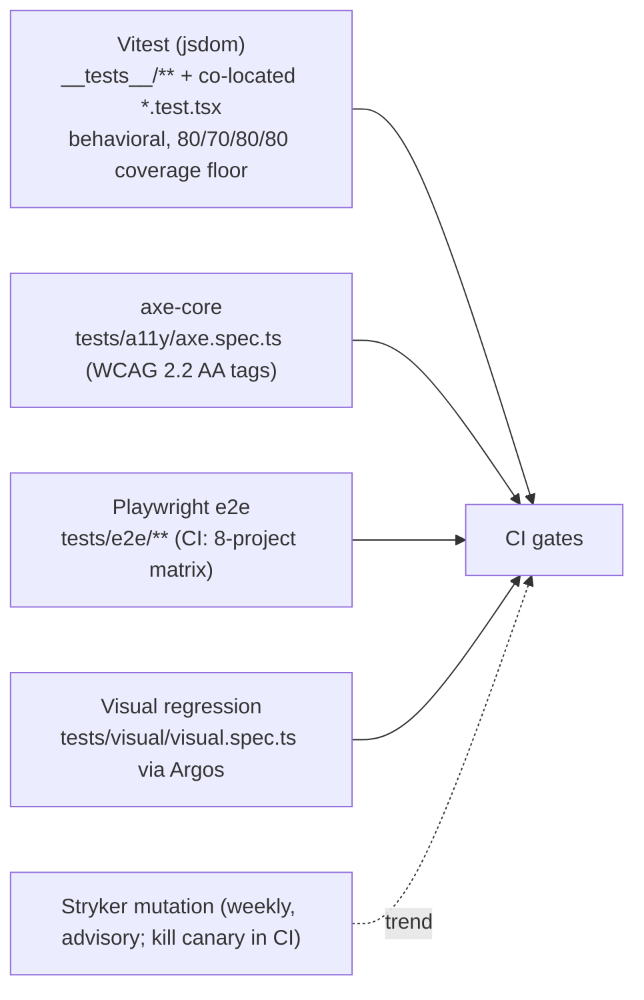
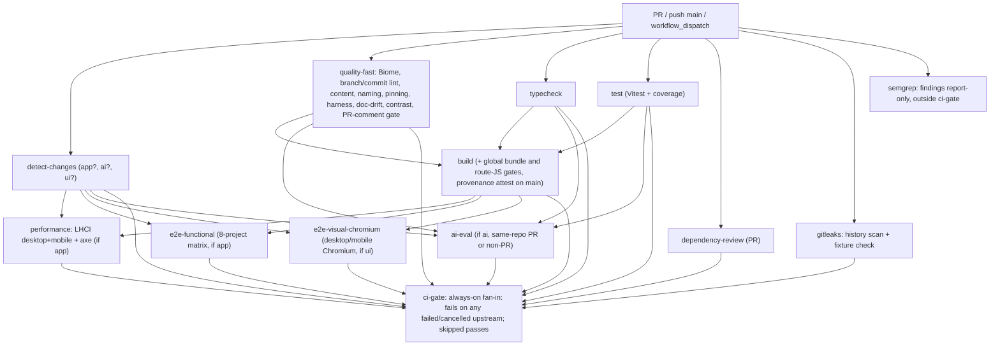
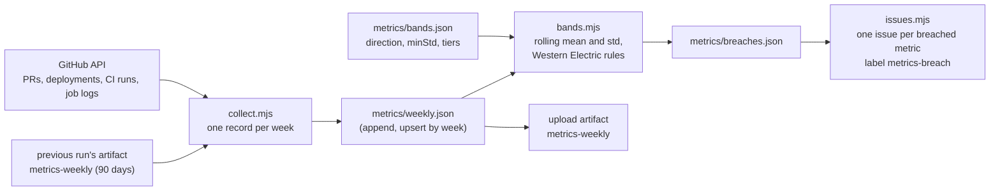

# Workflows

> Local development, build, testing, CI/CD, releases, and debugging - from scratch.

## Prerequisites

- Use `.nvmrc` for the local Node version. `package.json` accepts `^22.22.2 || ^24.15.0 || >=26.0.0`, requires pnpm 10+, and pins the package manager to `pnpm@10.15.0`.
- Install: `pnpm install` (CI uses `--frozen-lockfile`).
- For full local runs you'll want the env vars in `.env.example` (Upstash, AI Gateway, Resend, PSI). The public pages have fallbacks for missing services. API behavior differs: ask budget reservation requires Redis and fails closed; contact storage also fails closed. See doc 05 for individual failure modes.

## Local development

| Command                         | Purpose                                              |
| ------------------------------- | ---------------------------------------------------- |
| `pnpm dev`                      | Turbopack dev server                                 |
| `pnpm build`                    | production build (PPR)                               |
| `pnpm start`                    | serve the production build                           |
| `pnpm check` / `pnpm check:fix` | Biome lint + format                                  |
| `pnpm typecheck`                | `tsgo --noEmit` (strict, TypeScript native compiler) |

> **Gotcha:** `pnpm build` rewrites `next-env.d.ts`'s route-types import to the prod path; `pnpm dev` rewrites it back. Inspect any `next-env.d.ts` diff after switching build modes before deciding whether to keep it.

## The verify chain (the local CI mirror)

`pnpm verify` runs the full static gate chain (also the heart of pre-push):

```
check (Biome) -> typecheck -> validate-content -> check:client-naming -> check:dep-pinning
  -> check:harness-size -> check:section-order -> check:doc-drift
  -> check:detect-changes-paths -> lint:css-tokens -> test (Vitest)
```

`pnpm ci:local` == `pnpm verify`. `pnpm ci` == `verify + build + bundle-check + route-js-check`. Before opening a PR, also run `pnpm bundle-check`, `pnpm route-js-check`, and `pnpm gates:runtime`.

### The gate scripts (what each protects)

| Script                 | Enforces                                                                                         |
| ---------------------- | ------------------------------------------------------------------------------------------------ |
| `validate-content`     | every `content/*.ts` Zod schema parses (build gate)                                              |
| `check:client-naming`  | client directive files use `*.client.*`, a `/client/` directory, or an App Router error filename |
| `check:dep-pinning`    | no `latest`/`*`/tag deps or open overrides                                                                       |
| `check:harness-size`   | `CLAUDE.md` ≤ 275 lines                                                                          |
| `check:section-order`  | section ids have mobile order rules or a listed nested-anchor exemption                          |
| `check:doc-drift`      | `ARCHITECTURE.md` directory-tree paths exist on disk                                             |
| `lint:css-tokens`      | no raw hex outside `app/css/theme.css`                                                           |
| `lint:contrast`        | documented text/surface pairs meet WCAG AA                                                       |
| `check:component-docs` | each DS component is documented                                                                  |
| `check:pkg-age`        | supply-chain: flags <7-day-old package versions                                                  |
| `bundle-check`         | global gzipped client chunks ≤ 220KB                                                             |
| `route-js-check`       | every manifest route ≤ 164.7KB total first-load JS; app-owned split reported                     |

`check:section-order` runs both directions: every rendered section needs a mobile order rule or a listed nested-anchor exemption, and every `#sec-*` selector in `app/css` must match an id some source renders, so a deleted section cannot leave dead rules behind.

## Testing



- **Unit (Vitest):** behavioral assertions only; a `no-source-grep` test bans `readFileSync`-style source-grep tests. Run `pnpm test` / `pnpm test:coverage` / `pnpm test:watch`.
  For effect-driven focus, await the focus assertion with `waitFor`; finding the element only establishes that it rendered.
- **a11y (axe-core):** zero-violation gate over home (both languages), contact errors, design-system routes, the four reading views and both links locales. Every scan includes `wcag22aa`; page scans retain `wcag2a`, `wcag2aa` and `wcag21aa`, while contact errors retain `wcag2a` and `wcag2aa`.
- **e2e (Playwright):** CI runs every project in `playwright.config.ts` (8): `chromium`, `chromium-mobile`, `webkit-desktop`, `webkit-mobile` and the matching `-components` projects for co-located component specs; `__tests__/scripts/e2e-matrix-coverage.test.ts` fails if a project is left out. The DS component visual spec is darwin-only (CI ignores it on Ubuntu). Playwright targets `http://localhost:3000` unless `E2E_BASE_URL` points it at another server.
  Reading views, error states, no-JavaScript recovery and mobile reflow run in all four page-browser projects.
- **Visual regression:** Argos-backed snapshots of page sections; a color/layout/typography change requires regenerated baselines (see the `visual-baseline-regen` skill).
- **AI eval (`pnpm ask:eval`):** calibration → corpus → gate for `/api/ask` (doc 02). Gated in CI when `ai`-paths change.

## CI/CD

Changes under `tests/visual/` or `tests/e2e/` set both `app` and `ui` to true, so baseline-only and e2e-only PRs run the functional and visual jobs.

`.github/workflows/ci.yml` (the authoritative gate). A `detect-changes` job emits `app`, `ai` and `ui` booleans so heavy jobs skip on docs-only PRs (GitHub treats skipped required checks as satisfied). Matrix jobs skipped at job level report ONE unsuffixed check, so matrix-named required contexts (`e2e-functional (chromium)` etc.) hang forever on path-skipped PRs; required checks therefore point at always-reporting contexts and the conditional jobs are enforced through the `ci-gate` fan-in below.



`ci-gate` runs with `if: always()`, includes gitleaks and all build/test jobs above, and excludes semgrep, and is the terminal required status check. `__tests__/scripts/ci-gate-job.test.ts` asserts its `needs` list equals the full job set minus the self-reporting jobs, so adding a conditional job without fanning it in fails `pnpm test`.

Other workflows: `codeql.yml` (SAST, weekly + PR), `mutation.yml` (Stryker, weekly; fails when the runner cannot kill a mutant, judged by `scripts/check-mutation-kills.mjs`), `smoke.yml` (post-deploy: healthz + 7 security headers + apex→www + `/api/ask`,`/api/contact` liveness), `claude-review.yml` (pull-request review, on a `/claude-review` comment), `claude.yml` (`@claude` interaction), `agent-eval.yml` (advisory prompt evaluation), and `weekly-metrics.yml` (delivery metrics and band check, below).

**Token permissions:** every workflow sets a top-level `permissions` block of `contents: read` (`{}` for `smoke.yml`), and each job lists only the extra scopes it uses, for example `build` takes `id-token: write` + `attestations: write` for provenance, `semgrep` takes `security-events: write` to upload SARIF, `claude-review` takes `pull-requests: write` + `issues: read` + `checks: read` + `statuses: read` + `id-token: write` + `actions: read`. `__tests__/scripts/workflow-permissions.test.ts` fails a workflow with no top-level block or a broader one (OpenSSF Scorecard Token-Permissions).

**Lighthouse budgets (LHCI, hard gates):** desktop perf ≥95 / a11y =100 / BP ≥95 / SEO =100, LCP ≤1800ms, CLS ≤0.05, TBT ≤200ms; mobile perf ≥90, LCP ≤3500ms. Never disable a gate to merge - fix the property (doc 08).

Both desktop and mobile collect `/`, `/pt`, `/cv`, `/summary`, `/links`, `/links/en` and every design-system route listed in their configs. Run `pnpm lhci` and `pnpm lhci:mobile` against a production server.

### Weekly delivery metrics

`weekly-metrics.yml` runs Mondays 07:00 UTC and on manual dispatch. It measures how the delivery process behaved over the last complete week (Monday to Monday, UTC), compares each number with its own recent history, and opens a GitHub issue when a number leaves its band. No model is called. It is a signal for the owner, not a merge gate, and it blocks no PR.



| Metric | Source | Worse when |
| --- | --- | --- |
| `deploymentFrequency` | successful `Production` deployments (GitHub deployments API) | lower |
| `deploymentFailureRate` | share of decided `Production` deployments that failed | higher |
| `leadTimeHoursMedian` | first commit to merge, merged PRs by people | higher |
| `prCycleTimeHoursMedian` | PR opened to merged, merged PRs by people | higher |
| `ciMainFailureRate` | `ci.yml` runs on `main` pushes that ended `failure` over `success` plus `failure` | higher |
| `flakyPerE2eJob` | Playwright `N flaky` summary lines in `e2e-*` job logs, per job inspected | higher |

A merged PR counts whatever its base branch: a merge into an integration branch is a delivery event, and `main` receives few merges on its own. Bot-authored PRs count as merged but stay out of both timings. Each week is queried on its own (merged PRs, and `ci.yml` runs on `main` and in total) because the search and run-list APIs return at most 1000 results per query; a window that reaches 1000 results, or whose reported total exceeds what was fetched, fails the run.

Lighthouse LCP per route is not collected: LHCI uploads to `temporary-public-storage` and keeps no file, so the weekly record carries a `skipped.lighthouseLcp` reason. Storing it needs a `ci.yml` step that uploads `.lighthouseci`.

**Bands.** For each metric the latest week is scored against the mean and sample standard deviation of the up to 12 weeks before it (`minStd` floors the deviation so a flat history cannot turn a small move into an infinite score). Six weeks of history are needed first. The tiers follow the control-band loop: 1 sigma on the bad side is **log**, 2 sigma is **diagnose**, 3 sigma is **propose**. The Western Electric run rules lift a quiet-looking week, and each needs the latest point to be one of the counted points, so a metric that is back inside its band does not fire: 2 of the last 3 points beyond 2 sigma (diagnose), 4 of the last 5 beyond 1 sigma (log), or 8 in a row on the bad side (diagnose, so a sustained drift opens an issue). Only the bad side counts, so an improvement never opens an issue. A past week that scored diagnose or worse is left out of later baselines, so a second spike is judged against normal weeks; a lasting shift keeps reporting until the cause is fixed. Tiers, direction and floors live in `metrics/bands.json`; `validateBandsConfig` rejects a malformed file.

**Issues.** `issueFromTier` (default `diagnose`) sets the lowest tier that opens an issue. A breached metric gets one open issue labelled `metrics-breach`, found again through a hidden marker in its body; a repeat breach adds a comment instead of a second issue. Closing is manual, with the pull request that fixes the cause. Do not turn a metric into a target.

**Missing data.** The run fails instead of recording a quiet week when the data is incomplete: a PR search or run list that hit the 1000-result cap or reported more results than it returned, an earlier successful run whose history artifact cannot be downloaded or has no `metrics/weekly.json`, or a week whose e2e job logs all failed to download (an expired log, HTTP 404 or 410, is counted as `logsExpired` and is not a failure). Smaller gaps are annotated as `::warning::` in the run log: a metric with no value for the latest week, e2e logs that could not be downloaded or had no Playwright totals line (counted as `logErrors`, left out of the flaky rate), and a range with no finished `Production` deployment. A metric with too little history gets a `::notice::`.

**Requests.** Only reads (GET, HEAD and the read-only GraphQL query) are retried after a network error or a 5xx. A rate-limited request (HTTP 429, or 403 with `retry-after`) is replayed after the stated wait when that is 60 seconds or less, and otherwise fails naming the secondary rate limit.

**History.** The record is kept as the `metrics-weekly` artifact (90 days) and passed from one run to the next, so the workflow never pushes a branch and needs no write access to contents. The first run, when no earlier run succeeded, backfills 13 weeks from the API. A run after a gap collects the missing weeks. Locally, `node scripts/metrics/collect.mjs`, `bands.mjs` and `issues.mjs --dry-run` use `gh auth token` and write to the git-ignored `metrics/weekly.json`.

The token is read-only except `issues: write`. `__tests__/scripts/weekly-metrics-workflow.test.ts` fails if the permissions widen, a secret other than `GITHUB_TOKEN` appears, an action is not pinned to a SHA, or a `run:` script expands a context expression.

## The PR lifecycle

```
commit (scope blocks) -> (self-review the diff before opening the PR)
  -> pnpm ci:local + gates:runtime -> gh pr create (fill the template)
  -> resolve every review thread (rebase before each push) -> pnpm pr:gate
  -> repo owner runs gh pr merge (project policy; no agent hook enforces it)
```

Large features use an **integration branch + sub-PRs** (`feat/<feature>` ← `feat/<feature>-<part>`) to group independently reviewable changes. See `CLAUDE.md` "Working agreement".

## Releases & deployment

- **Platform:** Vercel (Fluid Compute, Node runtime) end-to-end. Push to `main` (via PR) deploys.
- **Cron:** `vercel.json` runs `/api/psi-refresh` at `0 3 * * *` and `/api/contact-retry` at `0 4 * * *`.
- **Post-deploy:** `smoke.yml` verifies the production deployment (healthz, headers, liveness) and emails on a 503.
- **Emergency rollback:** fast = `vercel promote <previous-url>` (30s, no code); slow = `git revert HEAD && git push --no-verify` (the `--no-verify` is the documented escape hatch for the main-push guard). Verify with `curl https://erikunha.dev/api/healthz | jq .sha`.

## Debugging

| Symptom                    | Where to look                                                                            |
| -------------------------- | ---------------------------------------------------------------------------------------- |
| `/api/healthz` 503         | `meta:psi-last-run` missing/stale (>25h) - the PSI cron failed; check `/api/psi-refresh` |
| `/api/ask` returns 503     | `ASK_ENABLED` off, or monthly token budget exhausted (`ask:tokens:{month}`)              |
| `/api/ask` stream cuts off | 15s watchdog, Layer-1 egress guard or provider failure (`STREAM_ERR_SENTINEL`)           |
| Push blocked               | inspect the main-target guard, branch name or `pnpm verify` failure in `.husky/pre-push` |
| CLS / visual regression    | regenerate Argos baselines via the `visual-baseline-regen` skill                         |
| Client error in prod       | it was POSTed to `/api/log` (`err:{date}:{id}`, 7-day TTL) by `error-bridge.client.ts`  |

See `UI_PATHS`/`APP_PATHS` in `scripts/detect-changes-paths.mjs` for the current CI path filters. Every git-tracked root file and `scripts/` file must be in `AI_PATHS`, `APP_PATHS`, `UI_PATHS` or `IGNORED_PATHS`; `check:detect-changes-paths` fails otherwise, so a new file cannot skip the gated jobs.
