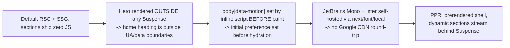

# Performance & Accessibility

> Configured performance and accessibility checks, their measurement scope, and the rendering techniques they exercise.

## Performance budgets and measurement scope

| Metric                                                   | Desktop   | Mobile    |
| -------------------------------------------------------- | --------- | --------- |
| LCP                                                      | < 1.8s    | < 3.5s    |
| INP target (not asserted by LHCI)                        | < 200ms   | < 200ms   |
| CLS                                                      | < 0.05    | < 0.05    |
| TBT                                                      | < 200ms   | < 400ms   |
| JS gzipped / route, first-load total                     | ≤ 164.7KB | ≤ 164.7KB |
| JS gzipped, app-owned allowance (reported, not asserted) | ≤ 32.8KB  | ≤ 32.8KB  |
| Lighthouse Perf                                          | ≥ 95      | ≥ 90      |
| Lighthouse A11y                                          | = 100     | = 100     |
| Lighthouse Best Practices                                | ≥ 95      | ≥ 95      |
| Lighthouse SEO                                           | = 100     | = 100     |

See `lighthouserc.json` + `.mobile.json`, `scripts/check-route-js.mjs`, and `scripts/check-bundle-size.mjs` for enforcement. The app-owned row reports total JS minus the measured 131.9KB framework floor. The script stores that floor as a constant and rejects a lightest route more than 2KB below it. Re-measure the baseline when framework changes make it stale. The 164.7KB total preserves 32.8KB of app-owned allowance. `bundle-check` measures chunks globally and cannot detect per-route regressions.

## Rendering techniques that support LCP

Key levers (all verifiable in code):
- **Static-first.** `app/page.tsx` composes RSC sections; their code/data never ship. Only `AppShell` chrome + named islands hydrate.
- **Shared Projects rendering.** Nine cards and six attached receipts render as one static RSC tree. Desktop and mobile use the same copy and stats; CSS controls the column count. Projects has no user-agent read or variant swap.
- **Hero outside Suspense.** The LCP element is in the prerendered shell, never gated on a dynamic boundary.
- **Pre-paint motion bootstrap.** An inline `<script>` in `layout.tsx` sets `body[data-motion]` from `localStorage`/OS pref before first paint, so the initial motion preference does not wait for hydration.
- **Self-hosted fonts** via `next/font/local` (no Google CDN), with the font `--font-*-src` bound into `@theme`.
- **Animation and streaming updates.** Per-keystroke, per-pixel and per-frame updates avoid broad re-renders: the Hero boot loop and `RoleTyper` mutate `textContent`; the DAW islands mutate `style`/`setAttribute`/`className`; the `/api/ask` stream coalesces `InteractiveShell` state updates with requestAnimationFrame and displays text in a dedicated span. This still re-renders the owning component. Asserted by `InteractiveShell.test.tsx`.
- **Deferred render cost.** The below-the-fold sections counted by `DEFERRED_SECTION_COUNT` use `defer` to apply `content-visibility` through `Module` or Career's own section wrapper.
- **Dynamic imports:** `ContactFormLazy` and `InteractiveShellLazy` use `ssr: false`. `MatrixRainLazy` is a fixed, `pointer-events:none` overlay behind `main`, so its late hydration moves nothing. `Footer` is an RSC; `FooterLazy.client.tsx` directly re-exports the session counters and halt/reboot controls; it does not split them with `next/dynamic`. Its static content remains available without JavaScript. The visitor’s halt clock starts empty on the server, then fills after mount. The netstat `CopyButton` is a separate client island. Footer links, COPY and the reboot key provide 44px targets and visible keyboard focus.
- **MatrixRain** caps at 22fps, pauses via `IntersectionObserver` + `visibilitychange`, and starts via `requestIdleCallback`.

## Layout techniques that support CLS

The dynamic (per-request) sections are the CLS risk, because their `<Suspense>` fallback is what's prerendered. Mitigations:
- **Per-section fallback choice.** Most dynamic sections prerender their _desktop_ variant as the fallback.
- **Measured fallbacks.** ASK and each PSI strategy have independent Suspense boundaries. Their loading states retain the metric tiles or score rows. One slow source does not block the other groups.
- **Responsive guitar presentation.** `GuitarSection` renders one RSC tree across viewports. CSS changes its layout without a desktop/mobile swap or the associated layout shift.
- **Mobile section ordering** uses CSS flex `order` (the `#sec-*` map in `base.css`). `check:section-order` requires order rules for top-level sections and exempts the declared nested anchors. An unordered top-level section defaults to `order:0` and can jump to the top. The same script also fails when a `#sec-*` selector in `app/css` matches an id no source renders, so a deleted section cannot leave dead rules behind.
- **Both nav variants in the DOM**, toggled by CSS at 768px, to avoid a hydration-driven reflow.

## Live performance, self-reported

Measured is one module at `sec-live-metrics`. `AiMetricsSection` composes ASK evaluation data and `LivePerfSection`'s desktop/mobile PSI groups. `content/measured.ts` supplies labels, sources, units and the p95 explanation; values come from the server adapters.

`lib/lighthouse-scores.ts` fetches Google PageSpeed Insights for the live URL and caches scores for 25 hours in Redis. The daily `/api/psi-refresh` cron refreshes them; `/api/healthz` returns 503 for stale PSI data. `lib/ask-metrics.ts` reads `ask:eval:latest`. ASK data is marked stale after seven days, and PSI uses its cache TTL. Missing data displays loading, pending or unavailable states rather than zero scores. Valid timestamps use semantic `time` elements. An unparseable ASK timestamp remains visible as raw text with a timestamp-unavailable label.

## Accessibility architecture

Target: WCAG 2.2 AA. Lighthouse accessibility and axe checks enforce their configured audit sets, not complete conformance.

| Concern             | How it's handled                                                                                                                                                                                                                                                                                              |
| ------------------- | ------------------------------------------------------------------------------------------------------------------------------------------------------------------------------------------------------------------------------------------------------------------------------------------------------------- |
| Color contrast      | Two-token text discipline: `--color-primary-500` only for headings/large text; `--color-tertiary-50` for body. `lint:contrast` parses `theme.css` and checks documented pairs against AA                                                                                                                      |
| Motion              | `prefers-reduced-motion: reduce` **and** a user `MOTION` toggle (`body[data-motion]`) both disable all CRT/JS animation; the toggle is an `aria-pressed` button in `DesktopTopbar` from 1280px, and the section drawer carries the `MOTION: ON` row at every width                                            |
| Semantics           | sections are `<section>` with an `<h2>`, named via `aria-labelledby` (`Module`); stat tiles are `<dl>`; the Hero headline is a real heading                                                                                                                                                                   |
| Keyboard            | a skip-to-content link; `:focus-visible` rings in `base.css`; DAW faders, knobs and VU meters expose keyboard slider controls; About Responsibilities and retry-code regions support keyboard scrolling; the section drawer traps Tab inside the panel and returns focus to a rendered trigger when it closes |
| Live regions        | Hero identity is static; About `RoleTyper` hides animated text and announces completed roles through a polite live region; `ContactForm` errors use `role="alert"`                                                                                                                                            |
| Forms               | `Field` synthesizes `aria-describedby` for errors; contact uses custom client validation with a focused alert summary linking to invalid fields, plus server re-validation                                                                                                                                    |
| Reduced-motion sync | `CRTOverlay` listens for OS `prefers-reduced-motion` changes and keeps `body[data-motion]` in sync                                                                                                                                                                                                            |

Per-component behavioral a11y tests live alongside components. The axe gate covers the home, contact errors, design-system routes and both links locales. Every scan includes `wcag22aa`; page scans also retain `wcag2a`, `wcag2aa` and `wcag21aa`, while contact errors retain `wcag2a` and `wcag2aa`. The CRT effects are all `aria-hidden` + `pointer-events:none`, so the decorative layer is invisible to assistive tech.

The section scroll containers listed below use `tabIndex={0}` and expose the `region` role (About uses named semantic `<section>` elements). Each has its own accessible name from the `SCROLL_REGION_LABELS` map in `content/section-labels.ts`, kept distinct from the parent section's name so no two landmarks share a name. Keyboard users can tab into these containers and scroll with arrow keys. `base.css` applies a `:focus-visible` outline using `--color-primary-500` to elements with `tabindex="0"`. The live scroll regions, with the accessible name each one exposes:
- `sec-responsibilities`: Responsibilities (scrollable)
- `sec-readme`: README code

Responsibilities and retry code belong to the About section; the label validation maps both regions to that parent. Responsibilities keeps its wrapping rows and allows horizontal scrolling if content still overflows. The work authorization table inside Contact is a semantic `<table>` whose cells wrap, so it has no scrolling container and needs no region. The interactive shell's scrollable log already has its own tab stop and accessible name. The footer's scrollable connection table contains keyboard-focusable links. The list above is checked against `SCROLL_REGION_LABELS` by `__tests__/scroll-regions.test.tsx`, so a region the code drops cannot stay in this doc and a new one cannot go undocumented.

## Verification scope

Both Lighthouse configs collect `/`, `/cv`, `/summary`, `/links`, `/links/en` and all 17 listed design-system routes. Every URL uses its config's shared assertions. The INP assertion is disabled in both configs. These automated checks do not establish complete WCAG conformance or real-user INP. The route-JS checker separately evaluates every route emitted in the build manifest.

Mobile reflow, reading views, error states and no-JavaScript recovery run in desktop and mobile Chromium and WebKit.
