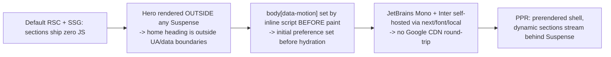

# Performance & Accessibility

> Configured performance and accessibility checks, their measurement scope, and the rendering techniques they exercise.

## Performance budgets and measurement scope

| Metric                                                   | Desktop   | Mobile    |
| -------------------------------------------------------- | --------- | --------- |
| LCP                                                      | < 1.8s    | < 3.5s    |
| INP target (not asserted by LHCI)                        | < 200ms   | < 200ms   |
| CLS                                                      | < 0.05    | < 0.05    |
| TBT                                                      | < 200ms   | < 400ms   |
| JS gzipped / route, first-load total                     | ≤ 164.7KB | ≤ 164.7KB |
| JS gzipped, app-owned allowance (reported, not asserted) | ≤ 32.8KB  | ≤ 32.8KB  |
| Lighthouse Perf                                          | ≥ 95      | ≥ 90      |
| Lighthouse A11y                                          | = 100     | = 100     |
| Lighthouse Best Practices                                | ≥ 95      | ≥ 95      |
| Lighthouse SEO                                           | = 100     | = 100     |

See `lighthouserc.json` + `.mobile.json`, `scripts/check-route-js.mjs`, and `scripts/check-bundle-size.mjs` for enforcement. The app-owned row reports total JS minus the measured 131.9KB framework floor. The script stores that floor as a constant and rejects a lightest route more than 2KB below it. Re-measure the baseline when framework changes make it stale. The 164.7KB total preserves 32.8KB of app-owned allowance. `bundle-check` measures chunks globally and cannot detect per-route regressions.

## Rendering techniques that support LCP

Key levers (all verifiable in code):
- **Static-first.** `components/SiteHome.tsx` composes RSC sections for `app/(en)/page.tsx` and `app/(pt)/pt/page.tsx`; their code/data never ship. Only `AppShell` chrome + named islands hydrate.
- **Shared Projects rendering.** Nine cards and six attached receipts render as one static RSC tree. Desktop and mobile use the same copy and stats; CSS controls the column count. Projects has no user-agent read or variant swap.
- **Hero outside Suspense.** The LCP element is in the prerendered shell, never gated on a dynamic boundary.
- **Pre-paint motion bootstrap.** An inline `<script>` in `layout.tsx` sets `body[data-motion]` from `localStorage`/OS pref before first paint, so the initial motion preference does not wait for hydration.
- **Self-hosted fonts** via `next/font/local` (no Google CDN), with the font `--font-*-src` bound into `@theme`.
- **Font faces follow the text.** Only JetBrains Mono 400 and 700 are declared and preloaded. Inter 900 loads only where an h1 is visible: an `sr-only` h1 uses the mono family. Lighthouse's mobile LCP for an image element is the time to download every request that finished before the paint, so each unused face costs the `/links` LCP about 130 ms. Held by the `font payload` specs in `tests/e2e/links.spec.ts`.
- **Animation and streaming updates.** Per-keystroke, per-pixel and per-frame updates avoid broad re-renders: the Hero boot loop and `RoleTyper` mutate `textContent`; the DAW islands mutate `style`/`setAttribute`/`className`; the `/api/ask` stream coalesces `InteractiveShell` state updates with requestAnimationFrame and displays text in a dedicated span. This still re-renders the owning component. Asserted by `InteractiveShell.test.tsx`.
- **Deferred render cost.** The below-the-fold sections counted by `DEFERRED_SECTION_COUNT` use `defer` to apply `content-visibility` through `Module` or Career's own section wrapper. A deferred module reserves an estimated placeholder height while its content is laid out at full height: 520px is only the default, with per-section and per-breakpoint overrides (Career 3340px, Opinions 3180px, Guitar and mixer 3320px, Contact 2322px) and `contain-intrinsic-size: auto var(--module-estimate)` remembering the rendered height, so the axe gate reveals the deferred modules before it scans: the audit then measures the painted page, where an unpainted module row cannot overlap the section below it.
- **Dynamic imports:** `ContactFormLazy` and `InteractiveShellLazy` are `React.lazy` islands rendered on the server, so their markup is in the HTML and the chunk only hydrates it. `MatrixRainLazy` is a fixed, `pointer-events:none` overlay behind `main`, so its late hydration moves nothing. `Footer` is an RSC that renders the session counters and halt/reboot controls from `Footer.client` directly, without `next/dynamic`. Its static content remains available without JavaScript. The visitor’s halt clock starts empty on the server, then fills after mount. The netstat endpoint cells are outbound links. Footer links and the reboot key provide 44px targets and visible keyboard focus.
- **MatrixRain** caps at 22fps and starts via `requestIdleCallback`. The frame loop runs only while every gate is open: idle start reached, motion on, tab visible, no system-failure beat, and (when a watched element is given) that element in view. Any gate closing cancels the pending frame, and reopening the last one restarts it, so switching MOTION on after loading with it off starts the rain and a tab return never restarts it while motion is off.
- **Frame governor** (`lib/frame-governor.ts`, started by `CRTOverlay`) keeps the CRT stack from starving a device that cannot draw it. It samples `requestAnimationFrame` deltas while motion is on, the tab is visible and no system-failure beat runs, and publishes a level from 0 to 5 as `html[data-crt-level]`. When the 75th percentile of frame times over a two-second window passes the degrade budget it steps one level down. At level 1 and above `crt.css` pauses the noise, flicker and scan beam, and the governor moves their animation clocks forward in steps of one rain tick times 2, 4, 8, 16 or 32 (`lib/crt-effect-stepper.ts`); `MatrixRain` stretches its own tick interval by the same factor and scales the per-tick advance and fade so fall speed and trail length hold. The effects keep their keyframes and speed, they just redraw less often, because a software compositor redraws the whole stack on every frame while any full-viewport animation runs, whether or not its value changed. It steps back up only after frames stay under a lower recovery threshold for a hold, and the hold doubles after a recovery the device could not sustain. Level 0 matches no extra rule, so a capable device renders exactly what it did before. The MOTION-off rules switch the animations off (`animation: none`); the level rule only pauses, so it cannot bring one back.
- **Hero boot and the shell input placeholder** follow the same rule (`lib/pause-when-hidden.ts`): the typing loops stop and show the static boot lines when MOTION is switched off, restart when it is switched on, and pause while the tab is hidden, the hero is out of view or a system-failure beat is showing. Each pause source is tracked separately, so one cannot release another. The placeholder has no system-failure source.

## Layout techniques that support CLS

The dynamic (per-request) sections are the CLS risk, because their `<Suspense>` fallback is what's prerendered. Mitigations:
- **Per-section fallback choice.** The DAW mixer, the one UA-selected part of the page (inside the guitar module), streams behind a boot-log fallback (`MixerLoading`) whose `min-height` is set per breakpoint to the height of the finished mixer; Measured retains its metric loading placeholders. No dynamic section prerenders a desktop variant as the fallback.
- **Measured fallbacks.** ASK and PSI have independent Suspense boundaries; PSI fetches desktop and mobile together inside its one boundary. Their loading states retain the metric tiles. A slow PSI source does not block ASK, and the reverse.
- **Responsive guitar presentation.** `GuitarSection` renders one RSC tree across viewports for the EQ strip, signal chain and photo. CSS changes its layout without a desktop/mobile swap or the associated layout shift; only the mixer below them swaps by user agent.
- **Mobile section ordering** uses CSS flex `order` (the `#sec-*` map in `base.css`). `check:section-order` requires order rules for top-level sections and exempts the declared nested anchors. An unordered top-level section defaults to `order:0` and can jump to the top. The same script also fails when a `#sec-*` selector in `app/css` matches an id no source renders, so a deleted section cannot leave dead rules behind.
- **Both nav variants in the DOM**, toggled by CSS at 768px, to avoid a hydration-driven reflow.
- **Reserved room for states that appear later.** The interactive shell's Stop control sits inside the input row, so a pending answer adds no row. The offline notice is `position: fixed` and collapses to zero height when empty, so going offline moves nothing. Each Measured block renders its status line inside a slot (`MeasuredStatus`) that holds the height of the longest status copy in every state, data included. The contact timezone host (`.ctz-host`) carries a per-locale minimum height tall enough for the live panel at each width band, so mounting it moves nothing below. On phones the footer keeps the back-to-top button's reach (`--to-top-reach`) clear at its inline end, so right-edge footer text never sits under it. `tests/e2e/layout-stability.spec.ts` and `tests/e2e/to-top-clearance.spec.ts` hold these.
- **Loading placeholders hold the room of what replaces them.** The Lighthouse block's loading status reserves the same longest copy as its resolved status, the mixer boot log and the shell and contact placeholders take a per-breakpoint `min-height` close to their final height, and `LatestVideoSkeleton` draws both feed columns (channel card and history rows). With scripting off no swap ever happens, so the placeholders give the room back: the shell and contact placeholders are `display: none`, the mixer box drops its `min-height`, and a status inside a busy block is `visibility: hidden` instead of announcing a load that never ends (`@media (scripting: none)`). `tests/e2e/loading-states.spec.ts` compares each fallback with its resolved block and checks the no-script rules.
- **A failed send grows the form, on purpose.** The error summary renders above the fields, takes focus and scrolls into view; the section grows by that alert and its gap only (`tests/e2e/contact-states.spec.ts`).
- **CV print.** In print the Certifications and Education rows share one `--reading-key-width` key column, the hire call to action is dropped (`.reading-cta`), and credential badges read as words (`credentialBadges` in `content/reading-views.ts`). `tests/e2e/cv-print.spec.ts` renders A4 with `emulateMedia({ media: 'print' })` and a PDF.

## Live performance, self-reported

Measured is one module at `sec-live-metrics`. `AiMetricsSection` composes ASK evaluation data and `LivePerfSection`'s desktop/mobile PSI groups. `content/measured.ts` supplies labels, sources, units and the p95 explanation; values come from the server adapters.

`lib/lighthouse-scores.ts` fetches Google PageSpeed Insights for the live URL and caches scores for 25 hours in Redis. The daily `/api/psi-refresh` cron refreshes them; `/api/healthz` returns 503 for stale PSI data. `lib/ask-metrics.ts` reads `ask:eval:latest`. ASK data is marked stale after seven days, and PSI uses its cache TTL. Missing data displays loading, pending or unavailable states rather than zero scores. Valid timestamps use semantic `time` elements. An unparseable ASK timestamp remains visible as raw text with a timestamp-unavailable label.

## Accessibility architecture

Target: WCAG 2.2 AA. Lighthouse accessibility and axe checks enforce their configured audit sets, not complete conformance.

| Concern             | How it's handled                                                                                                                                                                                                                                                                                                                                                                                                                                                                                                                                                                                       |
| ------------------- | ------------------------------------------------------------------------------------------------------------------------------------------------------------------------------------------------------------------------------------------------------------------------------------------------------------------------------------------------------------------------------------------------------------------------------------------------------------------------------------------------------------------------------------------------------------------------------------------------------ |
| Color contrast      | Two-token text discipline: `--color-primary-500` only for headings/large text; `--color-tertiary-50` for body. `lint:contrast` parses `theme.css` and checks documented pairs against AA                                                                                                                                                                                                                                                                                                                                                                                                               |
| Forced colors       | `app/css/forced-colors.css` (last in `globals.css`, one `@media (forced-colors: active)` block) covers Windows high contrast. The browser replaces author colors, drops `box-shadow`, `text-shadow` and gradients, and paints backgrounds as `Canvas`, so a control that showed its boundary or state only through those loses it. The block hides the six CRT overlays and every `canvas[aria-hidden]` (the rain; `visibility`, because the canvas sets `display` inline), and draws state with system colors: a `Highlight` border at `--forced-state-width` for an expanded menu trigger, the current nav, drawer and dock entry; a `Highlight` outline on the shell input and the selected timezone option; `Highlight` fill for the fader thumb and filled VU segments; `GrayText` for disabled controls. No markup changes and no `forced-color-adjust: none`. Held by `tests/e2e/forced-colors.spec.ts` (chromium project, `forcedColors: 'active'`), which also pins the default computed styles of the same elements. axe runs there without `color-contrast`: it reads author colors against the forced canvas and reports a contrast the user never sees |
| Motion              | The `MOTION` switch (`body[data-motion]`) is the one control: a first visit starts on even when the operating system asks for reduced motion, and off disables all CRT/JS animation and every CSS animation and transition; the choice persists in `localStorage` (`erik.motion`); the switch is an `aria-pressed` button in `DesktopTopbar` from 1280px, and the section drawer carries an `aria-pressed` row whose accessible name is its visible label `MOTION` and whose state word (`ON` or `OFF`) sits in an `aria-hidden` span, so the row reads `MOTION: ON` on screen and `MOTION` plus the pressed state to assistive technology, at every width |
| Semantics           | sections are `<section>` with an `<h2>`, named via `aria-labelledby` (`Module`); stat tiles are `<dl>`; the Hero headline is a real heading; the pt-BR subtree declares `lang="pt-BR"` on its wrapper (the root `<html>` keeps the default `en`), so screen readers switch voice per language                                                                                                                                                                                                                                                                                                          |
| Language            | the language switch is a pair of links carrying `aria-current="page"`, never a toggle, rendered by one `LocaleSwitch` (two 44px buttons, current language filled) in the header on every page: the desktop topbar and the phone title bar both render it, the `/links` chrome bar has none, `/cv`, `/summary`, the home and `/links` link each language to its twin, and a page without a twin (the design system, the 404 pages) links each language to its home. The server HTML already carries the pair for a visitor without JavaScript: each page hands `SiteShell` its own route, which the shell uses for the `Suspense` fallback of the switch and of the topbar's current-page link, so `/cv` ships `/cv` and `/pt/cv`, `/links` ships `/links/en` and `/links`, and `/links` marks its own topbar link `aria-current="page"` before hydration |
| Keyboard            | a skip-to-content link; `:focus-visible` rings in `base.css`; DAW faders, knobs and VU meters expose keyboard slider controls (all four arrows, Home, End, PageUp and PageDown, one rule in `lib/slider.ts`); About Responsibilities and retry-code regions support keyboard scrolling; the section drawer traps Tab inside the panel and returns focus to a rendered trigger when it closes                                                                                                                                                                                                           |
| Live regions        | Hero identity is static; About `RoleTyper` hides animated text and announces completed roles through a polite live region; `ContactForm` errors use `role="alert"` and its status line (waiting, sending, marked fields, failed send) is the one polite `role="status"` region of the form; `ContactTimezone` keeps its region empty until the visitor picks a zone, then announces the place and both local times once (minutes only), and the zone search announces its match count through an always-rendered status region; every copy button announces through a status region outside the button |
| Forms               | `Field` synthesizes `aria-describedby` for errors; contact uses custom client validation with a focused alert summary linking to invalid fields, plus server re-validation                                                                                                                                                                                                                                                                                                                                                                                                                             |

Per-component behavioral a11y tests live alongside components. The axe gate covers the home in both languages, the four reading views at desktop and 390px, contact errors, design-system routes and both links locales. Every scan includes `wcag22aa`; page scans also retain `wcag2a`, `wcag2aa` and `wcag21aa`, while contact errors retain `wcag2a` and `wcag2aa`. The CRT effects are all `aria-hidden` + `pointer-events:none`, so the decorative layer is invisible to assistive tech.

The section scroll containers listed below use `tabIndex={0}` and expose the `region` role (About uses named semantic `<section>` elements). Each has its own accessible name from the `SCROLL_REGION_LABELS` map in `content/section-labels.ts`, kept distinct from the parent section's name so no two landmarks share a name. Keyboard users can tab into these containers and scroll with arrow keys. `base.css` applies a `:focus-visible` outline using `--color-primary-500` to elements with `tabindex="0"`. The live scroll regions, with the accessible name each one exposes:
- `sec-responsibilities`: Responsibilities (scrollable)
- `sec-readme`: README code

Responsibilities and retry code belong to the About section; the label validation maps both regions to that parent. Responsibilities keeps its wrapping rows and allows horizontal scrolling if content still overflows. The interactive shell's scrollable log already has its own tab stop and accessible name. The footer's scrollable connection table contains keyboard-focusable links. The list above is checked against `SCROLL_REGION_LABELS` by `__tests__/scroll-regions.test.tsx`, so a region the code drops cannot stay in this doc and a new one cannot go undocumented.

## Verification scope

Both Lighthouse configs collect `/`, `/pt`, `/cv`, `/summary`, `/links`, `/links/en` and every listed design-system route. Every URL uses its config's shared assertions. The INP assertion is disabled in both configs. These automated checks do not establish complete WCAG conformance or real-user INP. The route-JS checker separately evaluates every route emitted in the build manifest.

Mobile reflow, reading views, error states and no-JavaScript recovery run in desktop and mobile Chromium and WebKit.
