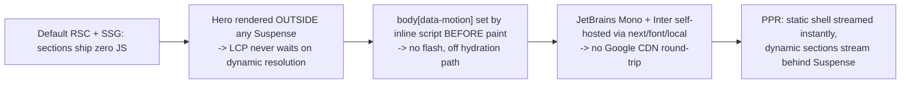

# Performance & Accessibility

> Both are treated as **implicit on every change**, not separate phases, and both are hard CI gates. This doc explains the budgets and the techniques that meet them.

## Performance budgets (non-negotiable, CI-enforced)

| Metric                                                           | Desktop   | Mobile    |
| ---------------------------------------------------------------- | --------- | --------- |
| LCP                                                              | < 1.8s    | < 3.5s    |
| INP                                                              | < 200ms   | < 200ms   |
| CLS                                                              | < 0.05    | < 0.05    |
| TBT                                                              | < 200ms   | < 400ms   |
| JS gzipped / route, first-load total                             | < 164.7KB | < 164.7KB |
| JS gzipped, app-owned (total minus the measured framework floor) | < 32.8KB  | < 32.8KB  |
| Lighthouse Perf                                                  | ≥ 95      | ≥ 90      |
| Lighthouse A11y                                                  | = 100     | = 100     |
| Lighthouse Best Practices                                        | ≥ 95      | ≥ 95      |
| Lighthouse SEO                                                   | = 100     | = 100     |

See `lighthouserc.json` + `.mobile.json`, `scripts/check-route-js.mjs`, and `scripts/check-bundle-size.mjs` for enforcement. The app-owned row reports total JS minus the measured 131.9KB framework floor. A bare hello-world Next 16.4.3 + React 19.3.1 app measures that floor before app code. The 164.7KB total preserves 32.8KB of app-owned allowance. `bundle-check` measures chunks globally and cannot detect per-route regressions.

## How LCP < 1.8s is achieved

Key levers (all verifiable in code):
- **Static-first.** `app/page.tsx` composes RSC sections; their code/data never ship. Only `AppShell` chrome + named islands hydrate.
- **Shared Projects rendering.** Nine cards and six attached receipts render as one static RSC tree. Desktop and mobile use the same copy and stats; CSS controls the column count. Projects has no user-agent read or variant swap.
- **Hero outside Suspense.** The LCP element is in the prerendered shell, never gated on a dynamic boundary.
- **Pre-paint motion bootstrap.** An inline `<script>` in `layout.tsx` sets `body[data-motion]` from `localStorage`/OS pref before first paint, so CRT effects and the LCP element don't flash.
- **Self-hosted fonts** via `next/font/local` (no Google CDN), with the font `--font-*-src` bound into `@theme`.
- **INP discipline (the big one).** Per-keystroke/per-pixel/per-frame updates must not re-render React: the Hero boot loop and `RoleTyper` mutate `textContent`; the DAW islands mutate `style`/`setAttribute`/`className`; the `/api/ask` stream is rAF-coalesced into a single isolated ``. Asserted by `InteractiveShell.test.tsx`.
- **Deferred render cost.** The below-the-fold sections counted by `DEFERRED_SECTION_COUNT` pass `defer` to `Module`, which applies `content-visibility`.
- **Lazy JS (`next/dynamic`) for interactive islands, plus decorative fixed islands that cannot shift layout**: `ContactFormLazy`, `InteractiveShellLazy`, `MatrixRainLazy` (fixed, `pointer-events:none` overlay behind `main`, so its late hydration moves nothing). `Footer` is an RSC; `FooterLazy` loads only the session counters and halt/reboot island. Its static content remains available without JavaScript. The visitor’s halt clock starts empty on the server, then fills after mount. The netstat `CopyButton` is a separate design-system island. Footer links, COPY and the reboot key provide 44px targets and visible keyboard focus.
- **MatrixRain** caps at 22fps, pauses via `IntersectionObserver` + `visibilitychange`, and starts via `requestIdleCallback`.

## How CLS < 0.05 is achieved

The dynamic (per-request) sections are the CLS risk, because their `<Suspense>` fallback is what's prerendered. Mitigations:
- **Per-section fallback choice.** Most dynamic sections prerender their _desktop_ variant as the fallback.
- **Measured fallbacks.** ASK and each PSI strategy have independent Suspense boundaries. Their loading states retain the metric tiles or score rows. One slow source does not block the other groups.
- **Responsive guitar presentation.** `GuitarSection` renders one RSC tree across viewports. CSS changes its layout without a desktop/mobile swap or the associated layout shift.
- **Mobile section ordering** is done with CSS flex `order` (the `#sec-*` map in `base.css`), and `check:section-order` fails the build if a section lacks an order rule - a section defaulting to `order:0` would float to the top and cause a visible jump (this actually happened, 2026-05-28).
- **Both nav variants in the DOM**, toggled by CSS at 768px, to avoid a hydration-driven reflow.

## Live performance, self-reported

Measured is one module at `sec-live-metrics`. `AiMetricsSection` composes ASK evaluation data and `LivePerfSection`'s desktop/mobile PSI groups. `content/measured.ts` supplies labels, sources, units and the p95 explanation; values come from the server adapters.

`lib/lighthouse-scores.ts` fetches Google PageSpeed Insights for the live URL and caches scores for 25 hours in Redis. The daily `/api/psi-refresh` cron refreshes them; `/api/healthz` returns 503 for stale PSI data. `lib/ask-metrics.ts` reads `ask:eval:latest`. ASK data is marked stale after seven days, and PSI uses its cache TTL. Missing data displays loading, pending or unavailable states rather than zero scores. Valid timestamps use semantic `time` elements. An unparseable ASK timestamp remains visible as raw text with a timestamp-unavailable label.

## Accessibility architecture

Target: **WCAG 2.1 AA, Lighthouse a11y = 100, zero axe violations** (all hard gates).

| Concern             | How it's handled                                                                                                                                                                          |
| ------------------- | ----------------------------------------------------------------------------------------------------------------------------------------------------------------------------------------- |
| Color contrast      | Two-token text discipline: `--color-signal` only for headings/large text; `--color-text-body` (~13:1) for body. `lint:contrast` parses `theme.css` and checks documented pairs against AA |
| Motion              | `prefers-reduced-motion: reduce` **and** a user `MOTION` toggle (`body[data-motion]`) both disable all CRT/JS animation; the toggle is an `aria-pressed` button in `DesktopTopbar`        |
| Semantics           | sections are `<section>` with an `<h2>`, named via `aria-labelledby` (`Module`); stat tiles are `<dl>`; the Hero headline is a real heading                                               |
| Keyboard            | a skip-to-content link; `:focus-visible` rings in `base.css`; the DAW faders/knobs/VU meters are keyboard-operable (`aria-valuenow` updated on arrow keys)                                |
| Live regions        | `RoleTyper` announces only the _completed_ role via an `sr-only` live region (not each keystroke); `ContactForm` errors use `role="alert"`                                                |
| Forms               | `Field` synthesizes `aria-describedby` for errors; native validation (`required`, `type=email`, `minLength`) plus server re-validation                                                    |
| Reduced-motion sync | `CRTOverlay` listens for OS `prefers-reduced-motion` changes and keeps `body[data-motion]` in sync                                                                                        |

Per-component behavioral a11y tests live alongside components; the axe gate covers the design-system routes. The CRT effects are all `aria-hidden` + `pointer-events:none`, so the decorative layer is invisible to assistive tech.

## The performance/accessibility invariant

From `CLAUDE.md`: _"Perf, a11y (WCAG 2.1 AA), and security are implicit on every change - not separate phases."_ In practice this means a visual-affecting change must regenerate visual baselines before a PR, a new interactive element must pass the a11y tester, and a change that trips an LCP/INP/CLS gate gets a `performance-engineer` pass. The gates make these non-optional.
