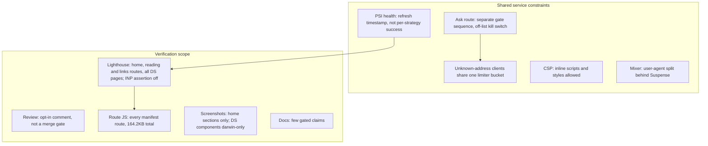

# Architecture Findings & Technical Debt

> Constraints and maintenance risks visible in the implementation.

## The ask route has a separate request pipeline

`/api/ask` runs its own pipeline (`lib/ask/preflight.ts`, then `lib/ask/stream.ts`) so it can return a plain-text stream. It reuses the cross-site check, the bounded body reader and the hashed client key, but it calls the rate limiter, parses and validates by itself, and answers pre-stream failures as `{ error: string }` instead of the `{ ok, requestId, error }` envelope. `defineHandler` centralizes the same stages for contact and log operations. Several other routes also use bespoke handlers, including cron, health, profile and MCP endpoints.

Changes to request validation or rate-limit behavior need comparison across the applicable handlers. A change to `defineHandler` does not reach the ask route.

## The kill switch is an off-list

`/api/ask` answers 503 only when `ASK_ENABLED`, trimmed and lower-cased, is `false`, `0`, `off`, `no` or `disabled`. Unset or any other value leaves the route on, so a misspelled value does not stop spending. `__tests__/ask-killswitch-behavioral.test.ts` holds the accepted keywords and that an unset value leaves the route on; nothing in the code or the tests rejects or warns on an unknown value.

## Clients without an address share one rate-limit bucket

`getClientIp` reads the first `x-forwarded-for` entry, then `x-real-ip`, and falls back to `unknown`. Every request with neither header shares that one bucket, and so does a value that is not an IP address. On Vercel the header is always set. The cases that reach the fallback are local development and an MCP request delivered by an in-memory transport, where `ask_erik` then shares the `rl:ask` allowance of eight requests per hour and the same spend budget.

## The Content Security Policy allows inline scripts and styles

`proxy.ts` sets `script-src 'self' 'unsafe-inline'` and `style-src 'self' 'unsafe-inline'`. A nonce would break the inline flight scripts of the statically generated pages, so the policy cannot block an injected inline script. Output escaping carries that weight: pages render text through React, the only `dangerouslySetInnerHTML` is the build-time motion bootstrap in `RootShell`, and JSON-LD values go through `serializeJsonLd`. The policy still blocks framing, plugins, foreign form targets and any script, font or connect source other than the site and the two Vercel analytics hosts.

## PSI health depends on a daily refresh

`vercel.json` schedules `/api/psi-refresh` once daily. `/api/healthz` uses the `meta:psi-last-run` timestamp and reports degraded status when it is absent or older than 25 hours. The refresh handler writes that timestamp when at least one strategy succeeds. A partial score failure still returns 500; failure of both strategies leaves the timestamp unchanged.

A fresh health response describes the refresh timestamp. It does not prove both PSI strategies returned usable scores. Inspect the cached score records when diagnosing a missing metric.

## The mixer is the one section that reads the user agent

`getIsMobile()` (`lib/ua.ts`) matches `Mobile` or `Android` in the user agent to choose the mixer variant inside the guitar module. Reading request headers makes that part of the page dynamic, so it streams behind the `MixerLoading` fallback while the rest of the home is prerendered. A client with an unusual user agent gets the desktop mixer at any width, and the fallback height must track both variants (`tests/e2e/mixer-mobile.spec.ts`, `tests/e2e/layout-stability.spec.ts`).

## Review and quality checks differ in how they run

Git hooks and CI run deterministic checks on every change. `claude-review.yml` runs only when an owner, member or collaborator comments `/claude-review`, and it is never a merge requirement. The review that runs before the merge is the `pr-review-orchestrator` skill, and it is not a gate on the conversation: nothing in CI reads the review threads. Plan review and API review are conventions in `AGENTS.md`.

Two quality signals run outside the merge path. Stryker mutation testing runs weekly in `mutation.yml` and is advisory; per pull request only a canary checks that the runner can still kill a mutant. The `ask:eval` job in `ci.yml` is skipped for fork pull requests and Dependabot, and it runs only when `ai` paths change.

## Performance and visual coverage differs by surface

The per-route JS checker evaluates every route in the build's route manifest. Both Lighthouse configurations collect the home page, `/pt`, `/cv`, `/summary`, `/links`, `/links/en` and every design-system page. Both disable the INP assertion; the only INP guard is the shell keystroke check in `tests/e2e/cross-cutting.spec.ts`.

The home and design-system performance gates therefore do not establish latency or visual performance on every route. Use the relevant functional tests and route-specific measurements before making those claims. Screenshot baselines exist for the home sections in `tests/visual/visual.spec.ts` (darwin and linux). The design-system component screenshots in `tests/e2e/design-system-components.spec.ts` are darwin-only and CI ignores them, so no CI job compares them.

## Reference docs have few gates

`check:doc-drift` checks the marked directory tree in `ARCHITECTURE.md`. Among the files in `docs/`, only the component counts in `04-components-and-state.md` (`__tests__/design-system-doc-counts.test.ts`) and the scroll-region list in `08-performance-and-accessibility.md` (`__tests__/scroll-regions.test.tsx`) are compared with the code. Every other claim in these documents is checked by review.

## Maintenance map

For component boundaries, read [04-components-and-state.md](./04-components-and-state.md). For active checks and commands, read [07-workflows.md](./07-workflows.md).
