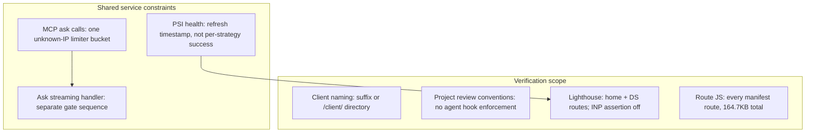

# Architecture Findings & Technical Debt

> Constraints and maintenance risks visible in the implementation.

## MCP callers share the ask limiter

`lib/agent/mcp-tools.ts` invokes the ask route with a synthetic request containing only `Content-Type`. It supplies no client IP. `getClientIp` therefore returns `unknown`, and MCP callers share the `rl:ask` bucket of eight requests per hour. The monthly token budget is shared as well.

A busy MCP client can exhaust that bucket for other callers. Per-caller isolation needs a trustworthy caller identity; the stateless transport alone does not provide one.

## The ask route has a separate request pipeline

`/api/ask` implements rate limiting, parsing and validation directly to return a plain-text stream. `defineHandler` centralizes these stages for contact and log operations. Several other routes also use bespoke handlers, including cron, health, profile and MCP endpoints.

Changes to request validation or rate-limit behavior need comparison across the applicable handlers. A change to `defineHandler` does not reach the ask route.

## PSI health depends on a daily refresh

`vercel.json` schedules `/api/psi-refresh` once daily. `/api/healthz` uses the `meta:psi-last-run` timestamp and reports degraded status when it is absent or older than 25 hours. The refresh handler writes that timestamp when at least one strategy succeeds. A partial score failure still returns 500; failure of both strategies leaves the timestamp unchanged.

A fresh health response describes the refresh timestamp. It does not prove both PSI strategies returned usable scores. Inspect the cached score records when diagnosing a missing metric.

## Repository checks and review conventions have different coverage

Git hooks and CI run deterministic checks. The project does not wire agent-runtime hooks for API review or architect approval. Local pre-PR review is a convention; the PR commands check automated approval and thread state.

`check-client-naming.mjs` explicitly accepts files inside `/client/` directories. Unsuffixed files in `components/client/` comply with that rule and are not a naming-gate blind spot.

## Performance coverage differs by surface

The per-route JS checker evaluates every route in the build's route manifest. Lighthouse configuration collects `/` and five design-system pages. It does not collect `/summary`, `/cv`, `/links` or `/links/en`. Both Lighthouse configurations disable the INP assertion.

The home and design-system performance gates therefore do not establish latency or visual performance on every route. Use the relevant functional tests and route-specific measurements before making those claims.

## Maintenance map

For component boundaries, read [04-components-and-state.md](./04-components-and-state.md). For active checks and commands, read [07-workflows.md](./07-workflows.md).
