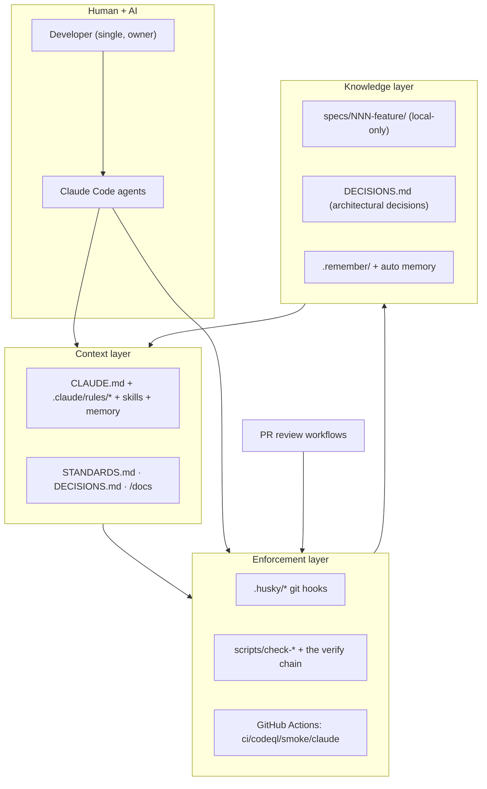

# Engineering Handbook

> How engineering happens in this repository: the lifecycle, the AI-assisted development platform, the workflows, the gates, and the knowledge system. This is the _process_ layer. For the _codebase_ layer (architecture, components, API), see the sibling architecture docs in [`/docs`](../README.md).

## Two doc sets, one knowledge base

| Layer                       | Where                                                          | Answers                                                                                 |
| --------------------------- | -------------------------------------------------------------- | --------------------------------------------------------------------------------------- |
| **Architecture** (the code) | [`/docs/01`-`/docs/11`](../README.md)                          | What the system is, how it renders, how the API works                                   |
| **Handbook** (the process)  | this folder, `/docs/handbook/*`                                | How work flows from idea to production, how AI participates, how we review/test/release |
| **Canonical intent** (root) | `ARCHITECTURE.md`, `STANDARDS.md`, `DECISIONS.md`, `CLAUDE.md` | The system design, the engineering bar, the ADR log, the agent instructions             |

The handbook routes to the other two rather than duplicating them.

## Handbook contents

| Doc                                                        | Covers                                                                                                                       |
| ---------------------------------------------------------- | ---------------------------------------------------------------------------------------------------------------------------- |
| [development-lifecycle.md](./development-lifecycle.md)     | The SDLC end to end: idea -> spec -> plan -> implement -> review -> merge -> release, with diagrams                          |
| [ai-assisted-development.md](./ai-assisted-development.md) | How AI participates in the SDLC: context engineering, enforcement boundaries, sequence diagrams                              |
| [agents-skills-hooks-mcp.md](./agents-skills-hooks-mcp.md) | Reference for tracked project skills, hooks, rules and MCP configuration, with the hook lifecycle and orchestration diagrams |
| [workflow-playbook.md](./workflow-playbook.md)             | Step-by-step runbooks: feature, bug fix, refactor, perf, a11y, ADR, PR, review                                               |
| [review-merge-release.md](./review-merge-release.md)       | The gate chain from commit to production, the convergence loop, release and rollback                                         |
| [knowledge-architecture.md](./knowledge-architecture.md)   | How engineering knowledge is organized (specs, plans, ADRs, memory) and the documentation standards                          |
| [engineering-standards.md](./engineering-standards.md)     | The explicit standards index and the gate that enforces each                                                                 |
| [engineering-audit.md](./engineering-audit.md)             | An evaluation of the platform's maturity, with a technical-debt register                                                     |
| [onboarding.md](./onboarding.md)                           | Process onboarding: how to do the work, not just read the code                                                               |
| [roadmap.md](./roadmap.md)                                 | Future-state engineering platform, ranked by ROI                                                                             |

## The platform in one picture

## Enforcement boundaries

Git hooks check commits and pushes. CI checks source, build output and selected runtime behavior. Architect review, API security dispatch and pre-PR review are workflow conventions. See [engineering-audit](./engineering-audit.md) for the limits of those checks.

## How to read this if you're new

Start with [onboarding.md](./onboarding.md). It sequences the architecture docs and this handbook into a "productive in days" path.
