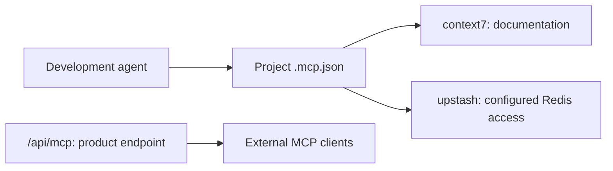

# Agents, Skills, Hooks and MCP Reference

This reference describes tracked project configuration. User-level tools and hooks require separate inspection.

## Layout

| Path                      | Role                                                                                                   | Read by             |
| ------------------------- | ------------------------------------------------------------------------------------------------------ | ------------------- |
| `AGENTS.md`               | The single source of project instructions                                                              | Codex, Claude Code  |
| `CLAUDE.md`               | `@AGENTS.md` import plus the Claude-only lines                                                         | Claude Code         |
| `REVIEW.md`               | Review severity, always-check list, skip list, domains and proof                                                       | CI review, reviewers |
| `.agents/skills/<name>/`  | Canonical project skills                                                                               | Codex               |
| `.claude/skills/<name>`   | Relative symlink to `../../.agents/skills/<name>`                                                      | Claude Code         |
| `.claude/rules/*.md`      | Path-scoped rules with `paths:` frontmatter                                                            | Claude Code         |
| `.claude/agents/`         | One read-only agent for the CI review job                                                              | Claude Code         |
| `.claude/settings.json`   | Team permissions (deny rules); no hooks                                                                | Claude Code         |
| `.mcp.json`, `.codex/config.toml` | The same MCP servers, one file per tool (project layer, trusted projects only for Codex) | Claude Code, Codex  |
| `.github/CODEOWNERS`      | Code owner for every path above, plus `.github/`, `.husky/`, `scripts/`, the manifests, lockfile and workspace settings, `biome.json`, `vercel.json` and `proxy.ts` | GitHub              |

Personal configuration stays out of the repository: `CLAUDE.local.md`, `.claude/settings.local.json`
and the user-level homes of each tool. Workflow hooks, review habits, merge habits and model choices
belong there too; the tracked files describe the repository only. Symlinks need `core.symlinks` on Windows checkouts.

## Project skills

| Skill                    | Use                                                                                          | Invocation        |
| ------------------------ | -------------------------------------------------------------------------------------------- | ----------------- |
| `visual-baseline-regen`  | Refresh affected Darwin and Linux screenshot baselines using its platform-specific procedure | model or user     |
| `ai-eval-update`         | Maintain the ask corpus, calibration, runner and CI eval job                                 | model or user     |
| `plan-review`            | Check a spec or plan against scope, JS budget, API constraints and Lighthouse floors         | model or user     |
| `perf-budget`            | Diagnose a failing route-JS or Lighthouse budget                                             | model or user     |
| `seo-discovery`          | Keep sitemap, robots, llms.txt, the JSON profile and metadata consistent                     | model or user     |
| `semgrep`                | Run the pinned static-analysis wrapper when explicitly requested                             | user only         |

Each skill is self-contained: it names no other skill, agent or command, and no config path. Frontmatter
uses the Agent Skills keys (`name`, `description`, `license`, `compatibility`, `metadata`,
`allowed-tools`). The two user-only skills add `disable-model-invocation: true`, a Claude Code key
that other consumers of the standard, such as claude.ai uploads, may reject; the Codex equivalent
is `agents/openai.yaml` with `policy.allow_implicit_invocation: false`. A guard test keeps the two in step.

## Skill dispatch

A skill is a method: it holds the checks, the traps and the order for one surface. The review
orchestrator discovers the skills the current session can load, matches them to the material
domains of the diff by their declared trigger, and records every skill it considered.

Two sources, with different weight. The project skills above are mandatory when their trigger
matches the diff: the trigger table in `AGENTS.md` maps a surface to a skill. The developer's own
skills are used when they fit the same surface, and their absence costs nothing, so the procedure
runs unchanged on a machine that has none.

The discovery is by directory, never by a written path: the project skills are the directories
beside the orchestrator's own, and the session skills are whatever the runtime advertises or the
per-user skill directories that exist on the machine. A skill that was never looked at does not
belong in the record; a skill that was looked at and stayed out says why.

## Agent and hooks

`.claude/agents/review-worker.md` is the only project agent. It has `Read`, `Grep` and `Glob` only, and
the CI review job dispatches it for bounded investigations. A test pins its tool list.

`.claude/settings.json` registers no hooks. A hook in a tracked settings file runs on every contributor's
machine, so workflow hooks stay in each engineer's own settings.

The permission deny rules turn the rules with no exceptions into enforcement for Claude Code:
broad `git add`, npm and yarn installs, and reads of local env files. Codex has no
equivalent here, so the same rules are also written in `AGENTS.md`.

No project hook proves that a pre-PR review or an API review took place; those are conventions.

## Git hooks

| Hook         | Runs                                                                                                 |
| ------------ | ---------------------------------------------------------------------------------------------------- |
| `pre-commit` | `pnpm check:staged`, then `pnpm gitleaks:staged`                                                     |
| `commit-msg` | commitlint, including mandatory scope                                                                |
| `pre-push`   | Rejects remote `refs/heads/main`; checks branch names and runs `pnpm verify` for non-deletion pushes |

A deletion-only push skips branch-name and verify checks after the main-ref guard. Runtime gates remain a manual pre-PR step.

## Rules and permissions

Path-scoped rules in `.claude/rules/` load when a matching file is read:

| Rule                   | Paths                                                                    |
| ---------------------- | ------------------------------------------------------------------------ |
| `api-boundary.md`      | `app/api/**`, `lib/rate-limit.ts`, `lib/server/**`, `proxy.ts`           |
| `client-components.md` | `components/**`, `design-system/**`, `app/css/**`, `**/*.client.tsx`     |
| `ci-and-config.md`     | `.github/**`, `.husky/**`, `scripts/**`, `biome.json`, test and Lighthouse configs |

`.claude/settings.json` does not set `defaultMode`.

## MCP connections

| Server     | Tracked configuration        | Role                                                     |
| ---------- | ---------------------------- | -------------------------------------------------------- |
| `context7` | HTTP endpoint in `.mcp.json` | Library documentation                                    |
| `upstash`  | stdio command in `.mcp.json` | Redis access using the supplied read-only API credential |

`.codex/config.toml` declares the same two servers for Codex; the Upstash command runs through `sh -c` because Codex does not expand variables inside `args`, and `env_vars` forwards the two credentials. A guard test keeps the server names and URLs equal across the two files. The configuration declares connections. It does not prove startup, available tools or credential permissions. GitHub, Vercel and browser tools are not declared in this project file.

The product endpoint `app/api/mcp/route.ts` is separate from the development connections.

## Review

`.github/workflows/claude-review.yml` runs a review only when an OWNER, MEMBER or COLLABORATOR comments `/claude-review` on a PR; no open or push starts it, and the review is never a merge requirement. `.github/workflows/claude.yml` handles human `@claude` mentions. The review job reads `.github/claude-review-prompt.md` from the default branch and `REVIEW.md`, `AGENTS.md` and `.claude/rules` from the base checkout, and hands bounded questions to the `review-worker` agent. The prompt carries the evidence files it reads from `/tmp/review-evidence`, the `UNAVAILABLE` and pending-check limits, the fan-out budget and the challenger rule for every CRITICAL; `__tests__/claude-review-ci.test.ts` fails when the snapshot step writes an evidence file the prompt does not name. It extracts no skill; a repository skill reaches it only as a file in the base checkout. How an engineer reviews before opening a PR is their own choice, independent of both workflows.
