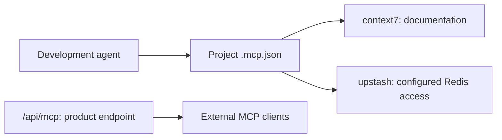

# Agents, Skills, Hooks and MCP Reference

This reference describes tracked project configuration. User-level tools and hooks require separate inspection.

## Layout

| Path                      | Role                                                                                                   | Read by             |
| ------------------------- | ------------------------------------------------------------------------------------------------------ | ------------------- |
| `AGENTS.md`               | The single source of project instructions                                                              | Codex, Claude Code  |
| `CLAUDE.md`               | `@AGENTS.md` import plus the Claude-only lines                                                         | Claude Code         |
| `REVIEW.md`               | Review severity, always-check list and skip list                                                       | CI review, reviewers |
| `.agents/skills/<name>/`  | Canonical project skills                                                                               | Codex               |
| `.claude/skills/<name>`   | Relative symlink to `../../.agents/skills/<name>`                                                      | Claude Code         |
| `.claude/rules/*.md`      | Path-scoped rules with `paths:` frontmatter                                                            | Claude Code         |
| `.claude/agents/`         | One read-only agent for the CI review job                                                              | Claude Code         |
| `.claude/settings.json`   | Team permissions (deny rules) and the hooks                                                            | Claude Code         |
| `.mcp.json`, `.codex/config.toml` | The same MCP servers, one file per tool (project layer, trusted projects only for Codex) | Claude Code, Codex  |
| `.github/CODEOWNERS`      | Code owner for every path above                                                                        | GitHub              |

Personal configuration stays out of the repository: `CLAUDE.local.md`, `.claude/settings.local.json`
and the user-level homes of each tool. Symlinks need `core.symlinks` on Windows checkouts.

## Project skills

| Skill                    | Use                                                                                          | Invocation        |
| ------------------------ | -------------------------------------------------------------------------------------------- | ----------------- |
| `visual-baseline-regen`  | Refresh affected Darwin and Linux screenshot baselines using its platform-specific procedure | model or user     |
| `ai-eval-update`         | Maintain the ask corpus, calibration, runner and CI eval job                                 | model or user     |
| `plan-review`            | Check a spec or plan against scope, JS budget, API constraints and Lighthouse floors         | model or user     |
| `perf-budget`            | Diagnose a failing route-JS or Lighthouse budget                                             | model or user     |
| `seo-discovery`          | Keep sitemap, robots, llms.txt, the JSON profile and metadata consistent                     | model or user     |
| `pr-review-orchestrator` | Review a diff across relevant domains, with local and CI profiles                            | user only         |
| `semgrep`                | Run the pinned static-analysis wrapper when explicitly requested                             | user only         |

Each skill is self-contained: it names no other skill, agent or command, and no config path. Frontmatter
uses the Agent Skills keys (`name`, `description`, `license`, `compatibility`, `metadata`,
`allowed-tools`). The two user-only skills add `disable-model-invocation: true`, a Claude Code key
that other consumers of the standard, such as claude.ai uploads, may reject; the Codex equivalent
is `agents/openai.yaml` with `policy.allow_implicit_invocation: false`. A guard test keeps the two in step.

## Agent and hooks

`.claude/agents/review-worker.md` is the only project agent. It has `Read`, `Grep` and `Glob` only, and
the CI review job dispatches it for bounded investigations. A test pins its tool list.

`.claude/settings.json` registers three hooks. A `PreToolUse` hook on `Bash` runs `scripts/guard-merge-main.mjs`: for each `gh pr merge` it asks `gh pr view` for the PR base and exits 2 when the base is `main` or `master`, or cannot be read (gh missing, offline, no such PR), so an unknown base fails closed. It does not see `gh api` merges. A second `PreToolUse` hook, on `Edit`, `Write`, `MultiEdit` and `NotebookEdit`, runs `scripts/guard-test-edits.mjs`: while a fix task is declared it exits 2 on any edit to an existing test file (`*.test|spec|e2e.{ts,tsx,js,mjs}`, or anything under `tests/` or `__tests__/`), and tells the agent to prove the defect in a new test file and change the source instead. Creating a new test file is always allowed. A fix task is declared when `FIX_MODE=1` is in the session environment or the gitignored marker `.claude/fix-mode` exists; unsetting the variable or deleting the marker lifts it. It does not see edits made through `Bash` (`sed -i`, redirects), and the agent can delete the marker, so it stops drift, not a determined bypass. Codex has no equivalent hook here; the rule is written in `AGENTS.md`. A `Stop` hook runs `scripts/stop-verify.mjs`: Biome on the
changed files, then the typecheck when TypeScript changed. It measured about half a second on a
warm tree, exits 2 to keep the turn going when a check fails, and does nothing in CI or when it is
already continuing a turn. Heavy checks stay in the pre-push hook and CI.

The permission deny rules turn the rules with no exceptions into enforcement for Claude Code:
broad `git add`, npm and yarn installs, and reads of local env files. Codex has no
equivalent here, so the same rules are also written in `AGENTS.md`.

No project hook proves that a pre-PR review or an API review took place; those are conventions.

## Git hooks

| Hook         | Runs                                                                                                 |
| ------------ | ---------------------------------------------------------------------------------------------------- |
| `pre-commit` | `pnpm check`, then `pnpm gitleaks:staged`                                                            |
| `commit-msg` | commitlint, including mandatory scope                                                                |
| `pre-push`   | Rejects remote `refs/heads/main`; checks branch names and runs `pnpm verify` for non-deletion pushes |

A deletion-only push skips branch-name and verify checks after the main-ref guard. Runtime gates remain a manual pre-PR step.

## Rules and permissions

Path-scoped rules in `.claude/rules/` load when a matching file is read:

| Rule                   | Paths                                                                    |
| ---------------------- | ------------------------------------------------------------------------ |
| `api-boundary.md`      | `app/api/**`, `lib/rate-limit.ts`, `lib/server/**`, `proxy.ts`           |
| `client-components.md` | `components/**`, `design-system/**`, `app/css/**`, `**/*.client.tsx`     |
| `ci-and-config.md`     | `.github/**`, `.husky/**`, `scripts/**`, `biome.json`, test and Lighthouse configs |

`.claude/settings.json` does not set `defaultMode`.

## MCP connections

| Server     | Tracked configuration        | Role                                                     |
| ---------- | ---------------------------- | -------------------------------------------------------- |
| `context7` | HTTP endpoint in `.mcp.json` | Library documentation                                    |
| `upstash`  | stdio command in `.mcp.json` | Redis access using the supplied read-only API credential |

`.codex/config.toml` declares the same two servers for Codex; the Upstash command runs through `sh -c` because Codex does not expand variables inside `args`, and `env_vars` forwards the two credentials. A guard test keeps the server names and URLs equal across the two files. The configuration declares connections. It does not prove startup, available tools or credential permissions. GitHub, Vercel and browser tools are not declared in this project file.

The product endpoint `app/api/mcp/route.ts` is separate from the development connections.

## Review checks

| Command            | Contract                                                                                                                                                                                                                                          |
| ------------------ | ------------------------------------------------------------------------------------------------------------------------------------------------------------------------------------------------------------------------------------------------- |
| `pnpm claude-gate` | Optional. After a requested review, the latest claude-review verdict must approve the current HEAD; an Approve on an ancestor SHA carries across a nonempty diff containing only visual baseline PNGs, and missing SHAs or other stale diffs fail |
| `pnpm pr:gate`     | Review threads must be resolved and carry a reply; a COMMENTED or APPROVED review from the owner, a member or a collaborator must contain `self-review: <current head SHA>` (`missing_self_review`); reports suspicious self-resolution                                                                                                                                                             |

`.github/workflows/claude-review.yml` runs a review only when an OWNER, MEMBER or COLLABORATOR comments `/claude-review` on a PR; no open or push starts it, and the review is never a merge requirement. `.github/workflows/claude.yml` handles human `@claude` mentions. The review job reads `.github/claude-review-prompt.md`, `REVIEW.md` and the `pr-review-orchestrator` skill from the default branch, and looks for the skill under `.agents/skills` first and `.claude/skills` second, so it works before and after the shared layout lands. Pre-PR review is procedural, independent of both workflows.
