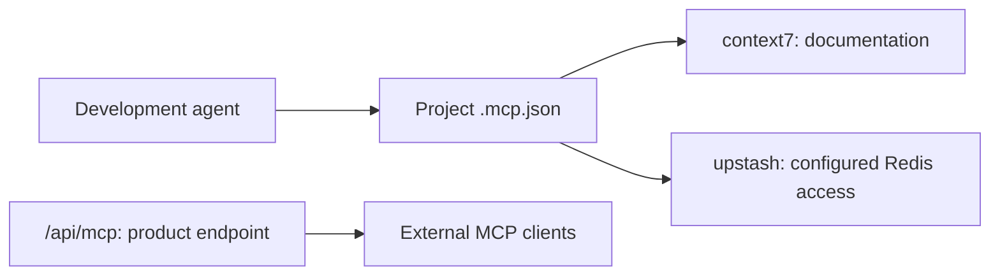

# Agents, Skills, Hooks and MCP Reference

This reference describes tracked project configuration. User-level tools and hooks require separate inspection.

## Project skills

| Skill                    | Use                                                                                          |
| ------------------------ | -------------------------------------------------------------------------------------------- |
| `visual-baseline-regen`  | Refresh affected Darwin and Linux screenshot baselines using its platform-specific procedure |
| `ai-eval-update`         | Maintain the ask corpus, calibration, runner and CI eval job                                 |
| `pr-review-orchestrator` | Review a diff across relevant domains, with local and CI profiles                            |
| `semgrep`                | Run the pinned static-analysis wrapper when explicitly requested                             |

Read each `.claude/skills/<name>/SKILL.md` for its trigger and procedure. `.claude/commands/commit.md` delegates scoped commit creation to `commit-commands:commit`.

## Project agent hooks

`.claude/settings.json` has no `hooks` block. The repository does not register `PreToolUse`, `PostToolUse` or `SessionStart` handlers. This says nothing about user-global runtime configuration.

Architect review before planning, security review after API changes and pre-PR review are conventions in `CLAUDE.md`. There is no project hook proving those dispatches occurred.

## Git hooks

| Hook         | Runs                                                                                                 |
| ------------ | ---------------------------------------------------------------------------------------------------- |
| `pre-commit` | `pnpm check`, then `pnpm gitleaks:staged`                                                            |
| `commit-msg` | commitlint, including mandatory scope                                                                |
| `pre-push`   | Rejects remote `refs/heads/main`; checks branch names and runs `pnpm verify` for non-deletion pushes |

A deletion-only push skips branch-name and verify checks after the main-ref guard. Runtime gates remain a manual pre-PR step.

## Rules and permissions

`.claude/rules/api-boundary.md` supplies path-scoped API guidance for `app/api/**`, `lib/rate-limit.ts`, `lib/server/**` and `proxy.ts`.

`.claude/settings.json` lists allowed skill invocations and denied `fallow fix` command forms. It does not set `defaultMode`.

## MCP connections

| Server     | Tracked configuration        | Role                                                     |
| ---------- | ---------------------------- | -------------------------------------------------------- |
| `context7` | HTTP endpoint in `.mcp.json` | Library documentation                                    |
| `upstash`  | stdio command in `.mcp.json` | Redis access using the supplied read-only API credential |

The configuration declares connections. It does not prove startup, available tools or credential permissions. GitHub, Vercel and browser tools are not declared in this project file.

The product endpoint `app/api/mcp/route.ts` is separate from the development connections.

## Review checks

| Command            | Contract                                                                               |
| ------------------ | -------------------------------------------------------------------------------------- |
| `pnpm claude-gate` | Latest claude-review verdict must approve the current HEAD; missing or stale SHA fails |
| `pnpm pr:gate`     | Review threads must be resolved and carry a reply; reports suspicious self-resolution  |

`.github/workflows/claude-review.yml` runs automatic review for non-draft PRs authored by non-Bot owners, members or collaborators. An authorized `/claude-review` comment can also trigger it. `.github/workflows/claude.yml` handles human `@claude` mentions. Pre-PR review is procedural, independent of both workflows.
