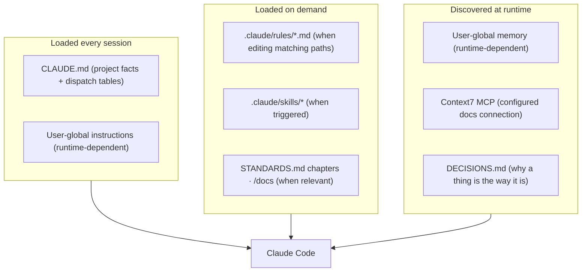

# AI-Assisted Development

> How AI participates across the SDLC. This doc describes the agent context, work loop and repository checks. For the per-artifact reference (every hook, skill, agent), see [agents-skills-hooks-mcp](./agents-skills-hooks-mcp.md).

## Where AI shows up in the lifecycle

```mermaid
sequenceDiagram
    participant H as Human (owner)
    participant C as Claude Code (main loop)
    participant A as Subagents (review workers, architect)
    participant G as Git hooks and scripts
    participant CI as CI

    H->>C: intent ("build X" / "fix Y")
    C->>C: /speckit.specify (intent + approach)
    C->>A: architect-reviewer (spec gate)
    A-->>C: GATE_RESULT: PASS (workflow convention)
    C->>C: writing-plans + thinking-risk-premortem (failure modes -> tasks)
    C->>C: TDD implement (tests first)
    C->>G: commit runs Biome, staged gitleaks and commitlint
    C->>C: self-review the diff (pr-review-orchestrator skill)
    C->>A: scoped review investigation
    A-->>C: findings
    C->>G: git push (pre-push: main guard, branch name, pnpm verify)
    C->>CI: open eligible PR; CI runs checks and filtered runtime jobs
    CI->>C: claude-review posts inline findings + Verdict
    CI-->>C: review threads
    C->>C: drive threads to resolved -> green
    H->>CI: owner squash-merges (project convention)
```

## 1. Context engineering (what the agent knows)

Project instructions divide context between always-loaded guidance and task-specific references. The guiding principle (`CLAUDE.md` rule-hygiene): pick the cheapest slot that still fires when needed. **gate > skill > path-scoped rule > memory > prose in CLAUDE.md.** Prose in `CLAUDE.md` is the most expensive slot (it taxes every session), so it is reserved for always-true facts and kept under 275 lines by `check:harness-size`.



- **`CLAUDE.md`** is an index plus dispatch tables (which skill/agent fires on which trigger), not a procedure manual.
- **`.claude/rules/api-boundary.md`** loads only when the agent reads `app/api/**`, `lib/rate-limit.ts`, `lib/server/**`, or `proxy.ts` (path-scoped via `paths:` frontmatter). This keeps API-specific guidance out of always-loaded context.
- User-global memory behavior depends on the active runtime. `.remember/` is the session-handoff location referenced by `CLAUDE.md`.

## 2. The agent's working loop

The project instructions define this loop. The table distinguishes conventions from mechanical checks:

| Step               | Mechanism                                        | Enforced by                                                     |
| ------------------ | ------------------------------------------------ | --------------------------------------------------------------- |
| Explore + plan     | brainstorming, writing-plans                     | architect-reviewer PASS (convention)                            |
| Anticipate failure | thinking-risk-premortem, pre-mortem              | convention + plan tasks                                         |
| Implement          | test-first project rule                          | convention                                                      |
| Self-verify        | project verification rule                        | convention + `pnpm verify`                                      |
| Review             | pre-PR self-review, then claude-review on the PR | `pnpm claude-gate` (fail-closed on a stale or SHA-less Approve) |
| Resolve            | reply in each review thread, then resolve it     | `pnpm pr:gate` (fails `silent_resolve`)                         |
| Record             | DECISIONS.md ADR                                 | PR template checklist (author confirmation)                     |

## 3. Review. claude-review on the PR, self-review before it

**claude-review (claude[bot]) runs automatically** on eligible PR open and push events, posting findings as inline review comments anchored to changed lines and closing with a `Verdict:` line that `pnpm claude-gate` reads fail-closed.

Pre-PR review is a convention: read the diff and run the project review procedure. `pnpm pr:gate` checks thread resolution on the PR.

## 4. Enforcement boundaries

`.claude/settings.json` registers no project agent-runtime hooks. Git hooks run Biome and staged gitleaks at pre-commit, commitlint at commit-msg, and branch/main-ref checks plus `pnpm verify` at pre-push.

CI runs separate quality, typecheck, unit-test and build jobs. Runtime and AI jobs use change filters. Semgrep findings are report-only; the fixture and report-existence checks can still fail. User-global runtime restrictions require separate inspection.

## 5. CI-side AI workflows

`.github/workflows/claude-review.yml` handles automatic PR review. `.github/workflows/claude.yml` handles human `@claude` mentions. They have different triggers and permissions.

## Prompt architecture (the shapes of AI work)

The repo encodes distinct prompt patterns for distinct SDLC stages:

| Stage               | Prompt shape                                      | Where it lives                                     |
| ------------------- | ------------------------------------------------- | -------------------------------------------------- |
| Specification       | brainstorm -> spec with Context/Gaps/Changes      | `/speckit.specify`, the spec template              |
| Architecture review | four-gate spec-gate -> `GATE_RESULT: PASS/FAIL`   | `architect-reviewer` agent                         |
| Implementation      | TDD: failing test first, smallest change          | `test-first discipline (CLAUDE.md skill dispatch)` |
| Review              | `pr-review-orchestrator` skill, scoped by change  | `CLAUDE.md` working agreement                      |
| Documentation       | reverse-engineer from code, route don't duplicate | source comparisons and canonical documentation     |

Choose verification from the affected behavior and the project gate requirements. A docs-only change still runs `pnpm ci:local` under `CLAUDE.md`.
