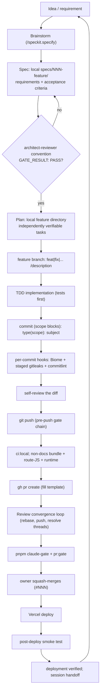
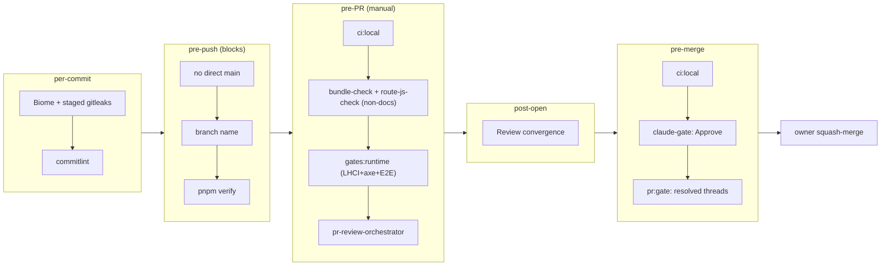

# Development Lifecycle

How a change flows from requirement to production. Git hooks and CI enforce checks; project instructions also require procedural review steps.

## The lifecycle at a glance

## Phase by phase

### 1. Idea -> Brainstorm

Work starts with `/speckit.specify` (mandated before any feature). The output is a shared understanding of intent, requirements, and the chosen approach, with failure modes considered up front (`thinking-risk-premortem`).

### 2. Spec (the approved requirements)

Write the feature requirements and acceptance criteria under local `specs/NNN-feature/`. `.gitignore` excludes `specs`, `.specify` and generated spec-kit skills. Artifact templates belong to the installed tooling; they are not tracked project contracts.

### 3. The architect gate

Before a plan is written, an `architect-reviewer` agent runs the four-gate spec protocol and must return `GATE_RESULT: PASS`. This is a convention, not a project hook.

### 4. Plan (the decomposed "how")

Decompose the requirements into independently verifiable tasks under the feature directory. Large changes use an integration branch and focused sub-PRs, as described in `CLAUDE.md`.

### 5. Branch + TDD implementation

A feature branch is created (`<type>/<description>`, enforced by `.husky/pre-push`). Implementation is test-first (`test-first discipline (CLAUDE.md skill dispatch)` is mandated before writing any new file/function/script). The agent works in scope blocks, one logical unit per commit.

### 6. Commit (per-commit gates)

- **`pre-commit`**: `pnpm check` (Biome check) and staged gitleaks scanning.
- **`commit-msg`**: commitlint. Conventional Commits with a **mandatory scope** (`scope-empty: [2, 'never']`) drawn from an **open set** (`scope-enum: [0]`). Scopes are feature-area names (`ci`, `dx`, `observability`, `healthz`, `ppr`, `arch`, ...), not technical categories.

### 7. Pre-PR self-review, and the pre-push gate chain

Before opening the PR, read the diff and run the `pr-review-orchestrator` skill over it; there is no project review-stamp gate. For non-deletion pushes, `.husky/pre-push` checks the main target, branch name and `pnpm verify`. Deletion-only pushes skip branch naming and verify after the main-target guard.

### 8. Pre-PR -> open PR

Run `pnpm ci:local`, then `pnpm bundle-check` and `pnpm route-js-check`, then `pnpm gates:runtime` (build, server, LHCI desktop/mobile, axe, E2E). Docs-only changes skip bundle, route-JS and runtime gates under the project workflow. Then `gh pr create` fills the PR template; every section must be non-empty, which is a convention checked by the author and the reviewer, not a gate.

### 9. Review convergence loop

On eligible open PRs, claude-review posts inline findings on open and push events. Drive it to green: rebase before every push, verify the pushed SHA landed, poll the run to completion rather than trusting a green job, and reply citing the fix SHA before resolving a thread.

### 10. Pre-merge gates -> merge

`pnpm claude-gate` (`scripts/check-claude-approval.ts`) requires the latest claude-review verdict to be Approve on the current head, fail-closed on a stale or SHA-less Approve. `pnpm pr:gate` (`scripts/check-pr-comments.ts`) requires every review thread to be resolved and flags `suspicious_self_resolve`. Run `pnpm ci:local` alongside both.

### 11. Deploy -> smoke -> record

Vercel deploys on merge to `main`. The `smoke.yml` workflow verifies the production deployment (healthz, 7 security headers, apex->www redirect, `/api/ask` + `/api/contact` liveness) and emails on a 503. The decision is recorded as an ADR in `DECISIONS.md` (with a reversibility note), and session state is handed off via `.remember/`.

## The responsive critique pass

A UI change is read at every width before its PR opens. Each section gets a critique pass, the findings are fixed, and the fixes land in one PR.

**Widths.** 320, 375, 390, 412, 768, 1024 and 1280. The narrow widths catch a label or a target that no longer fits, 768 catches the layout that only breaks in the middle, and 1280 is the desktop reference.

**Lenses.** Read every section through five lenses:

| Lens                     | The question it asks                                             |
| ------------------------ | ---------------------------------------------------------------- |
| Information architecture | Is the content in an order a reader can follow?                  |
| Responsive layout        | Does the layout hold at each width above?                        |
| Accessibility            | Can every control be reached, named and operated?                |
| Heuristics               | Does the surface show what happened and what to do next?         |
| Copy                     | Does the wording say what the reader needs, in the fewest words? |

**One PR per pass.** A pass collects its findings and fixes them in one branch and one pull request, so a reviewer reads one change.

**Screenshots.** Capture each section at 2x at 1280, 768 and 390, with the fixed chrome hidden, so the capture shows the section and not the chrome over it. `stripVolatileChrome` in `tests/e2e/_helpers/mask-volatile.ts` is the list of chrome hidden before a capture; add any new fixed or sticky bar to it.

A finding that changes behavior is a decision, so it lands in `DECISIONS.md` as a dated bullet. A finding that touches a CI-gated baseline follows `.claude/skills/visual-baseline-regen`.

## The gate chain between "written" and "merged"

