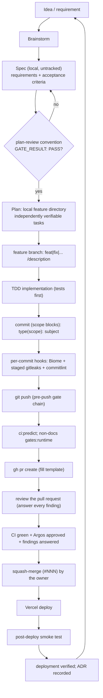
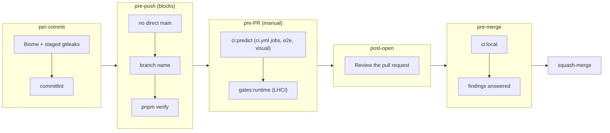

# Development Lifecycle

How a change flows from requirement to production. Git hooks and CI enforce checks; project instructions also require procedural review steps.

## The lifecycle at a glance

## Phase by phase

### 1. Idea -> Brainstorm

Work starts with a short brainstorm. The output is a shared understanding of intent, requirements, and the chosen approach, with failure modes considered up front.

### 2. Spec (the approved requirements)

Write the feature requirements and acceptance criteria. Specs stay local: `.gitignore` excludes `specs`, `.specify` and generated spec-kit skills, and the tool that writes a spec is each engineer's choice.

### 3. The plan gate

Before a plan is written, the `plan-review` skill runs the four-gate protocol against the spec and must return `GATE_RESULT: PASS`. This is a convention, not a project hook.

### 4. Plan (the decomposed "how")

Decompose the requirements into independently verifiable tasks under the feature directory. Large changes use an integration branch and focused sub-PRs, as described in `AGENTS.md`.

### 5. Branch + TDD implementation

A feature branch is created (`<type>/<description>`, enforced by `.husky/pre-push`). Implementation is test-first (`test-first discipline (AGENTS.md)` is mandated before writing any new file/function/script). The agent works in scope blocks, one logical unit per commit.

### 6. Commit (per-commit gates)

- **`pre-commit`**: `pnpm check` (Biome check) and staged gitleaks scanning.
- **`commit-msg`**: commitlint. Conventional Commits with a **mandatory scope** (`scope-empty: [2, 'never']`) drawn from an **open set** (`scope-enum: [0]`), and the subject must not start sentence-case, start-case, PascalCase or upper-case. Scopes are feature-area names (`ci`, `dx`, `observability`, `healthz`, `ppr`, `arch`, ...), not technical categories.

### 7. Pre-PR diff read, and the pre-push gate chain

Before opening the PR, read the diff. For non-deletion pushes, `.husky/pre-push` checks the main target, branch name and `pnpm verify`. The verify chain includes `pnpm check:test-integrity` (`scripts/check-test-integrity.ts`, also a `quality-fast` step in CI): it fails a focused test, a test body with no assertion (a call to a helper that asserts counts, whether it is local, imported by name or default, or reached through a re-export) and a skip without a reason string. Deletion-only pushes skip branch naming and verify after the main-target guard. Adding or upgrading a direct dependency also means updating its entry in `dependency-vetting.json` (purpose, license), because `pnpm verify` runs `check:dependency-vetting`.

### 8. Pre-PR -> open PR

Run `pnpm ci:predict` (add `--linux` when the change touches layout, fonts or metrics): it runs every CI job the commits trigger and says which it could not verify (exit 0 only for a fully verified clean run, 3 when jobs are partial or not run or the branch has no commits ahead of its base, 2 for `--list`), including the verify chain, the bundle and route-JS gates, the new or changed e2e specs and the visual spec, and it subsumes `pnpm ci:local`, `pnpm bundle-check` and `pnpm route-js-check`. Lighthouse is host-dependent and stays with `pnpm gates:runtime` (build, server, LHCI desktop/mobile, axe, E2E). Docs-only changes skip bundle, route-JS and runtime gates under the project workflow. Then `gh pr create` fills the PR template; every section must be non-empty, which is a convention checked by the author and the reviewer, not a gate.

### 9. Review threads

On the open PR, review it: the `pr-review-orchestrator` skill dispatches one specialist per material domain, applies every matching skill and reads the rendered result as images. Answer every blocking finding. claude-review runs only when an owner, member or collaborator comments `/claude-review`, with no automatic follow-up round.

### 10. Pre-merge gates -> merge

The gates are `pnpm ci:local` and CI, with CI green, the Argos visual check approved and the base contained, plus a review whose blocking findings are answered. The conversation state is not a gate: nothing in CI reads the review threads.

### 11. Deploy -> smoke -> record

Vercel deploys on merge to `main`. `attest-build` in `ci.yml` attests the build artifact on `main` only. The `smoke.yml` workflow verifies the production deployment (healthz, 7 security headers, apex->www promotion followed to its final 200, `/api/ask` + `/api/contact` liveness): the artifact probe is skipped for a protected `*.vercel.app` deployment without its bypass secret, and a canonical healthz 503 attempts a Resend alert only when that secret is configured, with delivery errors logged as warnings. The decision is recorded as an ADR in `DECISIONS.md` (with a reversibility note); no project file establishes a session-handoff location.

## The responsive critique pass

A UI change is read at every width before its PR opens. Each section gets a critique pass, the findings are fixed, and the fixes land in one PR.

**Widths.** 320, 375, 390, 412, 768, 1024 and 1280. The narrow widths catch a label or a target that no longer fits, 768 catches the layout that only breaks in the middle, and 1280 is the desktop reference.

**Lenses.** Read every section through five lenses:

| Lens                     | The question it asks                                             |
| ------------------------ | ---------------------------------------------------------------- |
| Information architecture | Is the content in an order a reader can follow?                  |
| Responsive layout        | Does the layout hold at each width above?                        |
| Accessibility            | Can every control be reached, named and operated?                |
| Heuristics               | Does the surface show what happened and what to do next?         |
| Copy                     | Does the wording say what the reader needs, in the fewest words? |

**Captures.** A section capture hides the fixed chrome, so it shows the section and not the chrome over it. `stripVolatileChrome` in `tests/e2e/_helpers/mask-volatile.ts` is the list of chrome hidden before a capture; add any new fixed or sticky bar to it.

A finding that changes behavior is a decision, so it lands in `DECISIONS.md` as a dated bullet. A finding that touches a CI-gated baseline follows the `visual-baseline-regen` skill.

## The gate chain between "written" and "merged"

