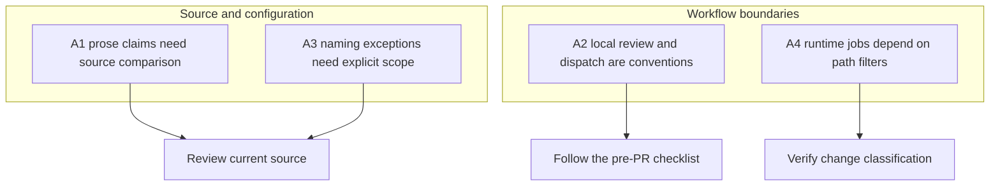

# Engineering Audit

This audit separates repository checks from workflow conventions. See [engineering-standards](./engineering-standards.md) for the check map.

## Enforcement boundaries

| Area              | Current mechanism                                                                     | Limit                                                                   |
| ----------------- | ------------------------------------------------------------------------------------- | ----------------------------------------------------------------------- |
| Commit safety     | `.husky/pre-commit` runs Biome and staged gitleaks; `commit-msg` runs commitlint      | Hooks can be bypassed; CI supplies independent checks                   |
| Push safety       | `.husky/pre-push` checks the remote main ref, branch name and `pnpm verify`           | Runtime browser gates are a manual pre-PR step                          |
| Documentation     | `check:doc-drift` checks the `ARCHITECTURE.md` tree; component-docs checks headings   | Neither validates every prose claim                                     |
| Review            | `claude-gate` checks the latest verdict against HEAD; `pr:gate` checks review threads | Pre-PR review and architect/security dispatch are conventions           |
| Product AI        | `ask:eval` runs calibration and corpus checks                                         | CI execution depends on the AI change filter and credentials            |
| Security analysis | gitleaks blocks on secrets; Semgrep uploads findings                                  | The Semgrep scan is report-only; its report and fixture checks can fail |

## Gaps to consider

### A1: Documentation checks cover structure, not meaning

A tree or heading can be correct while a described component, route or gate is wrong. Compare factual claims with source during review.

### A2: Pre-PR checks are procedural

There is no project agent-runtime hook requiring an architect PASS, security audit or completed local review. `CLAUDE.md` requires those steps. Git hooks and CI do not prove that they happened.

### A3: Client naming has explicit exceptions

`scripts/check-client-naming.mjs` scans `app`, `components` and `lib`. It accepts `*.client.tsx`, `*.client.ts`, files under a `client` directory and Next error boundaries. It does not scan `design-system`, where `Field.tsx` has a client directive.

### A4: Browser checks depend on path classification

CI uses `scripts/detect-changes.mjs` to decide whether app, UI and AI jobs run. New source locations must be included in the appropriate filters. `check:detect-changes-paths` checks filter paths, but cannot infer every semantic dependency.

## Improvement map

These are source-level findings. They do not establish current GitHub protection settings or deployed service health.
