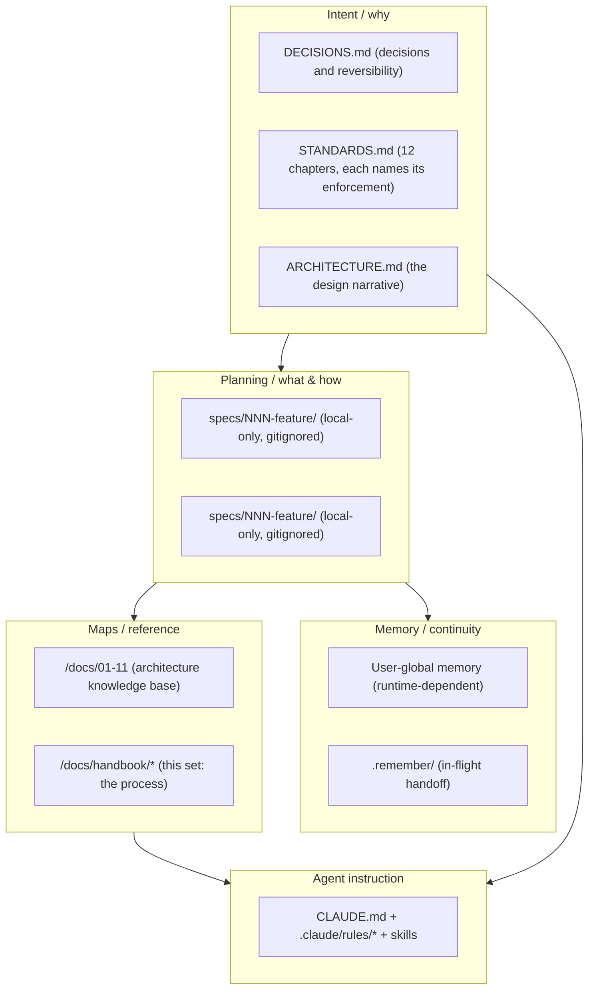
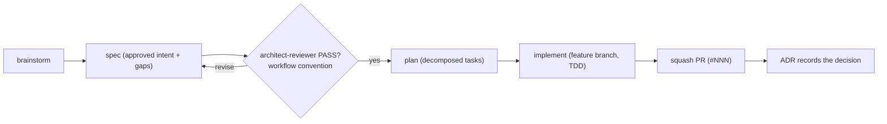

# Knowledge Architecture

> How engineering knowledge is organized, where each kind of knowledge lives, and the documentation standards. Use the table below to locate each kind of reference.

## The knowledge hierarchy



## Where each kind of knowledge lives

| Knowledge                    | Lives in                                      | Format                                        |
| ---------------------------- | --------------------------------------------- | --------------------------------------------- |
| Why a decision was made      | `DECISIONS.md`                                | dated ADR bullet + reversibility note         |
| The engineering bar          | `STANDARDS.md`                                | 12 chapters, each naming its enforcement gate |
| The system's design          | `ARCHITECTURE.md`                             | narrative + trade-offs                        |
| What to build (approved)     | `specs/NNN-feature/` (local-only, gitignored) | Context / Gaps / Changes / Status             |
| How to build it (decomposed) | `specs/NNN-feature/` (local-only, gitignored) | step-by-step tasks, sharded for sub-PRs       |
| The codebase map             | `/docs/01-11`                                 | reverse-engineered, diagram-first             |
| How engineering happens      | `/docs/handbook/`                             | this set                                      |
| Agent behavior               | `CLAUDE.md`, `.claude/rules/*`, skills        | instructions + dispatch tables                |
| Learned preferences          | `MEMORY.md` + `feedback_*.md`                 | runtime-specific notes                        |
| Session continuity           | `.remember/`                                  | timestamped handoff blocks                    |

## The ADR convention (load-bearing)

Every decision is recorded in `DECISIONS.md` as:

```
**YYYY-MM-DD** · **Decision title.** <mechanism: what changed, the causal why, the
failure mode it addresses> _Reversible: <exactly how to undo this>._
```

Rules that make the log trustworthy:
- **Reversibility is mandatory.** Every entry ends with how to undo it. This is what lets a solo developer move fast: nothing is a one-way door without saying so.
- **Failed attempts are recorded, not deleted.** "Falsified first attempt: ..." entries (e.g. the PSI twice-daily cron rejected by Vercel Hobby) preserve the reasoning so the same dead end is not re-explored.
- **Evidence is cited.** SHAs, PR numbers, and external doc URLs ground each claim.
- **Newest first**, grouped by working session.

## The spec -> plan pipeline

The project workflow separates requirements, planning and implementation:



A spec is the approved "what and why" with explicit gaps to close. A plan decomposes it into tasks and, for large work, focused sub-PRs. Architect review sits between them as a workflow convention. No project hook enforces it.

### Planning artifacts

Keep requirements, unresolved questions and implementation tasks together under the feature's local `specs/NNN-feature/` directory. Consult the active spec-kit templates for the artifact names and required sections. Local artifacts are not evidence that a tracked check ran.

## Memory and continuity

`CLAUDE.md` references `.remember/` for session handoff. The project has no hook or script that establishes a complete auto-memory lifecycle. User-global memory location, loading limits and save behavior depend on the active runtime configuration.

## Documentation standards

The documentation workflow uses these checks and conventions:
1. **Reverse-engineer from code; route, do not duplicate.** New docs cite the code and link to canonical docs rather than copying them. Where a doc and the code disagree, the code wins and the doc is a bug.
2. **Diagram-first.** Mermaid for any flow, hierarchy, or sequence (committable directly).
3. **`CLAUDE.md` is capped** at 275 lines (`check:harness-size`). Procedures move to skills or path-scoped rules; the slot-routing rule (gate > skill > rule > memory > prose) decides where any new instruction goes.
4. **`ARCHITECTURE.md` tree must match disk** (`check:doc-drift` checks that tree). It does not validate all documentation claims.
5. **Design-system changelog is generated**, not hand-written (`pnpm changelog:sync` from git history).
6. **ADRs are mandatory for architectural change** (the PR template asks the author to confirm it; this is not an automated ADR check).

## Undocumented tribal knowledge (now documented)

The biggest implicit-knowledge items are captured in [`/docs/09-hidden-knowledge`](../09-hidden-knowledge.md): the nonce-less CSP rationale, the fail-open-everywhere-except-the-budget posture, the content-grounded AI persona, the Zod-tuple invariants, the `next-env.d.ts` build-flip, and the convention map. The remaining gaps (a per-section feature guide, an ADR-to-code cross-link index) are tracked in [roadmap](./roadmap.md).
