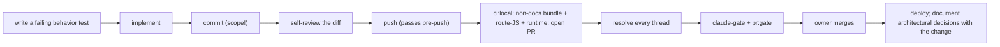

# Onboarding (Process)

> How to _do the work_, not just read the code. This complements the codebase onboarding in [`/docs/11`](../11-onboarding.md): that one gets you reading the architecture; this one gets you shipping through the gates.

## The 30-second model

You are joining a single-developer, AI-agent-assisted, spec-driven, gate-heavy platform. Work flows: brainstorm -> spec -> architect gate -> plan -> implement (test-first) -> self-review (`pr-review-orchestrator`) -> the gate chain -> squash-merge -> ADR. Git hooks and CI enforce checks. Architect review and pre-PR review are conventions.

## Day 1 - understand the flow before you touch it

1. Read [development-lifecycle.md](./development-lifecycle.md) and [review-merge-release.md](./review-merge-release.md). Now you know the path from idea to production and the gates on it.
2. Read [ai-assisted-development.md](./ai-assisted-development.md). Now you know how AI participates and how it is kept honest.
3. Skim [agents-skills-hooks-mcp.md](./agents-skills-hooks-mcp.md) as a reference; you will return to it.
4. From the architecture side, read [`/docs/02-domain`](../02-domain.md) and [`/docs/01-architecture`](../01-architecture.md) so you know _what_ you are building.

## Day 2 - run the gates locally

1. `pnpm install && pnpm dev`. Then `pnpm verify` once. Read what each gate checks ([engineering-standards](./engineering-standards.md)).
2. Read [`/docs/09-hidden-knowledge`](../09-hidden-knowledge.md) (the conventions that will trip you).
3. Your first push runs `.husky/pre-push`: it blocks a direct push to `main`, requires a `<type>/<description>` branch name, and runs the full `pnpm verify` chain. There is no project review-stamp check.

## Day 3 - make a change through the full pipeline

Pick a small change (a content edit or a design-system variant per the [workflow-playbook](./workflow-playbook.md)) and take it all the way:

This exercises the ordinary contribution path. Runtime checks depend on the affected surface.

## The five rules that matter most in practice

1. **Scope every commit.** `type(scope): subject`, scope mandatory, scope is the feature area. commitlint will reject you otherwise.
2. **Branch as `<type>/<description>`.** The pre-push hook enforces it; never commit on `main`.
3. **Review your diff before opening the PR** with the `pr-review-orchestrator` skill. No stamp or ledger gates the push; claude-review reviews the PR once it is open.
4. **A red gate is fixed by fixing the property**, never by disabling the gate.
5. **Record architectural decisions** in `DECISIONS.md` with a reversibility note.

## Who to "ask" (there is no team; ask the artifacts)

| Question                         | Source                                                                                    |
| -------------------------------- | ----------------------------------------------------------------------------------------- |
| Why is this like this?           | `DECISIONS.md` (search by date/topic)                                                     |
| What is the rule here?           | `STANDARDS.md` chapter + the enforcing gate                                               |
| How do I do X workflow?          | [workflow-playbook.md](./workflow-playbook.md)                                            |
| What does this gate want?        | run it and read its output                                                                |
| What is the agent allowed to do? | `CLAUDE.md` + `.claude/rules/*` + [agents-skills-hooks-mcp](./agents-skills-hooks-mcp.md) |
| What was just being worked on?   | `.remember/now.md`                                                                        |

## When you are stuck on a gate

| Symptom              | Remedy                                                  |
| -------------------- | ------------------------------------------------------- |
| Push blocked on main | push a feature branch and open a PR                     |
| Invalid branch name  | use a permitted `<type>/<description>` prefix           |
| commit rejected      | check the scope is present and the type is conventional |

## When you can independently contribute

You are ready when you can, without help: take a requirement through a spec and the architect gate, implement it test-first, get a clean self-review, pass the gate chain, open and converge a PR, and record the ADR. The [workflow-playbook](./workflow-playbook.md) is your reference until that is muscle memory.
