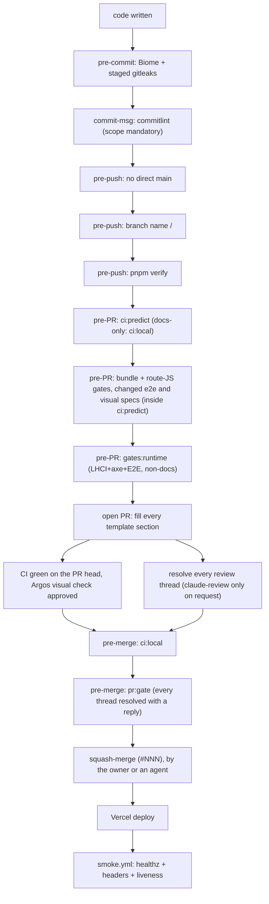
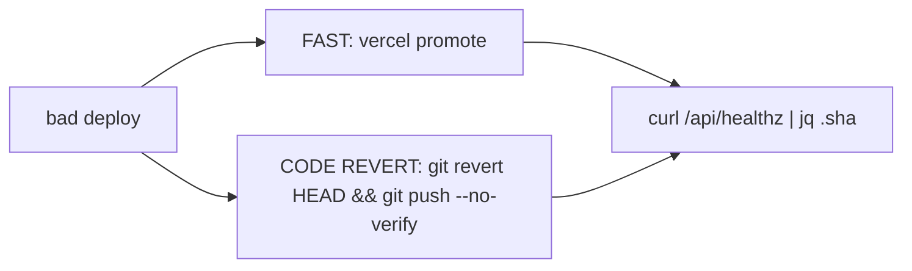

# Review, Merge & Release

> The gate chain from commit to production, the code-review process, review threads, and release/rollback. For the CI job graph, see [`/docs/07-workflows`](../07-workflows.md); this doc is the process and the ordering.

## The full gate chain (commit -> production)

## Code review

**claude-review (claude[bot]) is the AI reviewer.** It is opt-in: it runs only when an owner, member or collaborator comments `/claude-review` on the PR, and it is never a merge requirement. It posts one inline comment per finding anchored to a changed line and closes with a `Verdict:` line; a workflow step reds the job when the run posted none. It gathers evidence with the CI profile of the `pr-review-orchestrator` skill (`.claude/skills/pr-review-orchestrator/references/ci.md`): one `Task` subagent per material domain, and PR metadata, the diff and CI check results snapshotted by a workflow step before the review starts. The reviewer gets no `gh` or other shell command, and `--disallowedTools` denies the edit, git and push tools the action's tag mode would otherwise add, plus reads of `.git/` and other credential locations. No PR code runs in that job, so dependencies are not installed: for a dependency change it reviews the manifest and lockfile diff and names what only installed source could settle as a limit, which a local review can settle.

`claude-review` is requested, not automatic. It is a model-judged sensor: it reports findings, it does not approve, and no merge waits on it. Only correctness, security, accessibility, performance budget, test validity and spec or plan compliance block (`REVIEW.md`); style and naming never do, and nits are capped at five. No automatic follow-up round runs. Deterministic validation (tests, typecheck, lint, build, bundle and route-JS gates, CI) is the quality bar.

The `high-risk` label marks a pull request that changes a high-risk surface: the API and server code, the ask and agent code, rate limiting, env and IP-hash handling, contact delivery, `proxy.ts`, `next.config.ts` and `vercel.json`, the workflows, hooks and scanner configuration, CODEOWNERS and Dependabot settings, `.env.example`, and the dependency manifests, lockfile and workspace settings. `high-risk-label.yml` adds and removes it on every push from the list in `scripts/high-risk-paths.ts`, read from the PR's base commit. Read a labelled PR for the abuse paths each of those surfaces closes (`.claude/rules/api-boundary.md`) before anything else. The label limits no PR size, blocks no merge, and is not applied to fork or Dependabot PRs, whose token is read-only.

Answering threads: reply in the thread before resolving it, since `pnpm pr:gate` fails a thread resolved with no reply (`silent_resolve`); and put every comment in a review THREAD rather than an unanchored timeline comment, which `reviewThreads` cannot see.

After findings are answered, every finding fixed and every CI red becomes a candidate rule: if the mistake can repeat, append a numbered rule with the check that proves it to [`lessons.md`](./lessons.md) in the same PR. The next change reads that file before it starts.

## Pre-merge gates (`pnpm ci:local` + `pnpm pr:gate`)

In order: `ci:local` -> `check-pr-comments` (`pnpm pr:gate`, also run in CI by `quality-fast` on every PR: GraphQL `reviewThreads(first:100)` without pagination, every returned thread `isResolved` with a reply, flags `suspicious_self_resolve`). The base branch must be contained, CI green and the Argos visual check approved (the `e2e-visual-chromium` job uploads the screenshots; an agent may approve it). Once those hold, an agent may squash-merge the PR into an integration branch or into `main`; a direct push to `main` stays blocked by `.husky/pre-push`. GitHub branch-protection settings are not in the repository; the settings read from GitHub and the controls that stand in for a second reviewer are listed in the 2026-11-07 review-model entry of `DECISIONS.md`.

The pre-push hook rejects a remote `main` target. Live GitHub protection and bypass permissions require separate inspection.

## PR sizing (avoid the bloated-PR failure mode)

Large programs use an **integration branch + sub-PRs**: `feat/<feature>` off main, then `feat/<feature>-<part>` sub-PRs into it. Each sub-PR targets the integration branch and covers one reviewable unit.

A sub-PR is one milestone and opens complete. Before the first push it carries the code, its unit and
e2e tests, the responsive checks at 320, 390, 768, 1024 and 1280, regenerated darwin and linux visual
baselines, updated docs and diagrams, and any CI change the diff needs. The CI jobs a diff triggers
follow from it (path filters, LHCI target size and contrast, bundle and route JS budgets, visual
projects), so the affected ones can run locally first. macOS green does not mean Linux green: the
affected specs can run in the Playwright Linux image (`mcr.microsoft.com/playwright:v<installed version>-noble`)
against the local build.

## Release

- **Trigger:** squash-merge to `main` deploys via Vercel.
- **Verification:** `smoke.yml` (on `deployment_status == success && Production`) checks the canonical `/api/healthz` (the artifact probe is skipped for a protected `*.vercel.app` deployment without its bypass secret), the 7 security headers, apex->www promotion followed to its final 200 (the workflow asserts neither an intermediate 308 nor the final www host), and `/api/ask` + `/api/contact` liveness; a canonical healthz 503 attempts a Resend alert when that secret is configured, and delivery errors are warnings.
- **Cron:** `vercel.json` runs `/api/psi-refresh` daily (`0 3 * * *`) and `/api/contact-retry` daily (`0 4 * * *`).

## Rollback

Fast rollback is a Vercel promote (no code change). Slow rollback is a revert; the `--no-verify` is the documented escape hatch for the main-push guard (the revert still goes through CI after landing, but has no PR, which is the accepted emergency tradeoff).

`rollback-rehearsal.yml` rehearses the slow path every week: it reverts the latest commit on `main` in the runner only, then runs install, typecheck, tests and build on the reverted tree. It pushes nothing and never touches Vercel. A failure opens or updates the issue "Rollback rehearsal failed". See `docs/07-workflows.md`.

## Scheduled and auxiliary workflows

None of these gates a PR (`ci-gate` waits only on the jobs in `ci.yml`). Job-level detail is in [`/docs/07-workflows`](../07-workflows.md).

| Workflow                         | Trigger                                         | What it does                                                                                       |
| -------------------------------- | ----------------------------------------------- | -------------------------------------------------------------------------------------------------- |
| `ask-eval.yml`                   | Monday 05:00 UTC, manual                        | Runs `pnpm ask:eval` and republishes the stored result the site's AI metrics read                  |
| `agent-eval.yml`                 | Monday 06:00 UTC, manual                        | Runs `pnpm eval:agents`, the prompt-regression eval of the rules in `AGENTS.md`                     |
| `codeql.yml`                     | Push and PR to `main`, Monday 03:00 UTC, manual | CodeQL analysis of the JavaScript and TypeScript sources, reported to code scanning                 |
| `mutation.yml`                   | Sunday 04:00 UTC, manual                        | Stryker mutation run; fails when the runner produced no report                                      |
| `tool-pins.yml`                  | Monday 05:00 UTC, manual                        | `pnpm check:tool-pins`: fails when the pinned gitleaks or Semgrep version is behind the latest     |
| `lockfile-resolution-probe.yml`  | Monday 08:00 UTC, manual                        | Resolves every range without a lockfile and keeps one issue open while the release-age window blocks it |
| `weekly-metrics.yml`             | Monday 07:00 UTC, manual                        | Collects delivery metrics, checks them against `metrics/bands.json` and opens issues for breaches   |
| `rollback-rehearsal.yml`         | Monday 06:00 UTC, manual                        | Rehearses the slow rollback described above                                                         |
| `high-risk-label.yml`            | Pull request events                             | Adds or removes the `high-risk` label                                                               |
| `smoke.yml`                      | Successful production deployment                | Post-deploy checks described under Release                                                          |

## Docs-only changes

Run `pnpm ci:local`. The project workflow skips bundle, route-JS and runtime gates for docs-only changes. CI still builds; its runtime and AI jobs use `scripts/detect-changes.mjs` and `scripts/detect-changes-paths.mjs` for classification. MDX under `app/` is part of that app surface.
