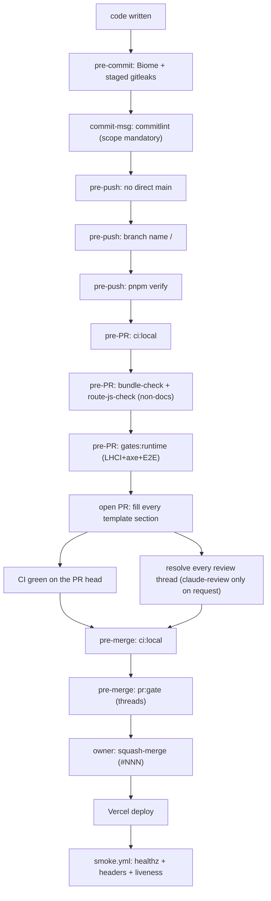
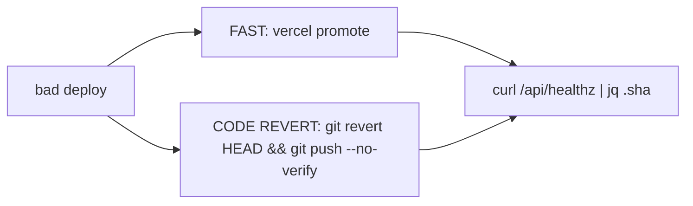

# Review, Merge & Release

> The gate chain from commit to production, the code-review process, review threads, and release/rollback. For the CI job graph, see [`/docs/07-workflows`](../07-workflows.md); this doc is the process and the ordering.

## The full gate chain (commit -> production)

## Code review

**claude-review (claude[bot]) is the AI reviewer.** It is opt-in: it runs only when an owner, member or collaborator comments `/claude-review` on the PR, and it is never a merge requirement. It posts one inline comment per finding anchored to a changed line and closes with a `Verdict:` line that the optional `pnpm claude-gate` parses fail-closed. It gathers evidence with the CI profile of the `pr-review-orchestrator` skill (`.claude/skills/pr-review-orchestrator/references/ci.md`): one `Task` subagent per material domain, and PR metadata, the diff and CI check results snapshotted by a workflow step before the review starts. The reviewer gets no `gh` or other shell command, and `--disallowedTools` denies the edit, git and push tools the action's tag mode would otherwise add, plus reads of `.git/` and other credential locations. No PR code runs in that job, so dependencies are not installed: for a dependency change it reviews the manifest and lockfile diff and names what only installed source could settle as a limit, which the local orchestrator then answers.

Review is requested, not automatic. After a `/claude-review` comment: fix every finding in one commit, reply in each thread with what was done and the fix SHA, then resolve; no automatic follow-up round runs. Any other model review (`pr-review-orchestrator`, a cross-provider review, a self-review) runs only when the owner asks. Deterministic validation (tests, typecheck, lint, build, bundle and route-JS gates, CI) is the quality bar, and the provider that made a change ships it.

Answering threads follows the project review procedure: rebase before _every_ push; verify the pushed SHA actually landed on the remote before citing it; reply in a thread citing the fix SHA _before_ resolving it; never resolve silently (a thread with one comment is a process gap); and put every comment in a review THREAD rather than an unanchored timeline comment, which `reviewThreads` cannot see.

After findings are answered, every finding fixed and every CI red becomes a candidate rule: if the mistake can repeat, append a numbered rule with the check that proves it to [`lessons.md`](./lessons.md) in the same PR. The next change reads that file before it starts.

## Pre-merge gates (`pnpm ci:local` + `pnpm pr:gate`)

In order: `ci:local` -> `check-pr-comments` (`pnpm pr:gate`, also run in CI: GraphQL `reviewThreads(first:100)` without pagination, every returned thread `isResolved`, flags `suspicious_self_resolve`). The base branch must be contained and CI green. GitHub branch-protection settings must be checked separately; repository files do not establish their live state.

`pnpm claude-gate` (`scripts/check-claude-approval.ts`) is an optional check: after a requested review it passes only when the latest claude-review verdict is Approve and names a head SHA that matches the current head. An Approve with no SHA, or a stale one, fails closed. When the head moved only through commits that touch visual baseline snapshots, `*-snapshots/*.png`, the Approve carries and the gate reports the carried SHA; any other file in the diff since the reviewed SHA, or a reviewed SHA that is not an ancestor of the head, fails closed as STALE. It is not part of merge readiness.

**AI agents never merge into `main`.** The repo owner runs the final squash-merge once all gates pass. Sub-PRs into an integration branch (`feat/*`) may be merged by an agent once CI is green (Argos excepted) and the review is done. For Claude Code, the `guard-merge-main` hook blocks `gh pr merge` when the PR base is `main` or cannot be determined; other tools rely on the written rule. The pre-push hook rejects a remote main target. Live GitHub protection and bypass permissions require separate inspection.

## PR sizing (avoid the bloated-PR failure mode)

Large programs use an **integration branch + sub-PRs**: `feat/<feature>` off main, then `feat/<feature>-<part>` sub-PRs into it. Each sub-PR targets the integration branch and covers one reviewable unit.

A sub-PR is one milestone and opens complete. Before the first push it carries the code, its unit and
e2e tests, the responsive checks at 320, 390, 768, 1024 and 1280, regenerated darwin and linux visual
baselines, updated docs and diagrams, and any CI change the diff needs. Predict each CI job from the
diff (path filters, LHCI target size and contrast, bundle and route JS budgets, visual projects) and
run the affected ones locally first. macOS green does not mean Linux green: run the affected specs in
the Playwright Linux image (`mcr.microsoft.com/playwright:v<installed version>-noble`) against the local
build before the push. The loop per milestone: finish, push once, request review, fix
every finding with a thread reply, land into the integration branch, start the next milestone.

## Release

- **Trigger:** squash-merge to `main` deploys via Vercel.
- **Verification:** `smoke.yml` (on `deployment_status == success && Production`) checks the canonical `/api/healthz` (the artifact probe is skipped for a protected `*.vercel.app` deployment without its bypass secret), the 7 security headers, apex->www promotion followed to its final 200 (the workflow asserts neither an intermediate 308 nor the final www host), and `/api/ask` + `/api/contact` liveness; a canonical healthz 503 attempts a Resend alert when that secret is configured, and delivery errors are warnings.
- **Cron:** `vercel.json` runs `/api/psi-refresh` daily (`0 3 * * *`) and `/api/contact-retry` daily (`0 4 * * *`).

## Rollback

Fast rollback is a Vercel promote (no code change). Slow rollback is a revert; the `--no-verify` is the documented escape hatch for the main-push guard (the revert still goes through CI after landing, but has no PR/claude-review, which is the accepted emergency tradeoff).

## Docs-only changes

Run `pnpm ci:local`. The project workflow skips bundle, route-JS and runtime gates for docs-only changes. CI still builds; its runtime and AI jobs use `scripts/detect-changes.mjs` and `scripts/detect-changes-paths.mjs` for classification. MDX under `app/` is part of that app surface.
