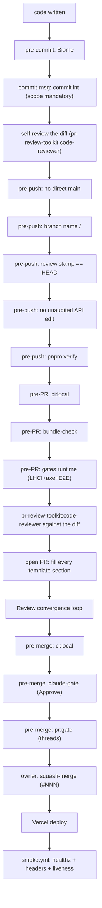
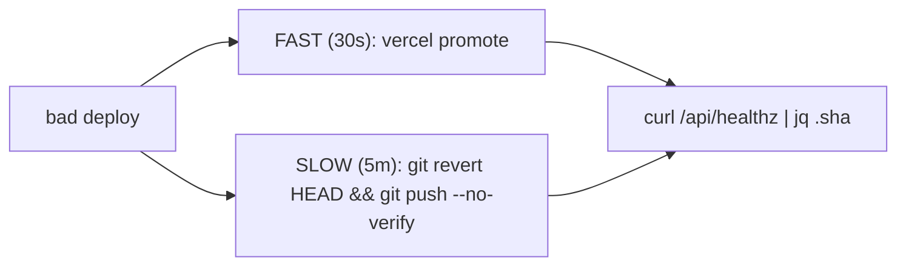

# Review, Merge & Release

> The gate chain from commit to production, the code-review process, the Review convergence loop, and release/rollback. For the CI job graph, see [`/docs/07-workflows`](../07-workflows.md); this doc is the process and the ordering.

## The full gate chain (commit -> production)

## Code review

**claude-review (claude[bot]) is the AI reviewer.** It runs automatically on PR open and on every push, posts one inline comment per finding anchored to a changed line, and closes with a `Verdict:` line that `pnpm claude-gate` parses fail-closed.

**The local 4-agent battery is not restored** — it, its findings ledger and `review:stamp` were removed on 2026-07-27 and stay removed. Pre-PR review is a discipline: read `git diff origin/main...HEAD` end to end, invoke `pr-review-toolkit:code-reviewer` against it, and fix every Critical/Important finding before `gh pr create`. Nothing gates that pre-PR pass, so nothing will tell you it was skipped.

On the open PR, the habits that were learned from real failures still apply and are still worth keeping: rebase before *every* push; verify the pushed SHA actually landed on the remote before citing it; reply in a thread citing the fix SHA *before* resolving it; never resolve silently (a thread with one comment is a process gap); and put every comment in a review THREAD rather than an unanchored timeline comment, which `reviewThreads` cannot see.

## Fix loop

The convergence loop runs **in GitHub Actions**. Cloning the repository is enough to get it: no local daemon, no external orchestrator, no command to remember.

**Trigger.** `.github/workflows/claude-fix.yml` runs on `workflow_run` when the `Claude Review` workflow completes. A `workflow_run` workflow is loaded from the default branch, so a pull request cannot author the fixer, its prompt or its gates.

**What one round does.** The fixer runs the same `anthropics/claude-code-action` pin as the reviewer, with the same `claude_code_oauth_token` auth input, so it acts as `claude[bot]` and its replies are the ones the merge gate reads. It verifies each finding against the code, fixes the real ones at the root (a behaviour change gets a failing test first), explains the wrong ones without changing code, runs `pnpm check`, `pnpm typecheck` and the affected unit tests, commits with a conventional scoped message, and pushes. The push carries the Claude App token, so it triggers the next review, and the loop repeats until the reviewer approves. Then, per thread, it replies with the commit link (`[`abc1234`](https://github.com/erikunha/portfolio/pull/123/commits/<full-sha>)`) and resolves the thread. `pnpm pr:gate` fails `silent_resolve` on a thread resolved without a reply; the commit-link format is checked by the sibling branch `chore/review-reply-commit-link`.

**Guards.** The fixer acts only when all of these hold:

| Guard | Rule | Where |
|---|---|---|
| Fork | The head repository is this repository. A fork never reaches a step that holds a write token. | `claude-fix.yml` job condition + `scripts/check-claude-fix-trigger.mjs` |
| Base branch | The pull request is not based on the default branch, unless `CLAUDE_FIX_ALLOW_MAIN_BASE` is `true`. The default branch itself is never a head the fixer may act on. | gate script |
| Plug-in | The pull request does not carry the `external-fixer` label. | gate script |
| Instruction files | The pull request does not change an instruction-shaped file (`CLAUDE.md`, `AGENTS.md`, `.claude/**`, ...), which would put pull-request-authored instructions in the fixer's context. | gate script |
| Round cap | The bot has authored fewer commits on the pull request than `CLAUDE_FIX_MAX_ROUNDS` (default 5). | gate script |
| Trigger | The review left an unresolved `claude[bot]` finding, or posted a request-changes verdict naming the current head. | gate script |
| Concurrency | One fixer per pull request at a time, and a running fixer is never cancelled. | `claude-fix.yml` |

**Round cap.** The cap counts the commits `claude[bot]` authored on the pull request, so it survives a runner restart and a rebase. On the round that would exceed it, the fixer posts one message in a review thread asking for a human and stops; the message is posted once, not once per run.

**Plug-in point.** The `external-fixer` label. An external orchestrator (another provider, another model, a local daemon) owns the loop for a pull request by labelling it `external-fixer`, and CI skips that pull request entirely. The label is the switch, not a fork of the workflow: the CI loop stays the default, and the plug-in is optional.

**Owner settings.** `CLAUDE_FIX_ALLOW_MAIN_BASE=true` is required for the loop to act on this repository's pull requests, because every pull request here is based on `main`. `CLAUDE_FIX_MAX_ROUNDS` sets the cap and defaults to 5. Neither is a secret.

## Pre-merge gates (`pnpm claude-gate` + `pnpm pr:gate` + `pnpm ci:local`)

In order: `ci:local` -> `check-claude-approval` (`pnpm claude-gate`: the latest claude-review verdict must be Approve, naming a head SHA that matches the current head — an Approve with no SHA, or a stale one, fails closed) -> `check-pr-comments` (`pnpm pr:gate`, also run in CI: GraphQL, all threads `isResolved`, flags `suspicious_self_resolve`). Branch protection is enforced by GitHub itself.

**AI agents must not run `gh pr merge`.** This is a convention now: the `bash-guard.sh` hook that blocked it with `exit 2` was removed on 2026-07-27. The repo owner runs the final squash-merge once all gates pass. The branch-protection invariant means all changes go through a PR; direct pushes to `main` are blocked at the pre-push hook.

## PR sizing (avoid the bloated-PR failure mode)

Large programs use an **integration branch + sub-PRs**: `feat/<feature>` off main, then `feat/<feature>-<part>` sub-PRs into it. This is the documented fix for the PR that once bloated past review.

## Release

- **Trigger:** squash-merge to `main` deploys via Vercel.
- **Verification:** `smoke.yml` (on `deployment_status == success && Production`) asserts the artifact and canonical `/api/healthz`, the 7 security headers, the apex->www 308 redirect, and `/api/ask` + `/api/contact` liveness; a 503 sends a Resend alert.
- **Cron:** `vercel.json` runs `/api/psi-refresh` daily (`0 3 * * *`).

## Rollback

Fast rollback is a Vercel promote (no code change). Slow rollback is a revert; the `--no-verify` is the documented escape hatch for the main-push guard (the revert still goes through CI after landing, but has no PR/claude-review, which is the accepted emergency tradeoff).

## What this buys

The chain turns "a solo developer plus AI agents" into a system that cannot easily ship unreviewed, unmeasured, or irreversible change. The cost is real (many gates), and it is paid down by scoping (cheap gates on trivial changes) and by the gates being mechanical (they run themselves).
