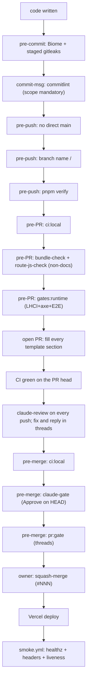
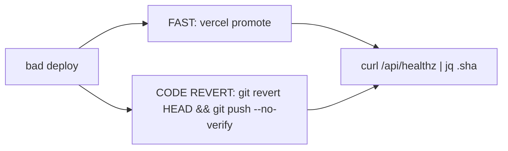

# Review, Merge & Release

> The gate chain from commit to production, the code-review process, the Review convergence loop, and release/rollback. For the CI job graph, see [`/docs/07-workflows`](../07-workflows.md); this doc is the process and the ordering.

## The full gate chain (commit -> production)

## Code review

**claude-review (claude[bot]) is the AI reviewer.** It runs automatically on eligible PR open and push events, posts one inline comment per finding anchored to a changed line, and closes with a `Verdict:` line that `pnpm claude-gate` parses fail-closed. It gathers evidence with the CI profile of the `pr-review-orchestrator` skill (`.claude/skills/pr-review-orchestrator/references/ci.md`): one `Task` subagent per material domain, and PR metadata, the diff and CI check results snapshotted by a workflow step before the review starts. The reviewer gets no `gh` or other shell command, and `--disallowedTools` denies the edit, git and push tools the action's tag mode would otherwise add, plus reads of `.git/` and other credential locations. No PR code runs in that job, so dependencies are not installed: for a dependency change it reviews the manifest and lockfile diff and names what only installed source could settle as a limit, which the local orchestrator then answers.

claude-review runs on every push: each new PR head gets one request right after the push, without waiting for CI or a rebase, and never while a run for that head is queued or running, because a second request cancels the first. Each fix push starts the next round, and the loop ends only when the bot approves the current head. Any other model review (`pr-review-orchestrator`, a cross-provider review, a self-review) runs only when the owner asks. Deterministic validation (tests, typecheck, lint, build, bundle and route-JS gates, CI) is the quality bar, and the provider that made a change ships it.

When a review did run, follow the project review procedure: rebase before _every_ push; verify the pushed SHA actually landed on the remote before citing it; reply in a thread citing the fix SHA _before_ resolving it; never resolve silently (a thread with one comment is a process gap); and put every comment in a review THREAD rather than an unanchored timeline comment, which `reviewThreads` cannot see.

## Pre-merge gates (`pnpm ci:local` + `pnpm claude-gate` + `pnpm pr:gate`)

In order: `ci:local` -> `check-claude-approval` (`pnpm claude-gate`: the latest claude-review verdict must be Approve, naming a head SHA that matches the current head. an Approve with no SHA, or a stale one, fails closed) -> `check-pr-comments` (`pnpm pr:gate`, also run in CI: GraphQL, all threads `isResolved`, flags `suspicious_self_resolve`). GitHub branch-protection settings must be checked separately; repository files do not establish their live state.

**AI agents must not run `gh pr merge`.** This is a project convention. The repo owner runs the final squash-merge once all gates pass. The pre-push hook rejects a remote main target. Live GitHub protection and bypass permissions require separate inspection.

## PR sizing (avoid the bloated-PR failure mode)

Large programs use an **integration branch + sub-PRs**: `feat/<feature>` off main, then `feat/<feature>-<part>` sub-PRs into it. Each sub-PR targets the integration branch and covers one reviewable unit.

## Release

- **Trigger:** squash-merge to `main` deploys via Vercel.
- **Verification:** `smoke.yml` (on `deployment_status == success && Production`) asserts the artifact and canonical `/api/healthz`, the 7 security headers, the apex->www 308 redirect, and `/api/ask` + `/api/contact` liveness; a 503 sends a Resend alert.
- **Cron:** `vercel.json` runs `/api/psi-refresh` daily (`0 3 * * *`) and `/api/contact-retry` daily (`0 4 * * *`).

## Rollback

Fast rollback is a Vercel promote (no code change). Slow rollback is a revert; the `--no-verify` is the documented escape hatch for the main-push guard (the revert still goes through CI after landing, but has no PR/claude-review, which is the accepted emergency tradeoff).

## Docs-only changes

Run `pnpm ci:local`. The project workflow skips bundle, route-JS and runtime gates for docs-only changes. CI still builds; its runtime and AI jobs use `scripts/detect-changes.mjs` and `scripts/detect-changes-paths.mjs` for classification. MDX under `app/` is part of that app surface.
