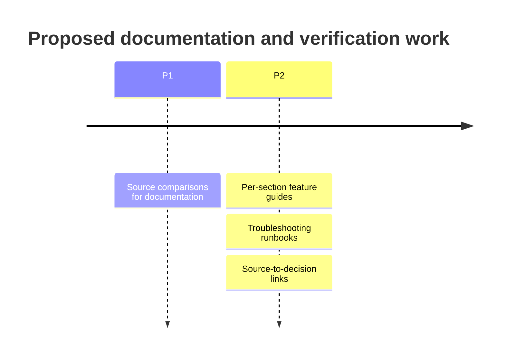

# Engineering Roadmap

These proposals address the boundaries in [engineering-audit](./engineering-audit.md). They are not implemented guarantees.

## Ranked proposals

| Priority | Improvement                                               | Completion criterion                                                                                      |
| -------- | --------------------------------------------------------- | --------------------------------------------------------------------------------------------------------- |
| P1       | Add source comparisons for documentation claims           | Route, component and CI descriptions match current implementations                                        |
| P2       | Add per-section feature guides                            | Each guide distinguishes page composition, registry navigation, labels and deferred client islands        |
| P2       | Expand troubleshooting                                    | Each runbook names a current check, failure condition and recovery command                                |
| P2       | Link source areas to architectural decisions              | A maintainer can locate the relevant `DECISIONS.md` entry from a subsystem guide                          |

## Sequencing

Prioritize a proposal when a concrete change exposes the gap. Verify the affected source and current checks before starting it.
